<p align="center">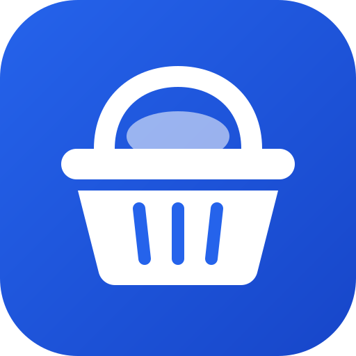</p>

<h1 align="center">Sistema de Mercado</h1>

<p align="center">PDV, estoque, padaria, compras, fornecedores e entregas para mercados e padarias, em um único app web.</p>

<p align="center">
  <a href="https://github.com/marco3079/sistema-mercado/actions/workflows/testes.yml"></a>
  
  
  
  
  
  
</p>

<p align="center">
  <a href="INSTALAR.md">Instalação</a> · <a href="docs/manual/README.md">Manual</a> · <a href="docs/TELAS.md">Telas</a> · <a href="CHANGELOG.md">Changelog</a> · <a href="CONTRIBUTING.md">Contribuir</a>
</p>

<p align="center">
  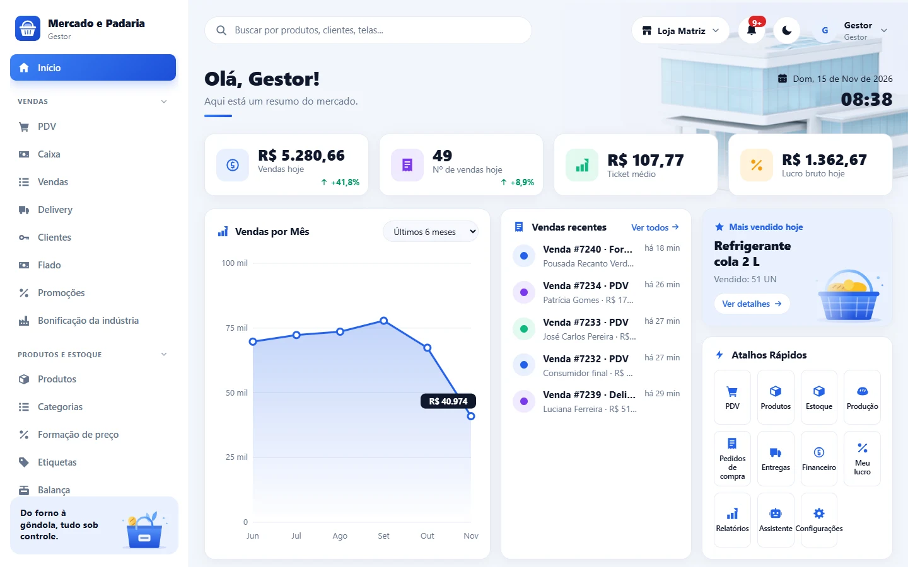
</p>

## Sumário

- [Visão geral](#visão-geral)
- [Funcionalidades](#funcionalidades)
- [Perfis de acesso](#perfis-de-acesso)
- [Telas](#telas)
- [Instalação rápida](#instalação-rápida)
- [Primeiro acesso](#primeiro-acesso)
- [Dados de demonstração](#dados-de-demonstração)
- [Integrações simuladas](#integrações-simuladas)
- [Atualizar o sistema](#atualizar-o-sistema)
- [Configuração](#configuração)
- [Arquitetura](#arquitetura)
- [Desenvolvimento](#desenvolvimento)
- [Documentação](#documentação)
- [Origem](#origem)
- [Segurança](#segurança)
- [Licença](#licença)

## Visão geral

Sistema de gestão para mercados, padarias e lojas de conveniência, com a parte de logística de fornecimento:
do pedido ao fornecedor até a entrega na casa do cliente. Funciona no navegador do computador, do tablet e do celular
(pode ser instalado como aplicativo). Atende várias lojas e um centro de distribuição.

## Funcionalidades

**Vendas**
- PDV (frente de caixa) com leitor de código de barras, etiqueta de balança (peso ou preço), atalhos de teclado,
  Pix com QR copia-e-cola, cartão, dinheiro com troco, vale-alimentação e fiado.
- Caixa: abertura, sangria, suprimento e fechamento com conferência da diferença.
- Clientes, fiado/crediário com limite, extrato e recebimento.
- Promoções inteligentes (preço fixo, %, leve X pague Y, atacado) e bonificação da indústria.
- Delivery próprio com página de pedido para o cliente, aviso no WhatsApp e pedidos de marketplace (iFood Mercado).

**Produtos e estoque**
- Produtos com EAN, código interno, pesáveis (PLU de balança), custo, preço, atacado e dados fiscais.
- Importação e exportação de produtos por planilha (.xlsx ou .csv), com modelo para preencher.
- Formação de preço por margem, histórico de preços e etiquetas de gôndola.
- Exportação para a balança.
- Estoque por loja, movimentações, perdas, lotes e validade (FEFO), inventário e contagem pelo celular.
- Estoque em terceiros (consignação, comodato ou evento), com portal de remessas que o terceiro acessa por link.

**Padaria**
- Receitas (fichas técnicas) com custo por unidade, fornadas, painel do forno e sugestão de produção pelo histórico de vendas.

**Compras e logística**
- Fornecedores com avaliação, cotação com link para o fornecedor responder e pedidos de compra com acompanhamento.
- Sugestão de compra automática (giro, estoque mínimo e prazo do fornecedor).
- Recebimento com conferência item a item, importação do XML da NF-e, lote/validade e custo médio.
- Frota, montagem de cargas, roteirização, romaneio, tela do motorista e rastreio público da entrega.
- Mapa com lojas, entregas e veículos, e rastreadores GPS na frota.
- Transferência de mercadoria entre lojas e centro de distribuição.
- Força de vendas (pedido pelo celular com negociação Flex), faturamento em lote e loja B2B para clientes de atacado.

**Gestão**
- Painel por perfil, contas a pagar e receber, boletos, fluxo de caixa e "Meu Lucro" (lucro real).
- Relatórios: vendas, curva ABC, margem e produtos parados.
- NFC-e/NF-e, área do contador com os XML do mês e assistente IA para perguntas sobre vendas, estoque e compras.
- Equipe, permissões com senha do gestor, log de atividades, backup e atualização pelo próprio sistema.

## Perfis de acesso

| Perfil | O que faz |
|---|---|
| Gestor | Tudo |
| Operador de caixa | PDV, caixa, vendas, clientes, fiado, delivery, produtos e entregas |
| Estoquista | Estoque, recebimento, validade, inventário, transferências |
| Padeiro | Produção, painel do forno, receitas |
| Comprador | Fornecedores, cotações, pedidos de compra, formação de preço |
| Motorista | Minhas entregas (rota do dia) |
| Vendedor | Força de vendas, carteira de clientes |
| Contador | Notas fiscais, área do contador, relatórios |

## Telas

<table>
  <tr>
    <td align="center" width="50%">
      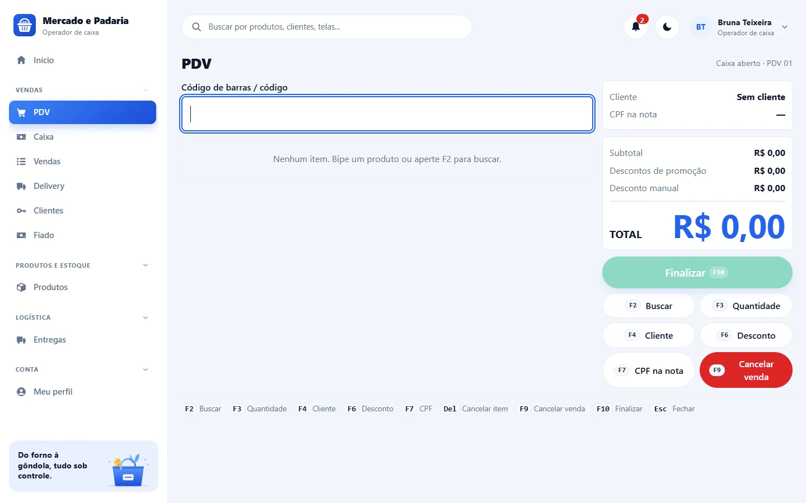<br>
      <sub>PDV: leitor de código de barras, balança e pagamentos.</sub>
    </td>
    <td align="center" width="50%">
      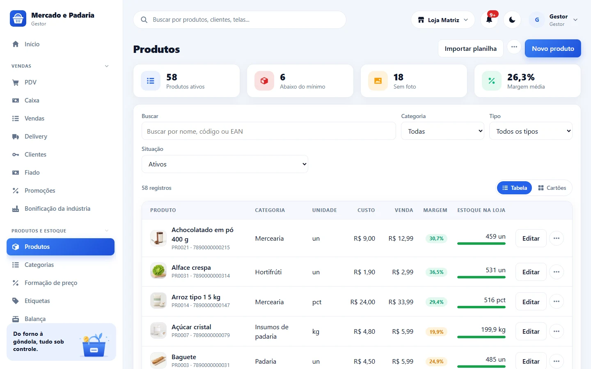<br>
      <sub>Produtos: catálogo com foto, margem e estoque.</sub>
    </td>
  </tr>
  <tr>
    <td align="center" width="50%">
      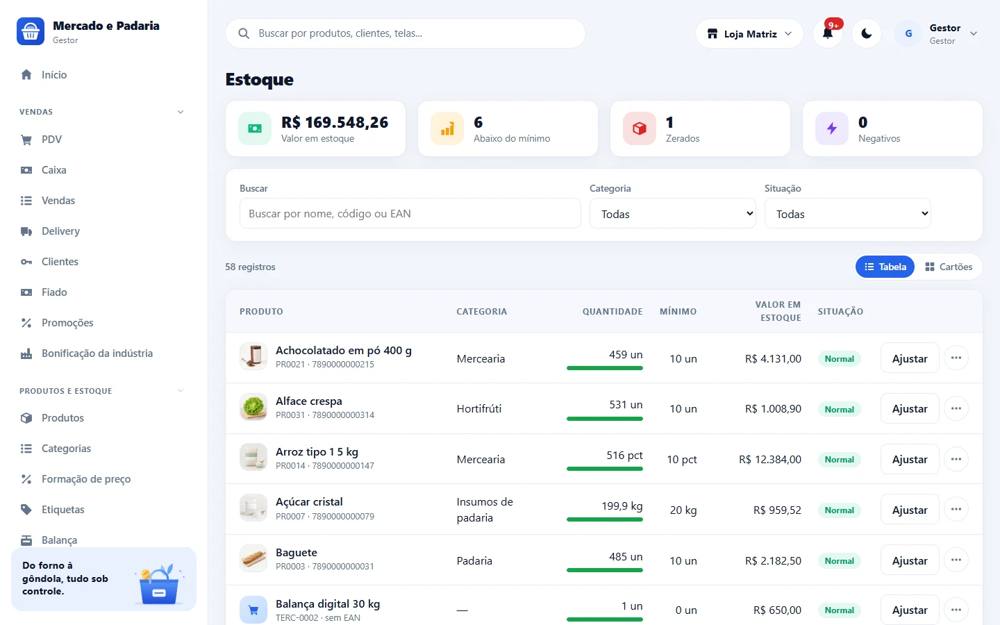<br>
      <sub>Estoque: saldo por loja e estoque mínimo.</sub>
    </td>
    <td align="center" width="50%">
      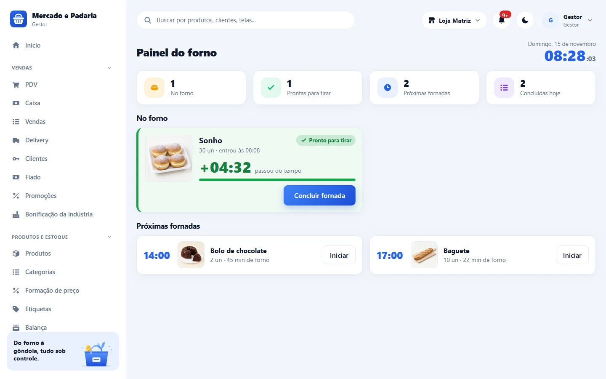<br>
      <sub>Painel do forno: o que assar agora.</sub>
    </td>
  </tr>
  <tr>
    <td align="center" width="50%">
      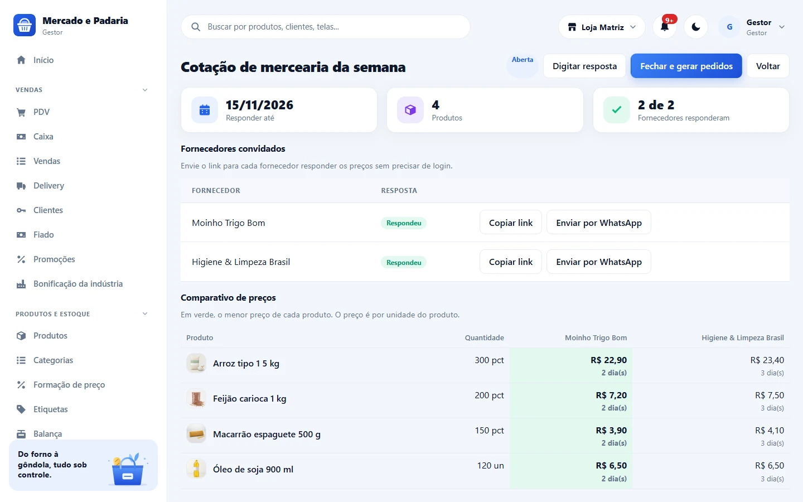<br>
      <sub>Cotação: comparação das respostas dos fornecedores.</sub>
    </td>
    <td align="center" width="50%">
      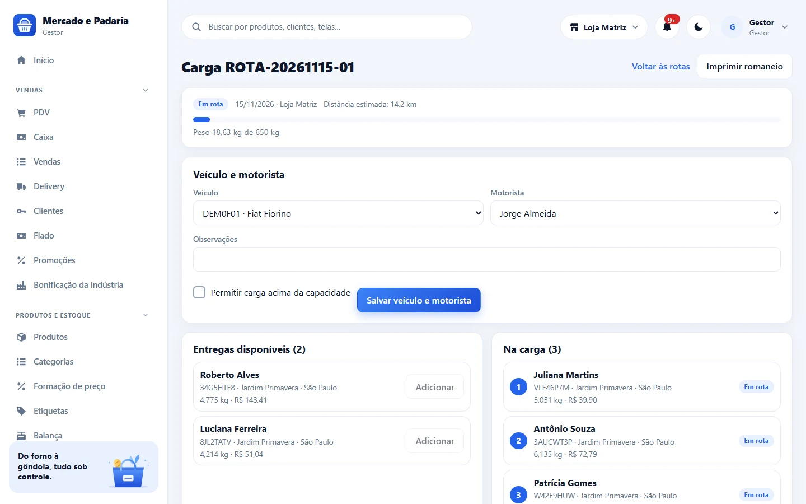<br>
      <sub>Montar carga: roteirização e romaneio.</sub>
    </td>
  </tr>
  <tr>
    <td align="center" width="50%">
      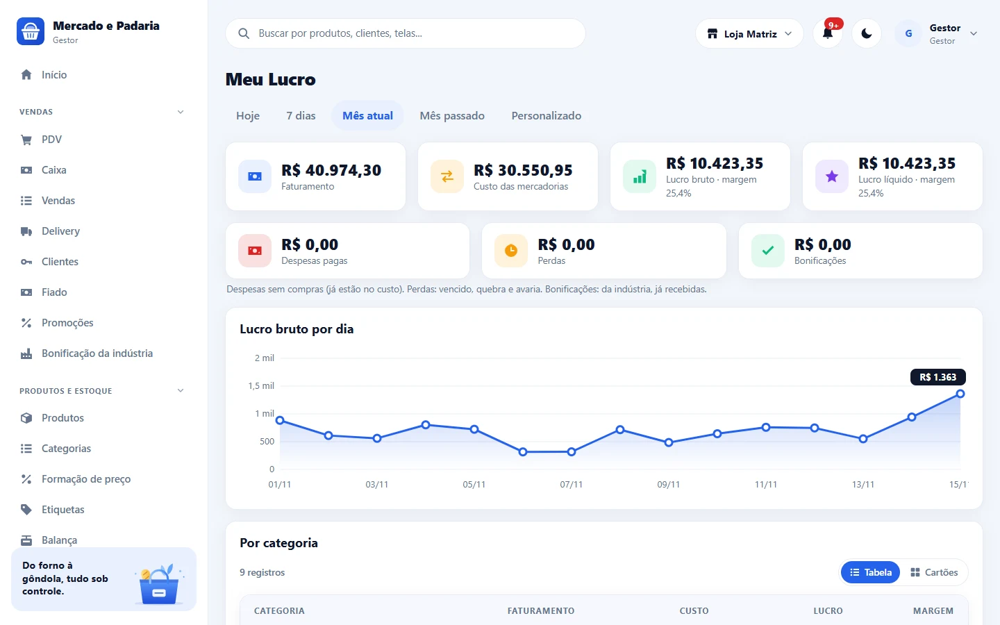<br>
      <sub>Meu Lucro: lucro real do período.</sub>
    </td>
    <td align="center" width="50%">
      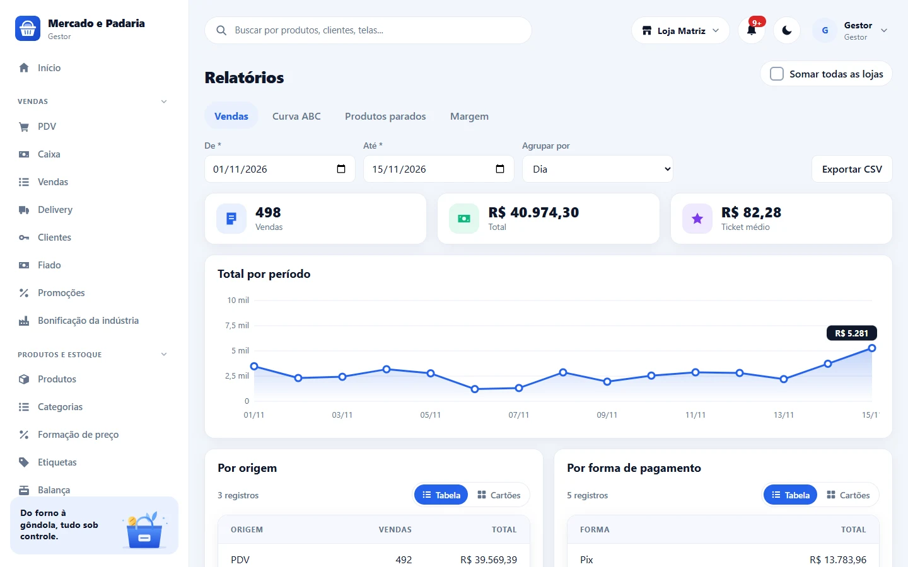<br>
      <sub>Relatórios: vendas, curva ABC, margem e produtos parados.</sub>
    </td>
  </tr>
</table>

<p align="center">
  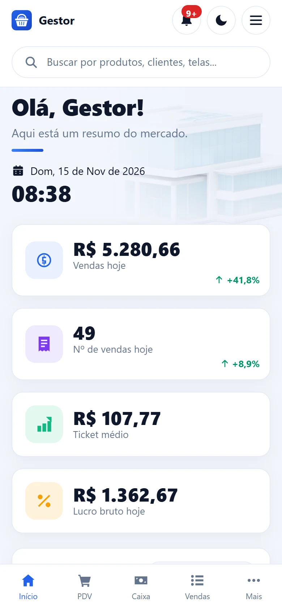
  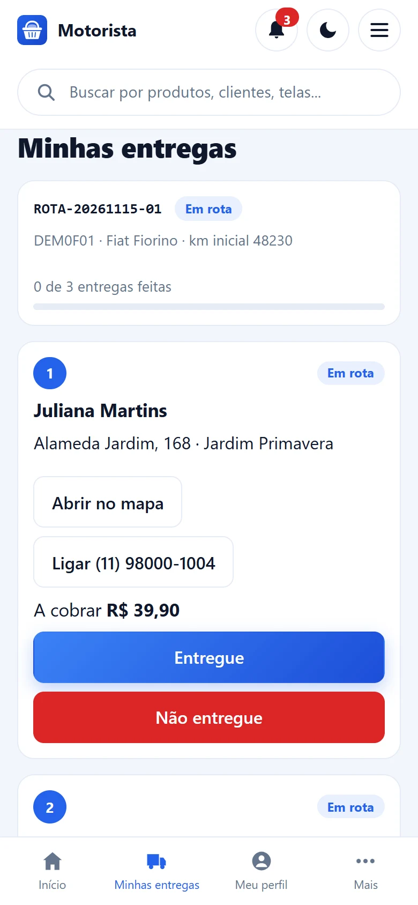
  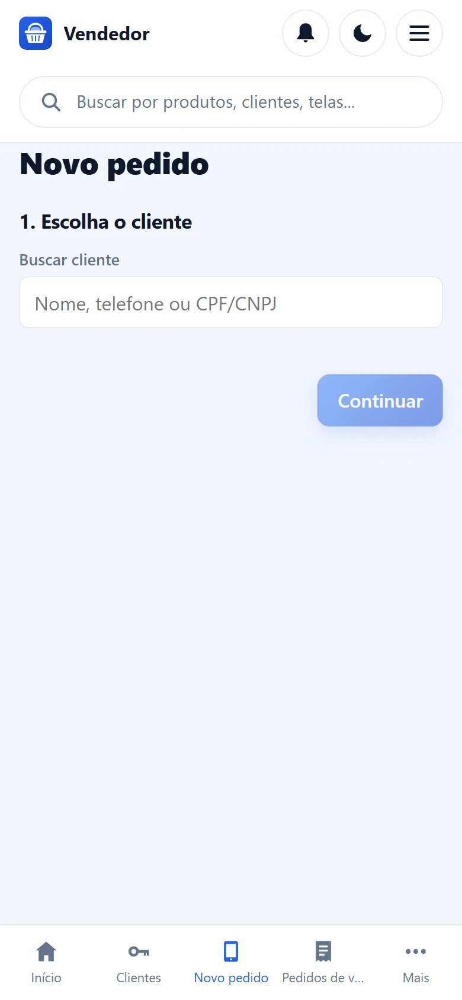
  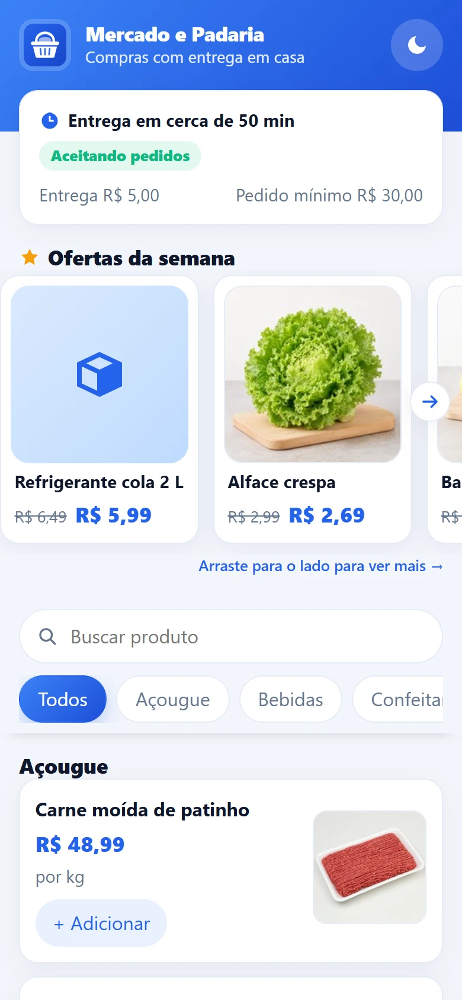
</p>

<p align="center">Painel do gestor, entregas do motorista, novo pedido do vendedor e pedido do cliente, no celular.</p>

<p align="center"><a href="docs/TELAS.md">Ver todas as telas</a></p>

## Instalação rápida

Requisito: [Docker Desktop](https://www.docker.com/products/docker-desktop/) instalado e aberto.

**Windows (PowerShell)**

```powershell
git clone https://github.com/marco3079/sistema-mercado.git
cd sistema-mercado
powershell -ExecutionPolicy Bypass -File .\instalar.ps1
```

**Linux e macOS**

```bash
git clone https://github.com/marco3079/sistema-mercado.git
cd sistema-mercado
bash instalar.sh
```

O instalador cria o arquivo `.env` com segredos aleatórios, baixa as imagens e sobe os contêineres: banco, API, site e atualizador.
No fim ele mostra o endereço do site (padrão `http://localhost:8093`).

O passo a passo completo está em [INSTALAR.md](INSTALAR.md).

## Primeiro acesso

1. Abra o endereço do site.
2. Entre com `gestor@mercado.local` e a senha `gestor1234`.
3. Troque a senha em **Meu perfil**.
4. Em **Configurações > Mercado**, preencha Pix, margem padrão, balança, nota fiscal e entregas.
5. Cadastre as lojas, as categorias, os produtos, os fornecedores e a equipe.

## Dados de demonstração

Instale com `-Demo` (Windows) ou `--demo` (Linux/macOS) para carregar o cadastro de demonstração, com dados fictícios:
3 lojas com endereço (Loja Matriz, Loja Bairro Jardim e Centro de Distribuição), uma conta por perfil, categorias,
56 produtos (40 com foto), estoque zerado e as receitas da padaria.

Não há vendas nem movimento: nenhuma venda, compra, entrega ou lançamento financeiro. O estoque começa zerado.
A opção vale só para instalação nova.

As contas de demonstração usam a senha `demo1234`: `operador@`, `estoque@`, `padeiro@`, `compras@`, `motorista@`, `vendedor@` e `contador@mercado.local`.

## Integrações simuladas

Sem contrato com os serviços externos, estas partes funcionam em modo simulado e mostram isso na tela:
emissão de NFC-e/NF-e (SEFAZ), aviso no WhatsApp, pedidos do iFood Mercado, bonificação da indústria (Scantech),
higienização fiscal dos cadastros (Mix Fiscal) e boleto. O assistente IA responde por regras; com uma chave da API
da Anthropic em **Configurações > Mercado**, ele usa IA sobre os mesmos dados.

## Atualizar o sistema

Em **Configurações > Atualização**, o gestor vê a versão instalada, a última do GitHub e o botão **Atualizar agora**,
que grava uma cópia do banco, baixa o último commit, reconstrói a API e o site e reinicia os dois.
Detalhes e cuidados em [SECURITY.md](SECURITY.md).

## Configuração

| Variável | Para que serve | Padrão |
|---|---|---|
| `POSTGRES_PASSWORD` | Senha do banco | gerada pelo instalador |
| `JWT_SECRET` | Segredo que assina os logins | gerado pelo instalador |
| `ADMIN_NOME` | Nome da conta do gestor criada na primeira subida | `Gestor` |
| `ADMIN_EMAIL` | E-mail da conta do gestor | `gestor@mercado.local` |
| `ADMIN_SENHA` | Senha inicial do gestor (8 caracteres ou mais) | `gestor1234` |
| `SEED_DEMO` | `true` carrega os dados de demonstração | `false` |
| `WEB_PORT` | Porta do site | `8093` |
| `API_PORT` | Porta da API (só neste computador) | `3093` |
| `DB_PORT` | Porta do banco (só neste computador) | `5435` |
| `TZ` | Fuso horário do servidor | `America/Sao_Paulo` |

## Arquitetura

```
client/   React 18 + TypeScript + Vite (site; nginx em produção)
server/   Node.js 26 + Express + Prisma (API)
          PostgreSQL 16 (banco)
```

- O servidor carrega sozinho cada pasta `server/src/modules/<modulo>/routes.ts`.
- O cliente junta as rotas de `client/src/modules/<modulo>/index.tsx` e monta o menu pelo perfil.
- Regras comuns (estoque, preços e promoções, vendas, nota fiscal) ficam em `server/src/lib/`.

Contrato completo dos módulos em [docs/CONTRATO.md](docs/CONTRATO.md).

## Desenvolvimento

Com um PostgreSQL acessível (o do `docker compose up -d db` serve):

```powershell
cd server
copy .env.example .env      (no Linux/macOS: cp .env.example .env)
npm install
npx prisma db push
npm run seed
npm run dev
```

```powershell
cd client
npm install
npm run dev
```

Verificações antes de entregar uma mudança:

```bash
cd server && npx tsc --noEmit
cd client && npx tsc --noEmit
cd client && npx vite build
```

## Documentação

| Documento | Para quem é |
|---|---|
| [Manual de uso](docs/manual/README.md) | Quem usa o sistema no dia a dia |
| [Galeria de telas](docs/TELAS.md) | Quem quer ver todas as telas antes de instalar |
| [Instalação](INSTALAR.md) | Quem vai instalar e manter o sistema no computador |
| [Contrato técnico](docs/CONTRATO.md) | Desenvolvedores: módulos, rotas e regras |
| [Changelog](CHANGELOG.md) | Todos: o que mudou em cada versão |
| [Contribuição](CONTRIBUTING.md) | Quem quer enviar mudanças ao projeto |
| [Segurança](SECURITY.md) | Quem precisa relatar uma falha ou entender a segurança |

## Origem

Este projeto usa a estrutura e o visual do [sistema-restaurante](https://github.com/marco3079/sistema-restaurante)
(que veio do [sistema-escolar](https://github.com/marco3079/sistema-escolar)): a mesma casca, os mesmos componentes
e a mesma organização em módulos.

## Segurança

Veja [SECURITY.md](SECURITY.md). Senhas com bcrypt, login por JWT de 12 horas, permissão por perfil em cada rota,
ações sensíveis com a senha do gestor, banco e API publicados só em `127.0.0.1`, segredos guardados cifrados e log de atividades.

## Licença

[MIT](LICENSE).
