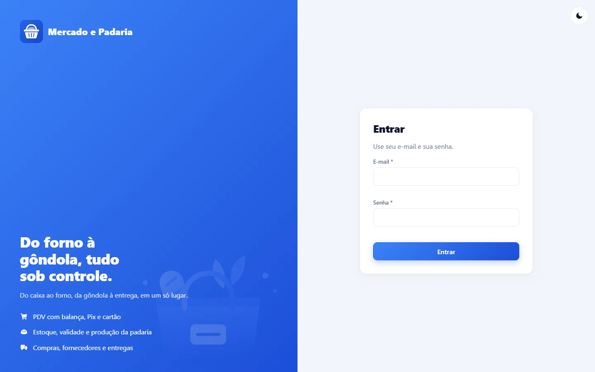

# Manual de uso

Este manual explica como usar o sistema no dia a dia, tela por tela. Ele é para o dono do mercado, para o gestor que configura o sistema e para cada pessoa da equipe, do caixa ao motorista.

Cada área tem uma página própria. Escolha a página pelo que você vai fazer ou pelo seu perfil de acesso.

## Primeiros passos

1. Abra o endereço do sistema e entre com seu usuário e sua senha. O acesso inicial do gestor é `gestor@mercado.local`, com a senha `gestor1234`.
2. Troque a senha em **Meu perfil**.
3. Em **Configurações > Mercado**, preencha Pix, margem padrão, balança, nota fiscal e entregas.
4. Faça os cadastros nesta ordem: lojas, categorias, produtos, fornecedores e equipe.

## Áreas do manual

| Área | O que cobre | Página |
|---|---|---|
| Vendas | PDV, caixa, vendas, clientes, fiado, delivery, promoções e bonificação | [vendas.md](vendas.md) |
| Produtos e estoque | Produtos, planilha, categorias, preços, etiquetas, balança, estoque, movimentações, validade, inventário, terceiros e portal de remessas | [produtos-e-estoque.md](produtos-e-estoque.md) |
| Padaria | Receitas, custo por unidade, fornadas, painel do forno e sugestão de produção | [padaria.md](padaria.md) |
| Compras | Sugestão de compra, cotações, pedidos, recebimento com XML da NF-e e página pública de cotação | [compras.md](compras.md) |
| Logística | Entregas, cargas, roteirização, romaneio, motorista, rastreio público, transferências, frota e rastreadores GPS | [logistica.md](logistica.md) |
| Força de vendas | Vendedores, carteira de clientes, loja B2B e página para pedidos | [forca-de-vendas.md](forca-de-vendas.md) |
| Financeiro | Contas, fluxo de caixa, Meu Lucro, notas fiscais, área do contador e relatórios | [financeiro.md](financeiro.md) |
| Importar de outro sistema | Planilhas (com perfis de Softcom, Bling, Tiny e outros), SPED Fiscal, Sintegra e XML de NF-e, com conferência antes de gravar | [migracao.md](migracao.md) |
| Gestão | Assistente, equipe e perfis, lojas, configurações, atividades, logs, meu perfil, backup e atualização | [gestao.md](gestao.md) |

## Por onde começar, por perfil

| Perfil | Por onde começar |
|---|---|
| Gestor | [gestao.md](gestao.md), depois as áreas que você precisa acompanhar |
| Operador de caixa | [vendas.md](vendas.md) |
| Estoquista | [produtos-e-estoque.md](produtos-e-estoque.md) |
| Padeiro | [padaria.md](padaria.md) |
| Comprador | [compras.md](compras.md) |
| Motorista | [logistica.md](logistica.md) |
| Vendedor | [forca-de-vendas.md](forca-de-vendas.md) |
| Contador | [financeiro.md](financeiro.md) |

## Mais informações

- [Galeria de telas](../TELAS.md): todas as telas do sistema, em PC e celular.
- [Instalação](../../INSTALAR.md): como instalar o sistema passo a passo.

[← Voltar à documentação](../README.md)
