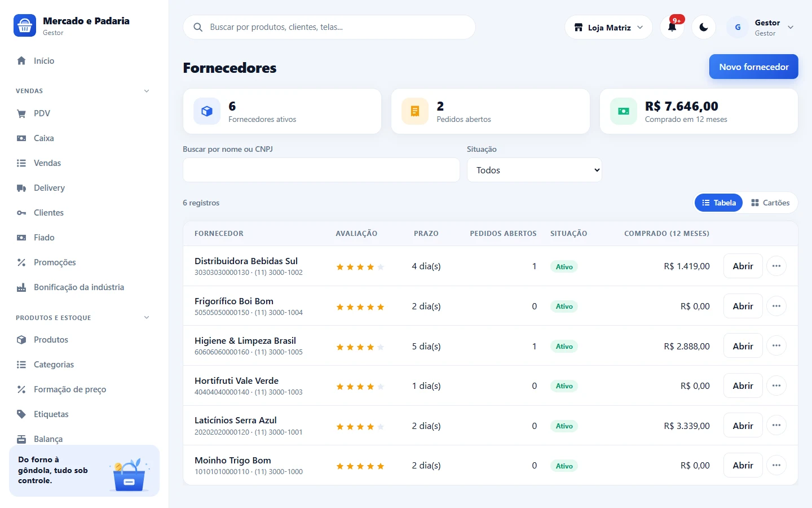
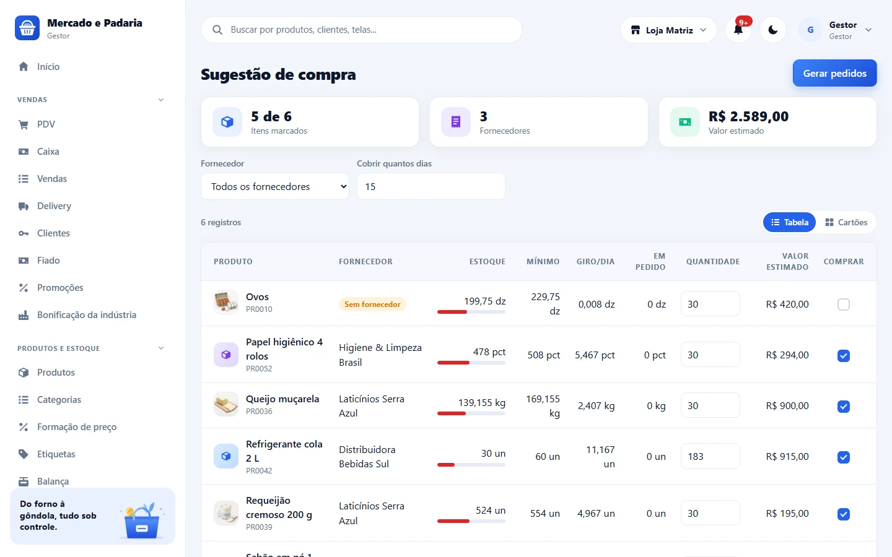
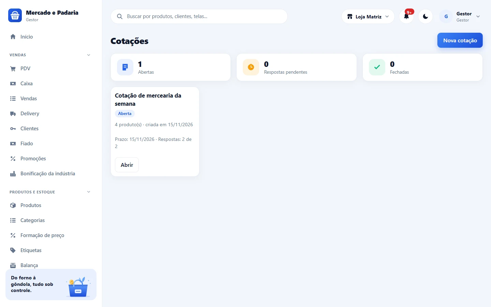
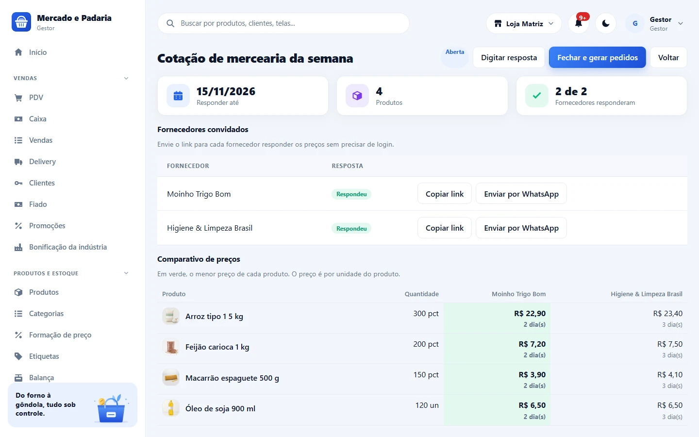
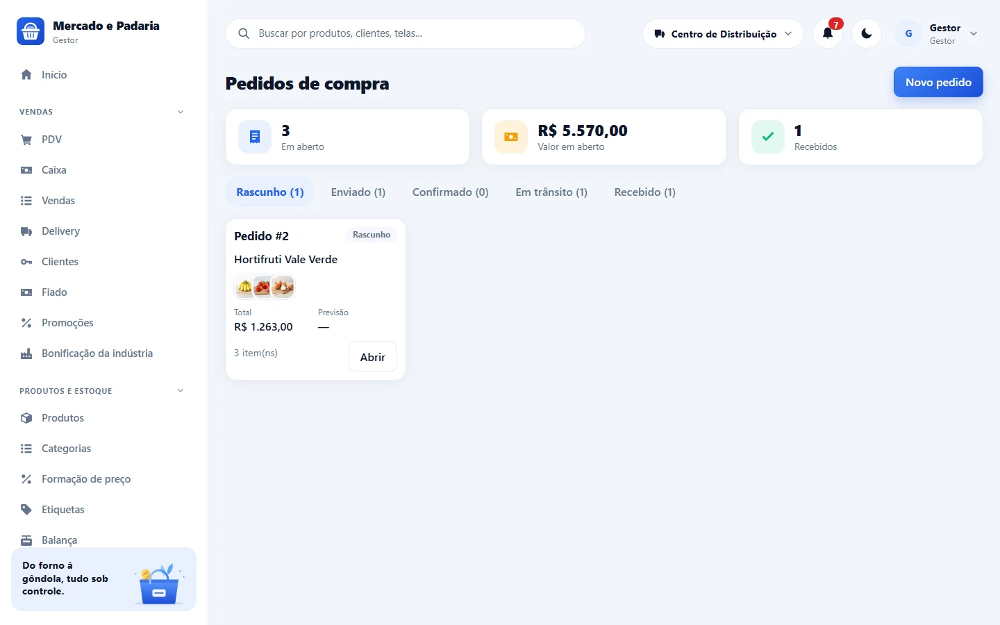
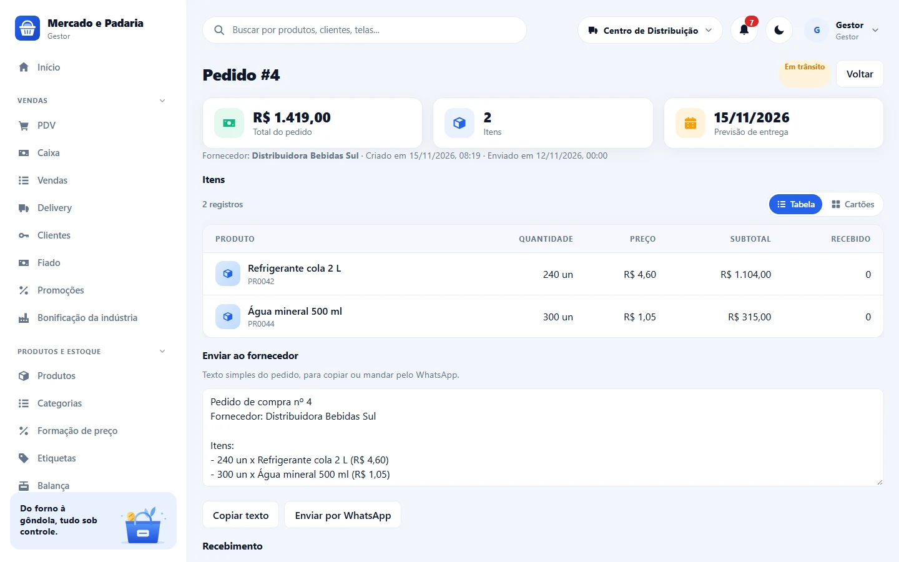
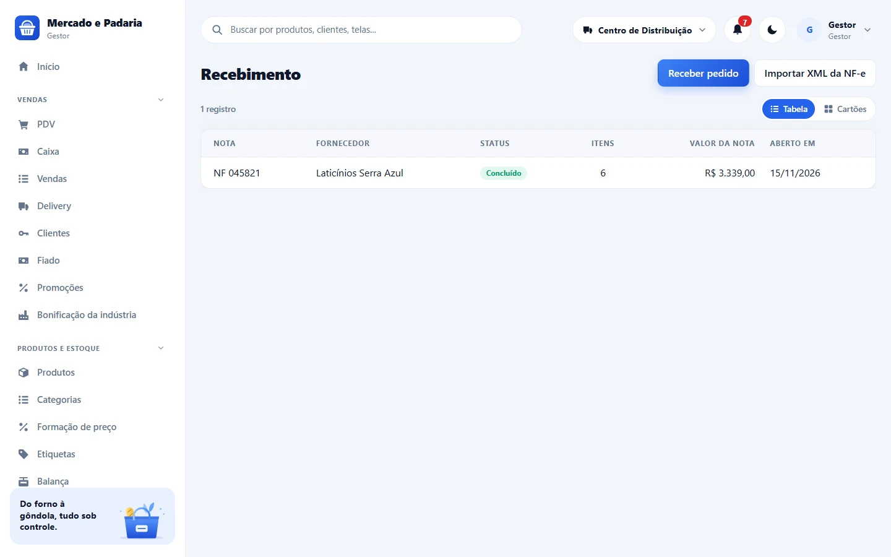
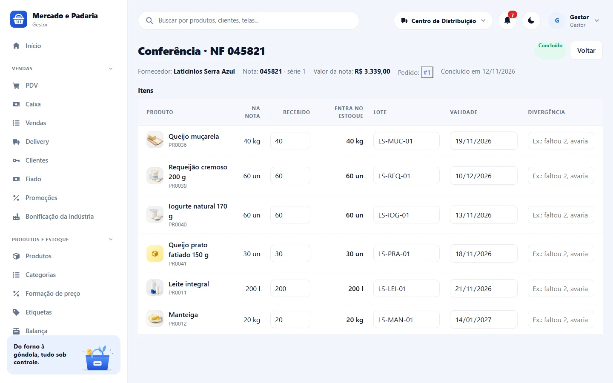
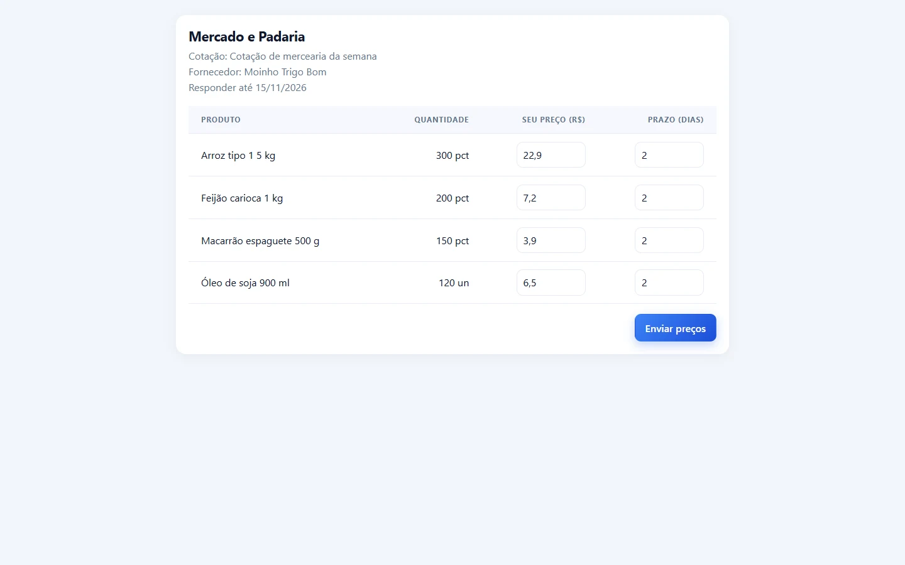
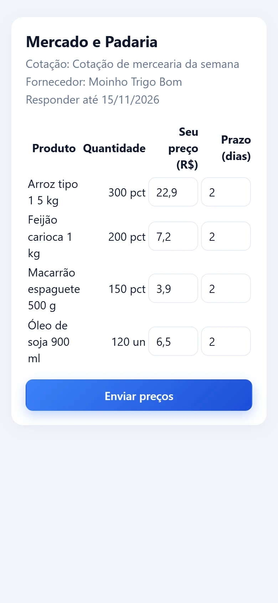

# Compras

**Para que serve.** Esta área cuida da compra de mercadoria, do primeiro preço até a entrada no estoque. O sistema sugere o que comprar pelo giro de vendas, monta cotações com os fornecedores, gera os pedidos e registra o recebimento com conferência item a item. Ao concluir um recebimento, o custo médio do produto é atualizado.

O fluxo normal é este: a sugestão de compra indica o que falta, a cotação compara os preços dos fornecedores, o fechamento da cotação gera os pedidos, e o recebimento confere a entrega e lança no estoque.

**Quem usa.**

- Gestor e comprador: todas as telas desta área.
- Estoquista: Pedidos de compra, Pedido de compra, Recebimento e Conferência.
- Fornecedor: responde a cotação pelo link da página pública, sem login (veja [Resposta de cotação](#resposta-de-cotação)).

## Fornecedores

Cadastro dos fornecedores, com prazo de entrega, condição de pagamento e avaliação. No topo, os cards mostram os fornecedores ativos, os pedidos abertos e o valor comprado nos últimos 12 meses. A busca filtra por nome ou CNPJ, e o filtro **Situação** separa os ativos dos inativos.

**O que dá para fazer**

- Cadastrar um fornecedor com o botão **Novo fornecedor**.
- Abrir a ficha de um fornecedor com o botão **Abrir** ou clicando na linha.
- Copiar o CNPJ e abrir o WhatsApp do fornecedor pelo menu **Mais ações**.
- Na aba **Dados**, editar nome, razão social, CNPJ, contatos, endereço, prazo de entrega, condição de pagamento, pedido mínimo e dias de visita.
- Na aba **Produtos**, vincular um produto ao fornecedor com o código dele, o último preço e o fator de conversão. O fator diz quantas unidades do produto cabem em uma unidade de compra (por exemplo, 12 unidades numa caixa).
- Na aba **Pedidos**, ver os pedidos feitos a este fornecedor.
- Na aba **Avaliações**, registrar a nota de pontualidade, qualidade e atendimento (de 1 a 5).

Os campos **Nome (fantasia)** e **Prazo de entrega (dias)** são obrigatórios. As abas de produtos e avaliações só ficam disponíveis depois de salvar os dados.

### Passo a passo: cadastrar um fornecedor

1. Clique em **Novo fornecedor**.
2. Preencha **Nome (fantasia)** e **Prazo de entrega (dias)**. Os demais campos são opcionais, mas o WhatsApp é necessário para enviar cotação e pedido por ele.
3. Clique em **Salvar dados**.
4. Abra a aba **Produtos** e clique em **Vincular produto** para cada item que este fornecedor vende.

## Sugestão de compra

Mostra o que comprar para cobrir os próximos dias. A conta usa o giro dos últimos 30 dias (vendas e consumo da produção da padaria), o estoque mínimo, o estoque atual e o que já está em pedido aberto. O alvo é o maior valor entre o estoque mínimo e o giro multiplicado pelos dias escolhidos mais o prazo do fornecedor. Se o produto tiver estoque máximo cadastrado, a sugestão não passa dele. Sem fornecedor definido, o prazo considerado é de 3 dias.

Os cards mostram os itens marcados, os fornecedores envolvidos e o valor estimado. A coluna **Quantidade** vem preenchida com a sugestão e pode ser editada. Itens sem fornecedor aparecem com o selo **Sem fornecedor** e não podem ser marcados.

**O que dá para fazer**

- Escolher quantos dias de cobertura quer, de 1 a 180, no campo **Cobrir quantos dias** (o padrão é 15).
- Filtrar por fornecedor no campo **Fornecedor**.
- Ajustar a quantidade de cada item antes de comprar.
- Marcar ou desmarcar os itens na coluna **Comprar**.
- Gerar um pedido em rascunho por fornecedor com o botão **Gerar pedidos**. Um aviso mostra os pedidos criados, com links para abri-los.

### Passo a passo: gerar pedidos pela sugestão

1. Informe em **Cobrir quantos dias** o período que o estoque precisa cobrir.
2. Se quiser, escolha um fornecedor em **Fornecedor**.
3. Confira a coluna **Quantidade** e corrija o que for preciso.
4. Marque os itens na coluna **Comprar**.
5. Clique em **Gerar pedidos**.
6. Abra os pedidos pelo aviso verde, que lista cada número e fornecedor.

## Cotações

Uma cotação reúne produtos e quantidades e é enviada a um ou mais fornecedores, que respondem os preços por um link. Não é preciso login para responder. Os cards mostram as cotações abertas, as respostas pendentes e as fechadas.

**O que dá para fazer**

- Criar uma cotação com o botão **Nova cotação**.
- Informar o **Título** (obrigatório) e a data **Responder até**.
- Adicionar produtos pela busca por nome, código ou EAN, com a quantidade de cada um.
- Marcar os fornecedores convidados.
- Abrir uma cotação com o botão **Abrir** e acompanhar as respostas.

### Passo a passo: criar uma cotação

1. Clique em **Nova cotação**.
2. Digite o **Título** (por exemplo, "Frios da semana").
3. Escolha a data em **Responder até**.
4. Busque os produtos e informe a quantidade de cada um. Para tirar um item, use **Remover**.
5. Marque os fornecedores em **Fornecedores convidados**.
6. Clique em **Criar cotação**.
7. Abra a cotação e envie o link a cada fornecedor (veja [Cotação](#cotação)).

## Cotação

Tela de uma cotação aberta ou fechada. O cabeçalho traz o status e os botões de ação. Abaixo, o sistema mostra quais fornecedores já responderam, o comparativo de preços e, quando a cotação fecha, os pedidos gerados.

No comparativo, o menor preço de cada produto aparece em verde, e a coluna **Vencedor** indica o fornecedor escolhido. O preço é sempre por unidade do produto.

**O que dá para fazer**

- Enviar o link da cotação a cada fornecedor com **Copiar link** ou **Enviar por WhatsApp**. Se o fornecedor não tem WhatsApp cadastrado, o sistema mostra **Sem WhatsApp cadastrado**.
- Digitar a resposta de um fornecedor, com o botão **Digitar resposta**. Escolha o fornecedor, preencha o **Preço (R$)** e o **Prazo (dias)** de cada produto e clique em **Salvar resposta**.
- Fechar a cotação com **Fechar e gerar pedidos**. O sistema cria um pedido em rascunho por fornecedor, com o menor preço de cada produto.
- Voltar à lista de cotações com **Voltar**.

Depois de fechada, a cotação não aceita mais respostas. Se nenhum fornecedor respondeu, o fechamento não cria pedido e o sistema avisa.

### Passo a passo: fechar a cotação e gerar pedidos

1. Confira na seção **Fornecedores convidados** quantos responderam.
2. Confira o comparativo de preços e o vencedor de cada produto.
3. Clique em **Fechar e gerar pedidos** e confirme a janela.
4. Abra os pedidos criados pelo aviso verde, ajuste o que for preciso e envie cada um ao fornecedor (veja [Pedido de compra](#pedido-de-compra)).

## Pedidos de compra

Lista de todos os pedidos de compra, separados em abas pela situação: **Rascunho**, **Enviado**, **Confirmado**, **Em trânsito** e **Recebido**. A aba Recebido inclui os pedidos com recebimento parcial. Cada aba mostra a quantidade de pedidos. Os cards mostram o total em aberto, o valor em aberto e os pedidos recebidos.

**O que dá para fazer**

- Criar um pedido manual com o botão **Novo pedido**. O estoquista não vê esse botão.
- Abrir um pedido com o botão **Abrir**.
- Ver a previsão de entrega de cada pedido.

No **Novo pedido**, escolha o **Fornecedor**, informe a **Previsão de entrega**, adicione os produtos pela busca e confira o **Total**. O botão **Criar pedido em rascunho** salva o pedido sem enviá-lo.

### Passo a passo: criar um pedido manual

1. Clique em **Novo pedido**.
2. Escolha o fornecedor em **Fornecedor**.
3. Informe a **Previsão de entrega**.
4. Busque cada produto, informe a quantidade e confira o preço e o subtotal.
5. Confira o **Total** e clique em **Criar pedido em rascunho**.

## Pedido de compra

Detalhe de um pedido, com o número, a situação, os itens, o andamento e o texto para enviar ao fornecedor. Os botões de andamento mudam conforme a situação do pedido.

**O que dá para fazer**

- Editar o pedido enquanto ele está em rascunho: adicionar ou remover produtos, mudar a **Previsão de entrega**, a **Condição de pagamento** e as **Observações**. Depois, clique em **Salvar pedido**.
- Registrar o **Código de rastreio** e a previsão de entrega informada pelo fornecedor.
- Avançar a situação do pedido com os botões de andamento.
- Copiar o texto do pedido com **Copiar texto**, ou enviá-lo com **Enviar por WhatsApp** (o botão aparece quando o fornecedor tem WhatsApp cadastrado).
- Iniciar o recebimento com **Receber mercadoria**, quando o pedido já foi enviado ou está em trânsito.
- Cancelar o pedido com **Cancelar pedido**. Um pedido cancelado não volta.

Os botões de andamento seguem a ordem do fluxo:

| Situação atual | Botões de andamento |
|---|---|
| Rascunho | **Marcar como enviado**, **Cancelar pedido** |
| Enviado | **Fornecedor confirmou**, **Saiu para entrega**, **Cancelar pedido** |
| Confirmado | **Saiu para entrega**, **Cancelar pedido** |

Ao final da página, a seção **Recebimentos deste pedido** lista as conferências já abertas para o pedido, com o status de cada uma.

### Passo a passo: enviar o pedido ao fornecedor

1. Confira os itens e a **Previsão de entrega**. Se estiver certo, clique em **Salvar pedido**.
2. Clique em **Copiar texto** ou em **Enviar por WhatsApp**, e envie a mensagem ao fornecedor.
3. Clique em **Marcar como enviado**.
4. Quando o fornecedor confirmar, clique em **Fornecedor confirmou**.
5. Quando a mercadoria sair, preencha o **Código de rastreio** e clique em **Saiu para entrega**.
6. Na chegada, clique em **Receber mercadoria** (veja [Recebimento](#recebimento)).

## Recebimento

Lista de todas as entradas de mercadoria da loja. Cada recebimento abre uma conferência, e a situação mostra em que ponto ele está: **Conferindo**, **Concluído** ou **Com divergência**.

Há dois jeitos de abrir um recebimento:

- **Receber pedido**: escolha o pedido que chegou. A lista mostra os pedidos enviados, confirmados, em trânsito ou com recebimento parcial.
- **Importar XML da NF-e**: escolha o arquivo XML da nota fiscal, de até 3 MB.

Ao importar o XML, o sistema lê a chave, o fornecedor (pelo CNPJ) e os itens da nota. Se o fornecedor não estiver cadastrado, ele é criado com o nome do emitente da nota. Se houver pedido aberto desse fornecedor, a nota é vinculada ao pedido mais antigo. Uma nota com a mesma chave não pode ser importada duas vezes, e o sistema avisa com a mensagem "Esta NF-e já foi importada".

Não é possível abrir uma segunda conferência para um pedido que já tem uma em andamento.

### Passo a passo: importar uma NF-e

1. Clique em **Importar XML da NF-e** e escolha o arquivo `.xml` da nota.
2. Se aparecer "Esta NF-e já foi importada", a nota não entra de novo. Abra o recebimento que já existe na lista.
3. Se a importação der certo, o sistema abre a conferência da nota (veja [Conferência](#conferência)).

## Conferência

Confere a mercadoria item a item antes de ela entrar no estoque. O título mostra o número da nota, quando houver, e a situação da conferência.

**O que dá para fazer**

- Bipar o código de barras no campo **Bipagem**. Cada leitura soma 1 à quantidade do item. Para outra quantidade, ajuste a coluna **Recebido** da tabela.
- Informar o **Lote** e a **Validade** de cada item. O lote só é gravado quando há lote e validade.
- Corrigir a quantidade recebida e registrar a **Divergência** de um item.
- Associar um item da nota a um produto do sistema com **Associar a um produto**. Itens sem produto não entram no estoque.
- Concluir o recebimento com **Concluir recebimento**.

A tabela de itens mostra a quantidade **Na nota**, a quantidade **Recebido** e a quantidade que **Entra no estoque**.

Ao concluir, o sistema pede o que fazer com o financeiro e com o preço de venda:

- **Gerar contas a pagar**: marque para criar o pagamento ao fornecedor. Informe o número de **Parcelas** e o **Primeiro vencimento**.
- **Preço de venda**: marque os produtos cujo preço deve mudar. O preço sugerido vem do custo novo e da margem padrão da categoria.

Quando a quantidade recebida é diferente da nota, ou há divergência registrada, o recebimento fica como **Com divergência**. Antes de concluir, o sistema avisa quantos itens da nota ainda estão sem produto.

Ao concluir, o sistema recalcula o **custo médio** de cada produto recebido: o preço da nota, dividido pelo fator de conversão do fornecedor, entra na média junto com o estoque atual. A quantidade que entra no estoque também é convertida pelo fator. Logo depois, a janela **Avaliar o fornecedor** abre para registrar as notas de pontualidade, qualidade e atendimento. O botão **Registrar avaliação** só fica ativo quando as três notas estão preenchidas. Use **Pular** para deixar a avaliação para depois.

### Passo a passo: conferir e concluir um recebimento

1. Bipe cada item da mercadoria no campo **Bipagem**, ou ajuste a coluna **Recebido** na tabela.
2. Informe o **Lote** e a **Validade** dos produtos que têm controle de validade.
3. Associe os itens da nota que estão sem produto, em **Associar a um produto**.
4. Clique em **Concluir recebimento**.
5. Marque **Gerar contas a pagar**, se for o caso, e os preços de venda que devem mudar.
6. Clique em **Concluir recebimento** de novo para confirmar.

## Resposta de cotação

Página pública que o fornecedor abre pelo link da cotação. Não exige login. Mostra o nome da empresa que pediu a cotação e a tabela de produtos com as quantidades pedidas.

**O que dá para fazer**

- Informar o **Seu preço (R$)** e o **Prazo (dias)** de cada produto.
- Enviar as respostas com **Enviar preços**. Depois do envio, a página mostra a mensagem "Obrigado!".
- Responder de novo, enquanto a cotação estiver aberta. A última resposta enviada vale.

Se a cotação já foi fechada, a página mostra "Esta cotação já foi fechada. Não é possível responder mais." e o botão fica desabilitado. O sistema só aceita preços de produtos que estão na cotação.

### Passo a passo: responder uma cotação pelo link

1. Abra o link recebido do comprador.
2. Informe o preço e o prazo de entrega de cada produto.
3. Toque ou clique em **Enviar preços**.

## Dicas

- Cadastre o prazo de entrega de cada fornecedor. A sugestão de compra usa esse prazo para calcular quanto comprar.
- Cadastre o WhatsApp do fornecedor. Assim, o botão **Enviar por WhatsApp** já abre a conversa com a mensagem pronta. O envio é feito por você, no WhatsApp.
- Confira a quantidade da nota antes de concluir. Qualquer diferença deixa o recebimento como **Com divergência**, e isso fica registrado.
- Vincule os produtos a cada fornecedor com o fator de conversão. Sem o fator, a compra em caixa entra no estoque como se fosse uma unidade.
- Se a mercadoria chegou com nota fiscal, importe o XML. Ele já traz os itens da nota e vincula o recebimento ao pedido aberto do fornecedor.

[← Voltar ao manual](README.md)
