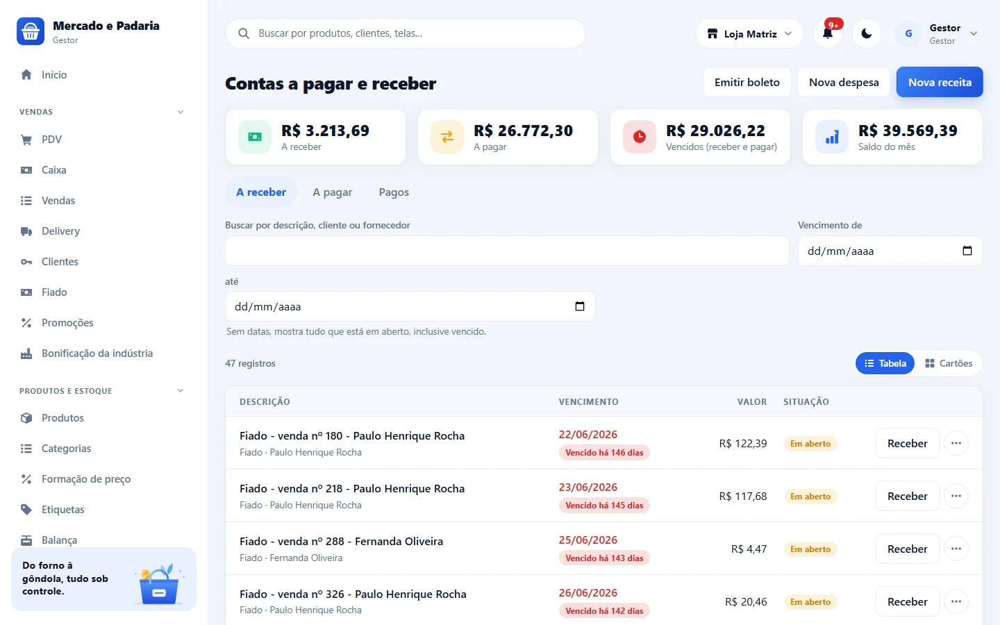
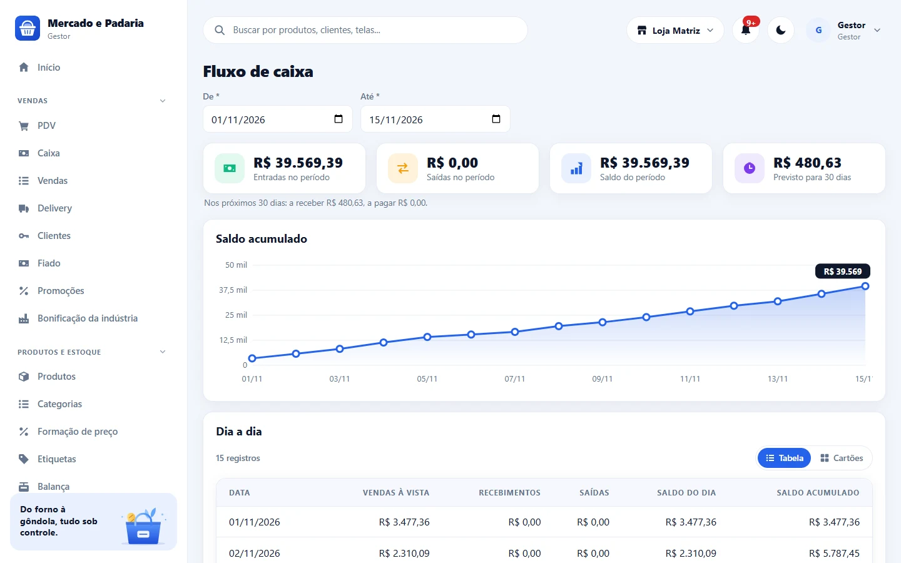
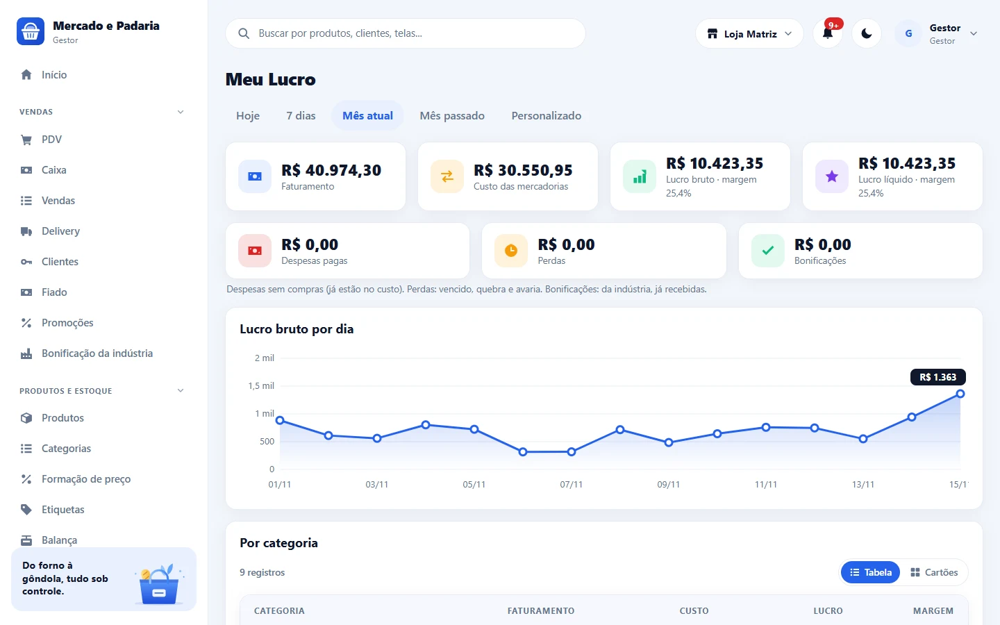
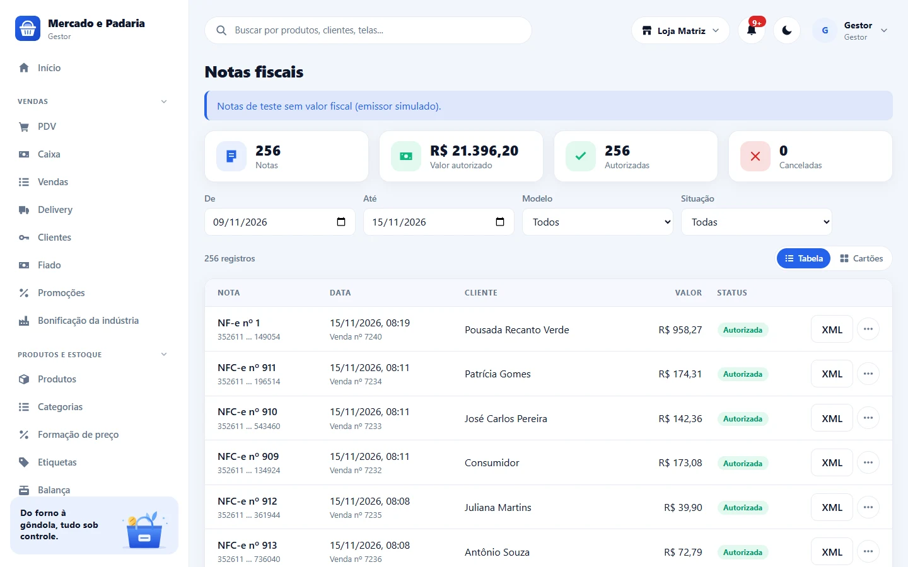
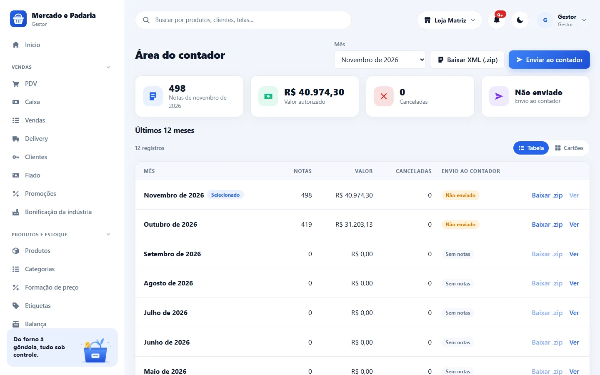
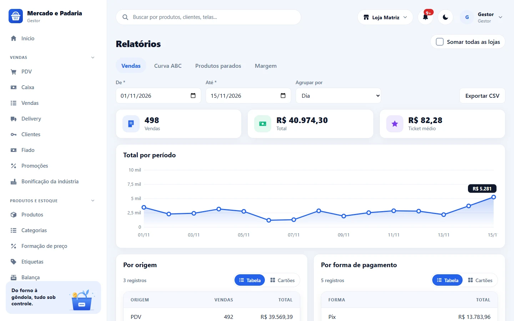

# Financeiro

## Para que serve

O financeiro mostra o dinheiro que entra e sai do mercado. Reúne as contas a pagar e a receber, o fluxo de caixa, o lucro do período, as notas fiscais emitidas e os relatórios de vendas. Também prepara os XML do mês para o contador.

## Quem usa

- **Gestor**: tudo. Só o gestor cria, edita, registra pagamentos e recebimentos, estorna lançamentos, emite boletos e cancela notas.
- **Contador**: consulta contas, fluxo de caixa, notas fiscais, área do contador e relatórios, sem alterar nada.

O **Meu Lucro** é só do gestor. O **Painel do contador** (`/contador`) junta as notas fiscais e os relatórios do mês. A área do contador fica em **Financeiro > Área do contador**.

## Contas a pagar e receber

Tela dos lançamentos financeiros. No topo, quatro indicadores: **A receber**, **A pagar**, **Vencidos (receber e pagar)** e **Saldo do mês**. As abas **A receber**, **A pagar** e **Pagos** separam os lançamentos. Os filtros são a busca por descrição, cliente ou fornecedor e o período de vencimento.

O que dá para fazer:

- Criar uma receita com **Nova receita** ou uma despesa com **Nova despesa**.
- Informar a categoria, o fornecedor (nas despesas), o número do documento, a linha digitável e uma observação.
- Dividir o valor em parcelas, com o campo **Parcelas (divide o valor)**. Ou repetir o lançamento todo mês por 12 meses, com o valor cheio em cada mês, com a opção **Repetir todo mês por 12 meses**. As duas opções só aparecem ao criar.
- Registrar o pagamento ou o recebimento com **Pagar** ou **Receber**. A janela pede a forma (Dinheiro, Pix, Débito, Crédito, Fiado, Vale-alimentação ou Boleto), a data e o valor. O título da janela é **Registrar pagamento** ou **Registrar recebimento**.
- Editar um lançamento pelo menu de ações.
- Estornar um lançamento pago pelo menu de ações.
- Excluir um lançamento manual que ainda não foi pago.
- Emitir um boleto para um cliente, com o botão **Emitir boleto**. Veja a seção de boleto abaixo.

Os botões de ação só aparecem para o gestor. O contador vê as listas, mas não altera nada.

Passo a passo para registrar uma despesa paga:

1. Abra **Financeiro > Contas a pagar e receber**.
2. Clique em **Nova despesa**.
3. Preencha a descrição, o valor, o vencimento, a categoria e o fornecedor.
4. Clique em **Confirmar**.
5. Na aba **A pagar**, clique em **Pagar** na linha da despesa.
6. Escolha a forma, confira a data e o valor e clique em **Confirmar**.

### Boleto simulado

Ao clicar em **Emitir boleto**, o gestor escolhe o cliente e informa descrição, valor e vencimento. O sistema devolve uma linha digitável e, se a empresa tiver chave Pix em **Configurações > Mercado > Pix**, um Pix copia e cola.

O boleto é simulado. A linha digitável não tem registro em banco, e a tela avisa isso no resultado. Ele não serve para cobrança real.

## Fluxo de caixa

Mostra as entradas e saídas do período, com o que já foi realizado e o que está previsto. Escolha o período com os campos **De** e **Até**.

O que dá para fazer:

- Ver as **Entradas no período**, as **Saídas no período** e o **Saldo do período**.
- Ver o **Previsto para 30 dias**, que mostra o saldo previsto para os próximos 30 dias.
- Acompanhar o cartão **Saldo acumulado**, que mostra o saldo dia após dia.
- Conferir o cartão **Dia a dia**, com as entradas e saídas de cada dia.

Passo a passo para conferir o caixa do mês:

1. Abra **Financeiro > Fluxo de caixa**.
2. Preencha **De** com o primeiro dia do mês e **Até** com o último.
3. Confira o **Saldo do período**.
4. Veja o **Previsto para 30 dias** para planejar os próximos pagamentos.

## Meu Lucro

Mostra o lucro real do período. Ele desconta o custo das mercadorias, as despesas, as perdas e acrescenta as bonificações. Os períodos rápidos são **Mês atual** e **Mês passado**. Para outro período, escolha **Personalizado** e preencha **De** e **Até**.

Como o lucro é calculado:

- **Lucro bruto** = faturamento menos custo das mercadorias.
- **Lucro líquido** = lucro bruto menos despesas pagas, menos perdas, mais bonificações.
- As margens são o lucro dividido pelo faturamento.
- As compras não entram como despesa. A mercadoria já entra no lucro pelo custo das vendas, então não é contada duas vezes.

Os indicadores mostram o **Faturamento**, o **Custo das mercadorias**, o **Lucro bruto** e o **Lucro líquido** com as margens, além de **Despesas pagas**, **Perdas** e **Bonificações**. Os cartões trazem o **Lucro bruto por dia**, o **Por categoria**, os **Produtos que mais deram lucro** e os **Produtos com a menor margem**.

Passo a passo:

1. Abra **Financeiro > Meu Lucro**.
2. Escolha **Mês atual**, **Mês passado** ou **Personalizado**.
3. Confira o lucro líquido e a margem.
4. Desça até o cartão **Produtos com a menor margem** e veja quais itens merecem reajuste.

## Notas fiscais

Lista as notas emitidas nas vendas, como NFC-e e NF-e. No topo, os indicadores mostram a quantidade de **Notas**, o **Valor autorizado**, as **Autorizadas** e as **Canceladas**.

O que dá para fazer:

- Filtrar por período (**De** e **Até**), por modelo (NFC-e ou NF-e) e por situação.
- Baixar o XML de uma nota com o botão **XML**.
- Abrir a venda de origem pelo menu de ações, com **Ver venda**.
- Cancelar uma nota autorizada, pelo menu de ações, com **Cancelar nota**. Só o gestor cancela. O motivo precisa ter pelo menos 15 caracteres.

Passo a passo para cancelar uma nota:

1. Abra **Financeiro > Notas fiscais**.
2. Localize a nota pelo período ou pela situação.
3. No menu de ações da linha, escolha **Cancelar nota**.
4. Escreva o motivo, com pelo menos 15 caracteres.
5. Clique em **Cancelar nota**.

### Como a emissão funciona

A emissão fica em **Configurações > Mercado > Nota fiscal**. Os campos são:

- **Provedor**: Nenhum (não emite nota), Simulado (teste), Focus NFe, Webmania ou Nuvem Fiscal.
- **Ambiente**: Homologação (teste) ou Produção.
- **CNPJ do emitente**.
- **Emitir nota automaticamente na venda**.

Saiba o que é real e o que é simulado:

- **Nenhum**: nenhuma nota é gerada.
- **Simulado**: o sistema gera uma nota com chave e XML no formato da SEFAZ, em homologação. A nota não tem valor fiscal. Ela serve para testar o fluxo.
- **Focus NFe, Webmania e Nuvem Fiscal**: a integração com esses emissores ainda não existe no código. Enquanto isso, qualquer um deles gera a mesma nota simulada. Não há envio à SEFAZ.

Para emitir nota de verdade, seria preciso um contrato com um emissor e a integração no sistema. Essa integração não está no código atual.

## Área do contador

Tela para entregar os documentos do mês ao contador. Escolha o **Mês** e veja o valor autorizado, as notas canceladas e a data do último envio ao contador. A lista **Últimos 12 meses** permite trocar de mês com um toque.

O que dá para fazer:

- Baixar o XML das notas do mês em um arquivo .zip, com o botão **Baixar XML (.zip)**.
- Enviar o aviso ao contador com o botão **Enviar ao contador**. Só o gestor envia.

O envio manda um e-mail ao contador dizendo que os arquivos do mês estão prontos. O e-mail traz um botão para a área do contador. Os XML não vão anexados: o contador entra com o próprio usuário e baixa o .zip, que traz os XML e um resumo em CSV. O e-mail do contador e o envio automático ficam em **Configurações > Mercado > Contador**. O envio automático usa **Dia do envio (1 a 28)** e manda o aviso do mês anterior, se ainda não tiver sido enviado.

Se o envio de e-mails estiver desligado em **Configurações > E-mail**, o aviso é só simulado e nada é enviado. A tela informa isso.

Passo a passo para mandar o mês ao contador:

1. Abra **Financeiro > Área do contador**.
2. Escolha o mês no campo **Mês**.
3. Clique em **Baixar XML (.zip)** e guarde o arquivo.
4. Clique em **Enviar ao contador**.
5. Confira a data em **Envio ao contador**.

## Relatórios

Relatórios de vendas, curva ABC, produtos parados e margem. Cada aba tem seus próprios filtros e o botão **Exportar CSV**. O arquivo sai com ponto e vírgula como separador, números com vírgula decimal e acentos corretos no Excel.

As abas são:

- **Vendas**: número de vendas, total e ticket médio, e os cartões **Total por período**, **Por origem**, **Por forma de pagamento** e **Por operador**. Agrupe por **Dia**, **Hora**, **Semana** ou **Mês**.
- **Curva ABC**: classifica os produtos pelo critério **Faturamento**, **Quantidade** ou **Lucro**. A classe A é o grupo que chega a 80% do total, a classe B vai até 95%, e a classe C é o resto.
- **Produtos parados**: mostra os produtos sem venda nos últimos dias que você informar em **Dias sem venda**, com o valor parado pelo custo.
- **Margem**: mostra a margem dos produtos que têm custo cadastrado.

Quando a aba mostra a opção **Somar todas as lojas**, marque-a para juntar as lojas. Deixe desmarcado para ver só a loja atual.

Passo a passo para exportar as vendas do mês:

1. Abra **Financeiro > Relatórios**.
2. Na aba **Vendas**, escolha o período com **De** e **Até**.
3. Escolha como agrupar, como **Mês**.
4. Clique em **Exportar CSV**.

## Dicas

- Confira os **Vencidos (receber e pagar)** no começo do dia.
- Para fechar o mês, use **Meu Lucro** e o **Fluxo de caixa** juntos. O lucro mostra o resultado, e o fluxo mostra se o dinheiro está entrando.
- Antes de enviar ao contador, confira o **Valor autorizado** e as canceladas do mês na **Área do contador**.
- Lembre que o boleto e a nota fiscal de teste são simulados. Confira o provedor em **Configurações > Mercado > Nota fiscal** antes de emitir qualquer documento.
- Se o aviso ao contador não sair, confira se o e-mail está ligado em **Configurações > E-mail** e se o endereço do contador foi preenchido.

[← Voltar ao manual](README.md)
