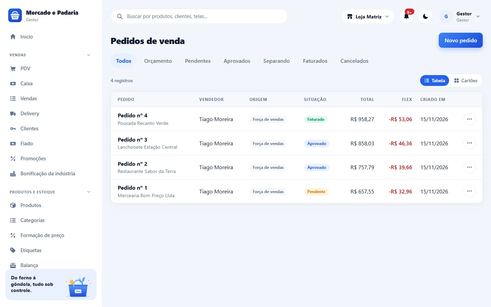
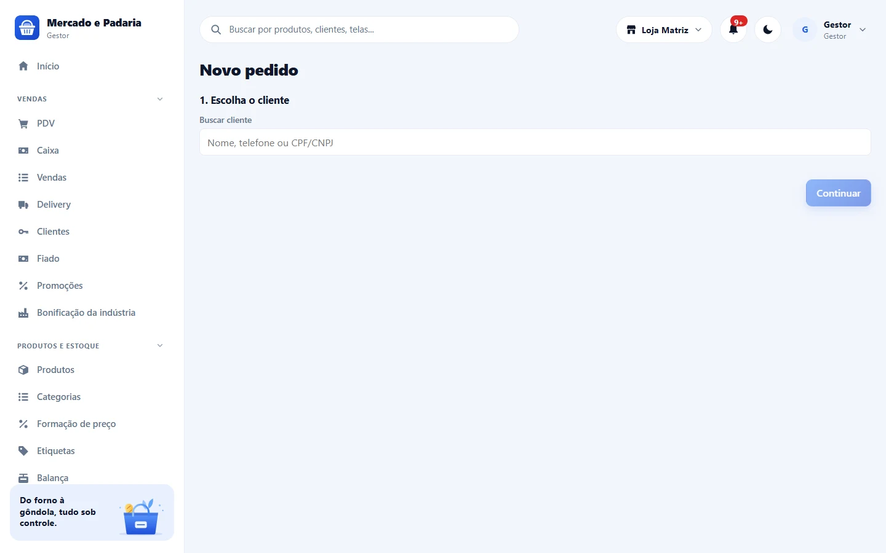
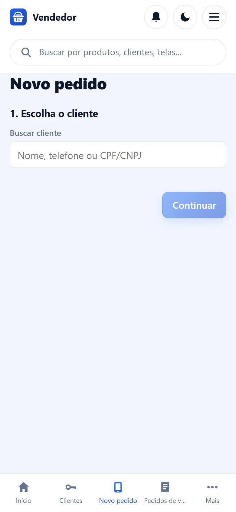
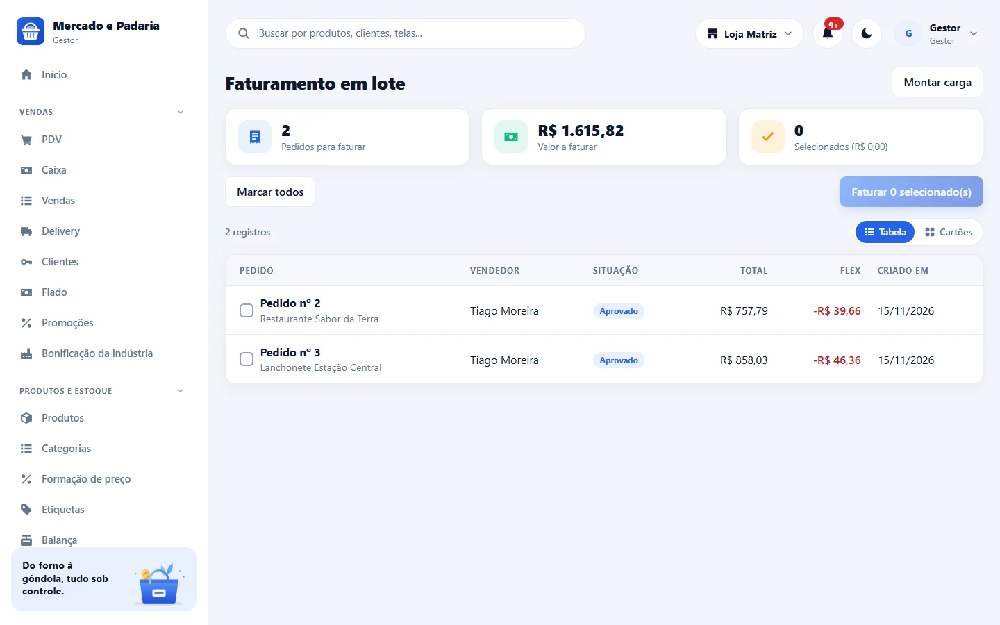
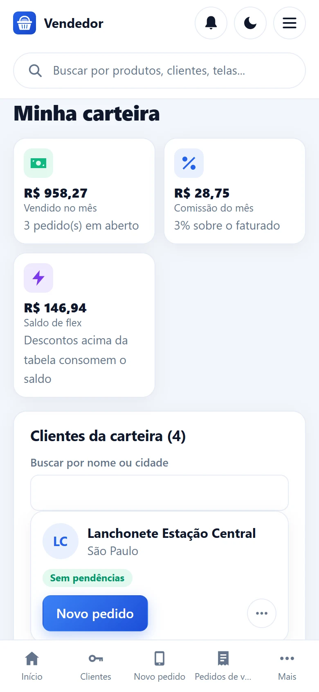
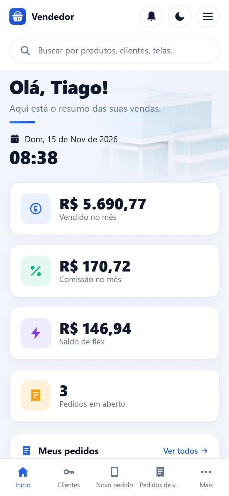
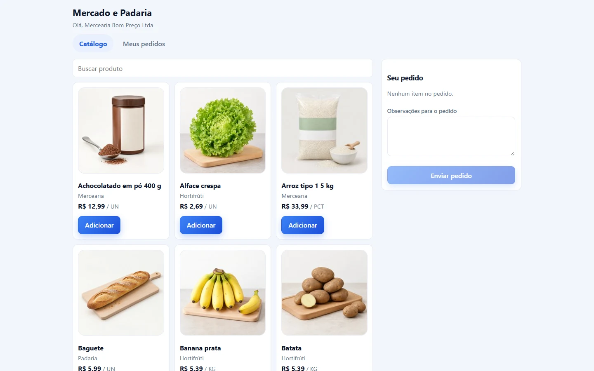
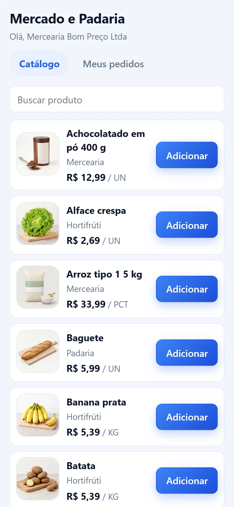
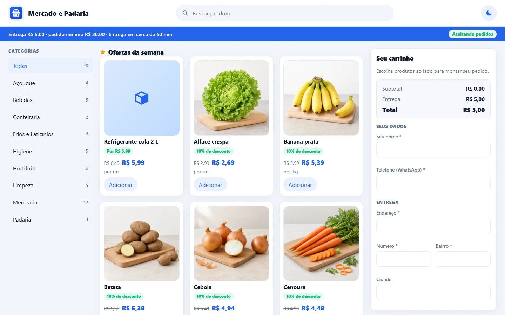
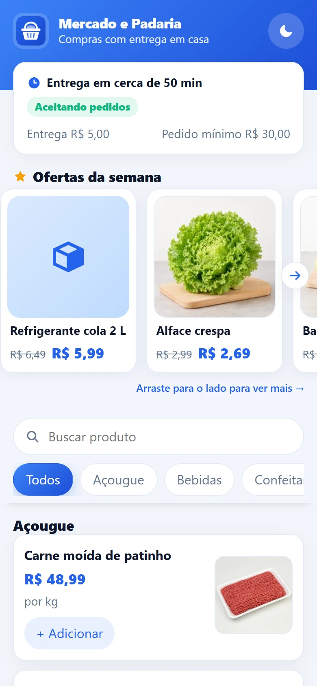

# Força de vendas

## Para que serve

A força de vendas cuida das vendas que não acontecem no balcão. O vendedor monta pedidos para os clientes da sua carteira, com preço negociado. O gestor aprova os pedidos, manda separar e fatura vários de uma vez. Os clientes de atacado fazem o próprio pedido pela loja B2B, e o consumidor final pode pedir delivery pela página pública `/pedir`.

## Quem usa

- **Gestor**: pedidos de venda (aprova, separa e cancela), novo pedido e faturamento em lote.
- **Vendedor**: pedidos de venda dos seus clientes, novo pedido, minha carteira e início com o resumo das suas vendas.
- **Cliente de atacado**: loja B2B, pelo link de acesso, sem login.
- **Cliente final**: página de pedido para delivery, sem login.

Os pedidos de venda ficam em **Força de vendas > Pedidos de venda**. O vendedor só vê e altera os pedidos dele.

## Pedidos de venda

Lista os pedidos da força de vendas e da loja B2B. Cada linha mostra o número, o cliente, a origem, a situação, o total, o flex e a data de criação. O gestor também vê a coluna Vendedor.

Situações do pedido:

- **Orçamento**: rascunho salvo pelo vendedor. Ainda não vai para aprovação.
- **Pendente**: enviado e aguardando aprovação do gestor. Pedidos da loja B2B entram aqui.
- **Aprovado**: liberado pelo gestor. Pode ir para separação ou para faturamento.
- **Separando**: em separação na loja.
- **Faturado**: virou venda, com entrega criada.
- **Cancelado**: cancelado.

O que dá para fazer:

- Filtrar pelas abas Todos, Orçamento, Pendentes, Aprovados, Separando, Faturados e Cancelados.
- Abrir o detalhe clicando na linha. Ele mostra os itens, o preço de tabela, o preço negociado, o flex, a condição e a forma de pagamento, a previsão de entrega e as observações.
- Editar um orçamento ou um pedido pendente, pelo menu de ações da linha ou pelo botão Editar do detalhe.
- Enviar um orçamento como pedido (vai para Pendentes).
- Aprovar um pedido pendente (somente o gestor).
- Mandar um pedido aprovado para separação (somente o gestor).
- Cancelar um pedido. O vendedor cancela só orçamentos e pedidos pendentes. Pedido aprovado só o gestor cancela.
- Cancelar uma venda faturada (somente o gestor). O cancelamento estorna a venda e devolve o flex ao saldo do vendedor.
- Ir para o faturamento em lote a partir de um pedido aprovado ou em separação (somente o gestor).

Passo a passo para aprovar um pedido:

1. Abra **Força de vendas > Pedidos de venda**.
2. Clique na aba **Pendentes**.
3. Clique na linha do pedido para abrir o detalhe.
4. Confira os itens, os preços negociados e o flex.
5. Clique em **Aprovar**.
6. Depois, clique em **Mandar para separação**.

## Novo pedido

Tela de montagem do pedido, feita para o celular do vendedor. Ela tem dois passos: primeiro o cliente, depois os produtos.

O que dá para fazer:

- Buscar o cliente por nome, telefone ou CPF/CNPJ. A busca começa com 2 letras. Clientes bloqueados não aparecem.
- Buscar o produto por nome, código ou EAN. Tocar no produto adiciona 1 unidade. Tocar de novo soma mais 1.
- Ajustar a quantidade de cada item (na unidade do produto).
- Digitar o **Preço negociado** de cada item. Se o campo ficar vazio, vale o preço de tabela.
- Ver o total, o total de tabela e o flex do pedido.
- Preencher a condição de pagamento, a forma de pagamento (Boleto, Pix, Dinheiro, Débito, Crédito, Fiado, Vale-alimentação ou A definir), a previsão de entrega e as observações.
- Salvar como orçamento (botão **Salvar orçamento**) ou enviar o pedido (botão **Enviar pedido**).

Como o flex funciona:

- O flex do item é a diferença entre o preço negociado e o preço de tabela, multiplicada pela quantidade. O flex do pedido é a soma dos itens.
- Flex positivo aumenta o saldo de flex do vendedor quando o pedido é faturado.
- Flex negativo consome o saldo de flex. Ao salvar, o sistema recusa o pedido se o saldo não cobrir o desconto. Nesse caso, a tela destaca o saldo e bloqueia o envio.
- O saldo só muda no faturamento. Ao salvar, os valores da tela são uma prévia. O servidor recalcula tudo ao gravar.

Passo a passo para montar um pedido:

1. Toque em **Novo pedido**.
2. Busque o cliente e toque nele. Depois toque em **Continuar**.
3. Busque o produto e toque nele para adicionar.
4. Se o preço combinado for diferente, digite-o no campo **Preço negociado**.
5. Escolha a forma de pagamento e, se houver, a previsão de entrega.
6. Toque em **Enviar pedido**. Para guardar sem enviar, toque em **Salvar orçamento**.

## Faturamento em lote

Tela do gestor para faturar vários pedidos de uma vez. A lista reúne os pedidos aprovados e os que estão em separação, em ordem de número.

O que dá para fazer:

- Marcar pedidos um a um, ou todos de uma vez, com **Marcar todos** e **Desmarcar todos**.
- Ver o total dos pedidos marcados.
- Faturar os marcados com o botão **Faturar N selecionado(s)**.
- Ver o resultado de cada pedido: número da venda, número da NF-e e código da entrega.

Cada pedido é faturado em uma transação própria. Se um pedido der erro, os outros continuam. O pedido com erro não muda de situação.

Ao faturar, o sistema cria a venda e a entrega com código de rastreio. A NF-e segue a configuração em **Configurações > Mercado > Nota fiscal**. Com o provedor em **Nenhum (não emite nota)**, o resultado mostra o traço no lugar do número da NF-e. Com o provedor **Simulado (teste)**, a nota tem validade apenas de teste. A integração com Focus NFe, Webmania e Nuvem Fiscal ainda não existe no código. Esses provedores geram a mesma nota simulada.

Passo a passo:

1. Abra **Força de vendas > Faturamento em lote**.
2. Marque os pedidos que vão sair, ou toque em **Marcar todos**.
3. Confira o total do lote.
4. Clique em **Faturar N selecionado(s)**.
5. Confira o resultado de cada pedido. Os que deram erro continuam na lista.

## Minha carteira

Tela do vendedor com os clientes da sua carteira. No topo aparecem os indicadores do mês: **Vendido no mês**, **Comissão do mês** e **Saldo de flex**. Cada cliente mostra o último pedido e a situação de pendências.

O que dá para fazer:

- Ver o que foi vendido e a comissão do mês.
- Ver o saldo de flex disponível para negociar.
- Localizar um cliente da carteira.
- Tocar em **Novo pedido** ao lado do cliente. O pedido já abre com esse cliente escolhido.

Passo a passo:

1. Abra **Minha carteira**.
2. Localize o cliente.
3. Toque em **Novo pedido**.
4. Monte os produtos e envie o pedido.

## Painel do vendedor

É a tela inicial do vendedor. Ela mostra o resumo das suas vendas, com os seus pedidos e clientes. Para criar um pedido, use **Novo pedido** ou **Minha carteira**.

## Loja B2B

Catálogo de atacado para clientes cadastrados. A loja não pede login. Quem tem o link de acesso entra direto, e o pedido vai para a fila de aprovação do gestor.

Como o gestor dá o acesso:

1. Abra o cliente em **Vendas > Clientes** e mude o tipo para **Atacado (B2B)**. O código de acesso é gerado nessa mudança.
2. Abra a aba **B2B** da ficha do cliente. Ela mostra o código e o link da loja.
3. Use o botão de cópia para enviar o link ao cliente. Se o link vazar, use **Gerar novo código**. O link antigo deixa de funcionar.

Se o código não existir ou o cliente não estiver liberado, a página mostra: "Link inválido ou cliente sem acesso à loja. Fale com seu representante."

O que o cliente faz na loja:

- Ver o catálogo com o preço de atacado.
- Buscar um produto e tocar em **Adicionar**.
- Ajustar a quantidade de cada item. O **Total estimado** mostra a soma.
- Escrever observações para o pedido.
- Tocar em **Enviar pedido**.
- Acompanhar os pedidos já feitos na aba **Meus pedidos**.

Um pedido da loja B2B entra com a origem **Loja B2B** e a situação **Pendente**. O gestor aprova em **Pedidos de venda**. Esse pedido não tem negociação de preço, então o flex é zero.

Passo a passo para o cliente:

1. Abra o link da loja no celular ou no computador.
2. Busque o produto e toque em **Adicionar**.
3. Ajuste as quantidades.
4. Escreva as observações, se houver.
5. Toque em **Enviar pedido**.

## Pedido do cliente (delivery)

Página pública em `/pedir`. O consumidor monta o pedido de delivery sem login. Os pedidos caem na tela **Vendas > Delivery**, onde a equipe acompanha até a entrega.

Para a página funcionar, ligue **Delivery ativo** na seção **Delivery e WhatsApp** de **Configurações > Mercado**. Sem isso, a página mostra "Delivery indisponível no momento". Na mesma seção ficam a taxa de entrega e o pedido mínimo.

O cliente passa por cinco etapas:

1. **Seu pedido**: escolhe os produtos e as quantidades.
2. **Seus dados**: nome e telefone (WhatsApp).
3. **Endereço de entrega**: endereço, número e bairro são obrigatórios. Cidade e complemento são opcionais.
4. **Pagamento**: a forma de pagamento é escolhida para a entrega: Dinheiro, Pix, Débito ou Crédito. Para dinheiro, aparece o campo "Troco para quanto?".
5. **Confirmar pedido**: confere o total e confirma.

A página não cobra o pagamento online. O pagamento é feito na entrega.

## Dicas

- Antes de aprovar, confira o flex do pedido. Um flex negativo grande pode ser um erro de digitação no preço negociado.
- A loja B2B só abre para clientes com código B2B. Esse código existe quando o cliente é do tipo **Atacado (B2B)**.
- Quando o saldo de flex do vendedor não cobre um desconto, peça ao gestor para ajustar o saldo na ficha do usuário em **Gestão > Equipe**.
- Faturar em lote poupa tempo, mas confira o resultado de cada pedido. O que deu erro continua aprovado para você tentar de novo.
- Para trocar o link da loja B2B de um cliente, use **Gerar novo código** na aba B2B. Avise o cliente, porque o link antigo para de funcionar.

[← Voltar ao manual](README.md)
