# Gestão

## Para que serve

A gestão reúne o que organiza o sistema como um todo: a equipe e os perfis de acesso, as lojas e o centro de distribuição, as configurações do mercado, o backup e a atualização, o registro de atividades e o log técnico. Também tem o assistente de perguntas sobre os dados e a tela de cada perfil da equipe.

## Quem usa

- **Gestor**: tudo nesta página. Equipe, Lojas e CD, Configurações, Atividades e Log do sistema são só do gestor.
- **Comprador e estoquista**: Assistente IA.
- **Todos os perfis**: Meu perfil.
- **Cada perfil da equipe**: o próprio painel, descrito no fim desta página, em **Painéis dos outros perfis**.

## Assistente IA

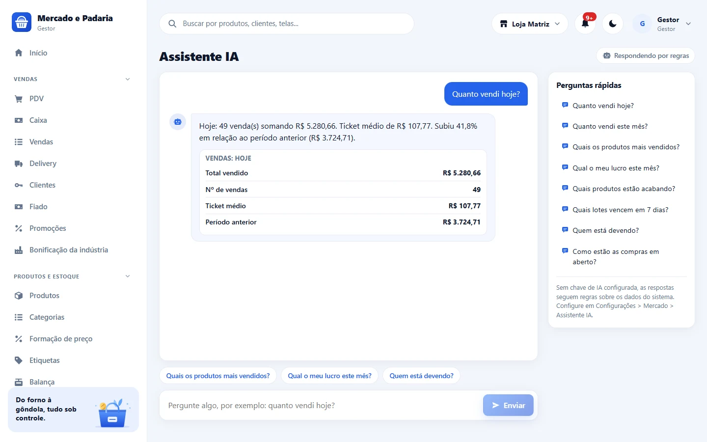

Tela para fazer perguntas em português sobre vendas, estoque, validade, fiado, compras, produção, entregas e lucro. Escreva a pergunta no campo de texto e toque em **Enviar**. Os exemplos na tela ajudam a começar.

O assistente funciona de dois jeitos:

- **Sem chave da Anthropic**: responde por regras. Ele reconhece palavras-chave e busca os números direto no banco de dados. As respostas seguem modelos fixos para os temas que ele conhece.
- **Com chave da Anthropic e com o assistente ativo**: a resposta é escrita pela IA, com base nos mesmos dados.

O que dá para fazer:

- Perguntar sobre as vendas do dia, da semana ou do mês, e comparar com o período anterior.
- Perguntar quais produtos vendem mais.
- Perguntar sobre estoque baixo, lotes que vencem e compras em aberto.
- Perguntar quem está devendo no fiado e como estão as entregas.
- Ver o histórico das perguntas feitas.

Como ligar a IA:

1. Abra **Configurações > Mercado**.
2. Clique na seção **Assistente IA**.
3. Marque **Assistente ativo**.
4. No campo **Chave da API Anthropic**, cole a chave. A chave fica gravada de forma cifrada.
5. Clique em **Salvar configurações**.

Se já houver uma chave gravada, deixe o campo em branco para mantê-la. A tela mostra "Já há uma chave gravada." ou "Sem chave: o assistente responde por regras."

Passo a passo para fazer uma pergunta:

1. Abra **Gestão > Assistente IA**.
2. Digite a pergunta, por exemplo "quanto vendi hoje?".
3. Toque em **Enviar** e aguarde a resposta.

## Equipe

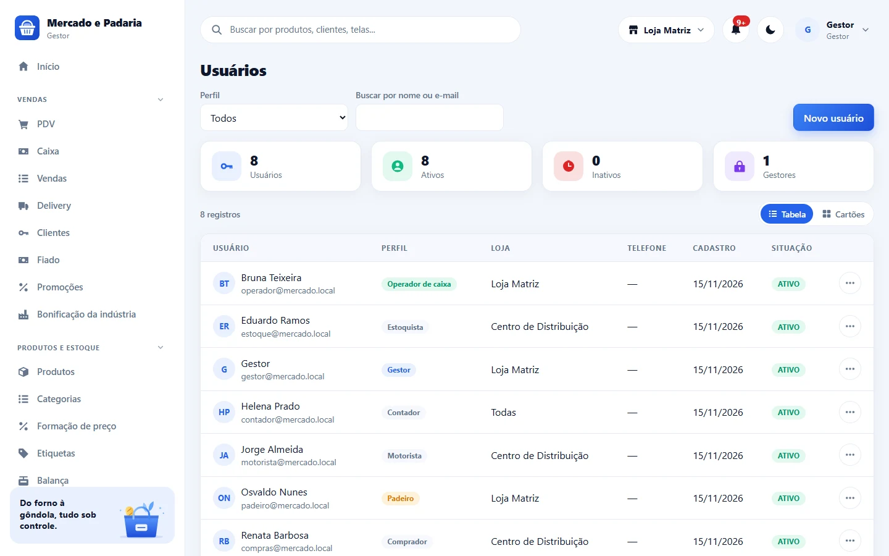

Cadastro dos usuários do sistema, com o perfil de cada um. No topo, os cartões mostram a quantidade de **Usuários**, **Ativos**, **Inativos** e **Gestores**. Os filtros são **Perfil** e a busca por nome ou e-mail.

O que dá para fazer:

- Criar um usuário com **Novo usuário**. Os campos são Nome, E-mail, Senha inicial (mínimo de 6 caracteres), Perfil e Loja.
- Para o perfil **Vendedor**, informar a **Comissão (%)** e o **Saldo de flex (R$)**.
- Para o perfil **Motorista**, informar a **CNH**.
- Ver a ficha do usuário, com a atividade recente, pelo menu da linha ou clicando nela.
- Editar os dados com **Salvar dados**.
- Redefinir a senha pelo menu da linha, em **Redefinir senha**.
- Desativar ou reativar um usuário com **Desativar** ou **Ativar**.

Regras da equipe:

- Ninguém desativa a própria conta.
- O sistema exige pelo menos um gestor ativo. Não é possível desativar o último.
- Um usuário desativado não entra no sistema.

Passo a passo para criar um usuário:

1. Abra **Gestão > Equipe**.
2. Clique em **Novo usuário**.
3. Preencha o nome, o e-mail, a senha inicial e escolha o perfil.
4. Escolha a loja. Se o usuário atende todas, deixe **Todas as lojas**.
5. Clique em **Criar usuário**. Peça para a pessoa trocar a senha em **Meu perfil**.

### Perfis e o que cada um vê

Cada perfil entra pelo próprio painel e só vê as telas listadas abaixo. O servidor também confere o acesso. A lista segue as telas cadastradas no sistema.

| Perfil | Painel inicial | Telas que vê |
|---|---|---|
| Gestor | `/gestor` | Tudo |
| Operador de caixa | `/operador` | PDV, Caixa, Vendas, Detalhe da venda, Clientes, Fiado, Delivery, Produtos e Entregas |
| Estoquista | `/estoquista` | Produtos, Etiquetas, Balança, Estoque, Movimentações, Validade e perdas, Inventário, Contagem, Entregas, Rotas e cargas, Montar carga, Transferências, Lojas e mapa, Receitas e Assistente IA |
| Padeiro | `/padeiro` | Produção do dia, Painel do forno e Receitas |
| Comprador | `/comprador` | Produtos, Categorias, Formação de preço, Etiquetas, Fornecedores, Sugestão de compra, Cotações, Pedidos de compra, Recebimento, Promoções, Lojas e mapa e Assistente IA |
| Motorista | `/motorista` | Minhas entregas, com o painel do motorista |
| Vendedor | `/vendedor` | Pedidos de venda, Novo pedido, Minha carteira e Clientes |
| Contador | `/contador` | Vendas, Clientes, Notas fiscais, Área do contador, Contas a pagar e receber, Fluxo de caixa e Relatórios |

Todos os perfis veem **Meu perfil**. O operador de caixa e o contador enxergam as vendas, mas as ações sensíveis dependem das regras de permissão, descritas em **Configurações**.

## Lojas e CD

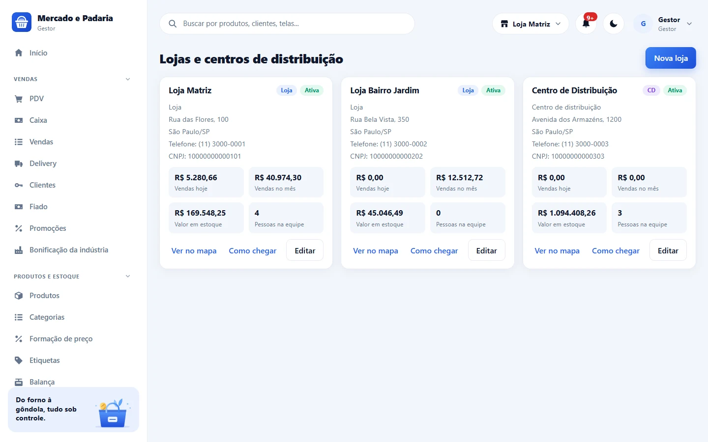

Cadastro das lojas e do centro de distribuição (CD). Cada cartão mostra o tipo, o endereço, as vendas de hoje e do mês, o valor em estoque e o número de pessoas na equipe.

O que dá para fazer:

- Cadastrar uma loja com **Nova loja**.
- Escolher o **Tipo**: **Loja** ou **Centro de distribuição**.
- Informar nome, CNPJ, telefone e o **Horário de funcionamento** (texto livre, como "Seg a sáb 7h–21h, dom 7h–13h").
- Preencher o endereço: Logradouro, Número, Complemento, Bairro, Cidade, UF e CEP.
- Preencher a posição no mapa. A latitude e a longitude podem ser digitadas, ou preenchidas com **Buscar coordenadas pelo endereço**. Informe o logradouro ou a cidade para buscar. Depois confira o ponto no mapa.
- Ver a loja no mapa, com **Ver no mapa**.
- Desmarcar **Loja ativa** para desativar uma loja. É preciso manter pelo menos uma loja ativa.

Passo a passo para cadastrar uma loja:

1. Abra **Gestão > Lojas e CD**.
2. Clique em **Nova loja**.
3. Preencha o nome, o tipo e o endereço.
4. Clique em **Buscar coordenadas pelo endereço** e confira o ponto no mapa.
5. Clique em **Salvar**.

## Configurações

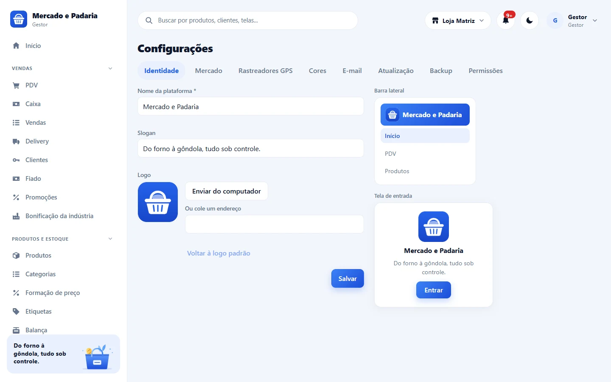

Tela com as abas de configuração do sistema: **Identidade**, **Mercado**, **Rastreadores GPS**, **Cores**, **E-mail**, **Atualização**, **Backup** e **Permissões**. 

**Identidade** e **Cores** guardam o nome, o slogan, a logo e as duas cores do sistema. Ao mudar as cores, a tela mostra uma prévia na hora. Ela só fica gravada quando você salva.

**Mercado** reúne as seções da operação:

- **Pix**: a chave usada no PDV e nos boletos.
- **Preços**, **Balança** e **Impressora de etiquetas**.
- **Fiado**: se o mercado vende a prazo para clientes cadastrados.
- **Nota fiscal**: provedor, ambiente, CNPJ e emissão automática. Veja a seção de notas fiscais no manual de financeiro.
- **Contador**: nome e e-mail do contador, envio automático dos XML e o dia do envio.
- **Delivery e WhatsApp**: delivery ativo, taxa de entrega e pedido mínimo.
- **Integrações**: iFood Mercado, Scantech e Mix Fiscal. Estão em modo simulado, sem contrato.
- **Assistente IA**: ligar o assistente e informar a chave da Anthropic.

**E-mail** configura o servidor de saída (SMTP) e o remetente. Também escolhe quando enviar: envio de e-mails ligado, recuperação de senha e boas-vindas a novos usuários. Use **Enviar e-mail de teste** para conferir a configuração. A aba **Últimos envios** mostra o que saiu.

**Rastreadores GPS** cadastra as tags e os veículos que enviam posição. Ela mostra como ligar um rastreador e permite simular uma posição para testar.

### Permissões

A aba **Permissões** tem duas partes. A primeira é a **senha do gestor**, uma senha curta de 4 a 12 números. Ela libera ações na frente do cliente, como cancelar um item. Não é a senha de login. Para gravar ou apagar a senha, confirme com a sua senha de login.

A segunda parte é **O que a equipe pode fazer**. Cada ação pode ser:

- **Livre**: a equipe faz sem pedir nada.
- **Com a senha do gestor**: a tela pede a senha do gestor antes de seguir.
- **Só o gestor**: só o gestor faz.

As ações e os modos padrão são estes:

| Ação | Padrão | Onde aparece |
|---|---|---|
| Cancelar item no PDV | Com a senha do gestor | PDV |
| Cancelar venda | Com a senha do gestor | Vendas e PDV |
| Dar desconto na venda | Com a senha do gestor | PDV |
| Fazer sangria do caixa | Livre | Caixa |
| Vender fiado acima do limite | Com a senha do gestor | PDV |
| Ajustar estoque e lançar perdas | Livre | Estoque e validade |
| Alterar preço de venda | Com a senha do gestor | Produtos e planilha de produtos |

Pontos importantes:

- O gestor faz tudo sem senha.
- O comprador altera preço de venda sem senha. A regra de preço não se aplica a ele.
- Sem senha do gestor gravada, as ações marcadas como **Com a senha do gestor** ficam bloqueadas para a equipe. Defina a senha antes de usar essas ações.
- Depois de 5 senhas erradas em 10 minutos, o sistema bloqueia novas tentativas por alguns minutos.
- Apagar a senha do gestor põe todas as ações que pediam senha em **Só o gestor**.

Passo a passo para mudar uma permissão:

1. Abra **Gestão > Configurações** e clique na aba **Permissões**.
2. Se ainda não houver senha, digite sua senha de login e a nova senha do gestor e clique em **Gravar senha**.
3. Em **O que a equipe pode fazer**, escolha o modo de cada ação.
4. Clique em **Salvar**.

### Backup

A aba **Backup** guarda cópias do banco de dados. O backup automático roda todo dia no horário definido.

- **Fazer uma cópia do banco todo dia**: liga ou desliga o backup diário. O padrão é às **03:00**.
- **Quantas cópias diárias guardar**: o padrão é 7 cópias.
- **Fazer uma cópia agora**: cria uma cópia manual na hora.

A lista **Cópias guardadas** mostra cada arquivo com o tipo: **Diária**, **Manual**, **Antes de restaurar** e **Antes de atualizar**. Cada cópia tem as ações **Baixar**, **Restaurar esta cópia** e **Excluir**.

Ao restaurar uma cópia, o sistema faz antes uma cópia do estado atual, do tipo **Antes de restaurar**. Para confirmar, digite RESTAURAR. A restauração troca o banco inteiro pelo da cópia. Use com cuidado, e de preferência fora do horário de venda.

O sistema guarda um número limitado de cada tipo. Manuais ficam 10, as de antes de atualizar ficam 5 e as de antes de restaurar ficam 3. As diárias seguem o campo **Quantas cópias diárias guardar**.

Passo a passo para restaurar uma cópia:

1. Abra **Configurações > Backup**.
2. Localize a cópia na lista **Cópias guardadas**.
3. No menu da linha, escolha **Restaurar esta cópia**.
4. Digite RESTAURAR no campo de confirmação.
5. Confirme. Espere a página recarregar.

### Atualização

A aba **Atualização** mostra a versão instalada, a versão disponível e as mudanças pendentes. O botão **Verificar agora** procura novidades no repositório do sistema.

- **Atualizar agora** aparece habilitado quando há mudanças pendentes.
- **Reconstruir mesmo sem novidades** refaz os serviços com o código atual.

Ao atualizar, o sistema fica fora do ar por alguns minutos. Antes de começar, uma cópia do banco de dados é feita automaticamente. Os pedidos em andamento não se perdem.

A atualização é feita por um serviço separado, o atualizador (`atualizador/servidor.js`). Ele copia o banco, baixa o código mais novo e recria os serviços da API e da interface. A API só repassa o pedido. Quem faz o trabalho é o atualizador.

Passo a passo para atualizar:

1. Abra **Configurações > Atualização**.
2. Clique em **Verificar agora**.
3. Confira a lista **O que muda**.
4. Clique em **Atualizar agora** e confirme.
5. Espere o sistema voltar.

## Atividades

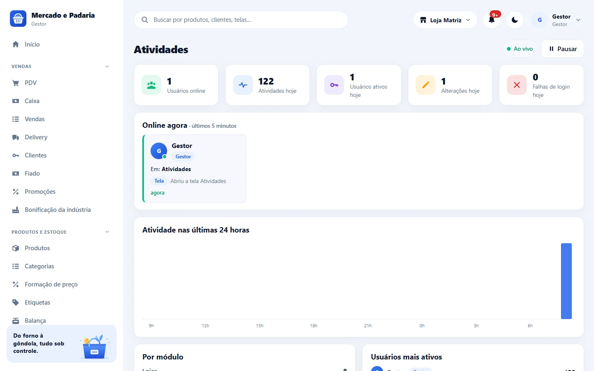

Mostra quem fez o quê e quando. No topo, os indicadores mostram os **Usuários online**, as **Atividades hoje**, os **Usuários ativos hoje**, as **Alterações hoje** e as **Falhas de login hoje**. Abaixo há um resumo das últimas 24 horas, por módulo, os usuários mais ativos e as últimas atividades.

O que dá para fazer:

- Ver quem está online agora.
- Conferir as falhas de login do dia.
- Ver as alterações feitas no sistema.
- Pausar a atualização ao vivo com **Pausar** e voltar com **Retomar**.

Passo a passo para investigar uma alteração:

1. Abra **Gestão > Atividades**.
2. Localize a atividade na lista **Últimas atividades**.
3. Para ver tudo o que a pessoa fez, abra a ficha dela em **Gestão > Equipe**.

## Log do sistema

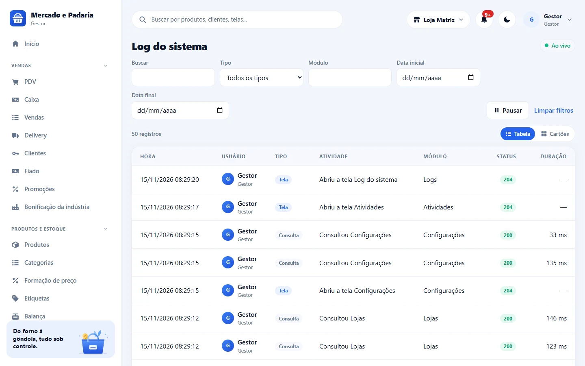

Lista os eventos técnicos registrados pelo servidor. Cada linha mostra a data e hora, o usuário, o perfil, o tipo, o módulo, o caminho, o status e a duração.

O que dá para fazer:

- Buscar um texto com o campo **Buscar**.
- Filtrar por **Tipo** (Entrada, Falha de login, Saída, Tela, Consulta, Criação, Alteração e Exclusão), por **Módulo** e pelo período (**Data inicial** e **Data final**).
- Abrir um evento para ver os detalhes: IP, navegador, método e caminho.
- Carregar eventos mais antigos com **Carregar mais antigos**.
- Limpar os filtros com **Limpar filtros**.
- Pausar a atualização ao vivo com **Pausar**.

Passo a passo para achar erros de um dia:

1. Abra **Gestão > Log do sistema**.
2. Preencha **Data inicial** e **Data final** com o dia.
3. Clique no evento para ver os detalhes.

## Meu perfil

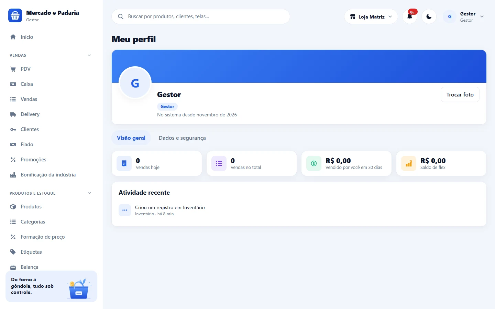

Tela de dados da própria conta. Todos os perfis têm esta tela.

O que dá para fazer:

- Trocar a foto com **Trocar foto**. Envie uma imagem ou cole o endereço de uma imagem. Também dá para remover a foto.
- Corrigir o telefone e salvar com **Salvar dados**.
- Trocar a senha. Informe a senha atual, a nova senha (mínimo de 6 caracteres) e a confirmação, e toque em **Trocar senha**.
- Escolher o tema do sistema: **Sistema**, **Claro** ou **Escuro**.

Passo a passo para trocar a senha:

1. Abra **Meu perfil**.
2. Na seção **Trocar senha**, digite a senha atual.
3. Digite a nova senha e confirme.
4. Toque em **Trocar senha**.

## Painéis dos outros perfis

Cada perfil da equipe tem o próprio painel, com as telas do dia a dia dele. Os painéis abaixo servem de guia. Para as telas em detalhe, veja o manual de cada área.

### Painel do operador de caixa

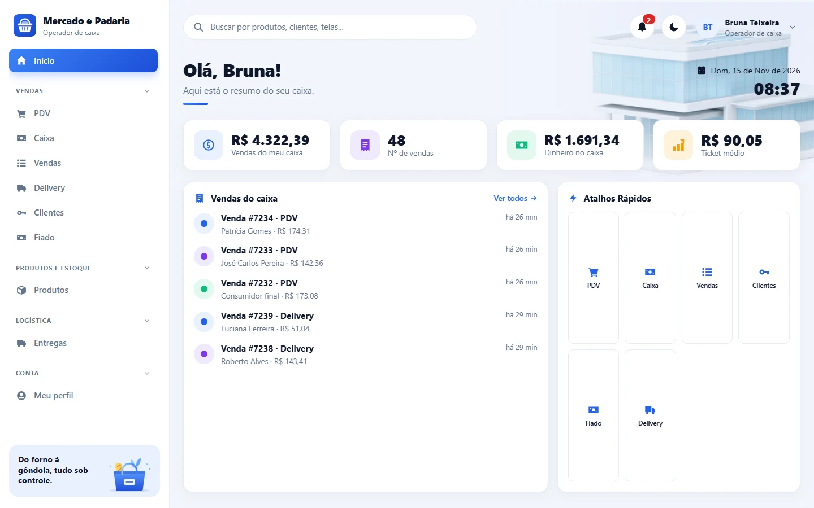

O operador de caixa trabalha no PDV, no caixa, nas vendas, nos clientes, no fiado, no delivery, nos produtos e nas entregas. As ações sensíveis, como cancelar uma venda ou dar desconto, seguem as regras de **Configurações > Permissões**.

Passo a passo: abra o **PDV** no menu para começar a vender. Ao fim do turno, use **Caixa** para o fechamento.

### Painel do estoquista

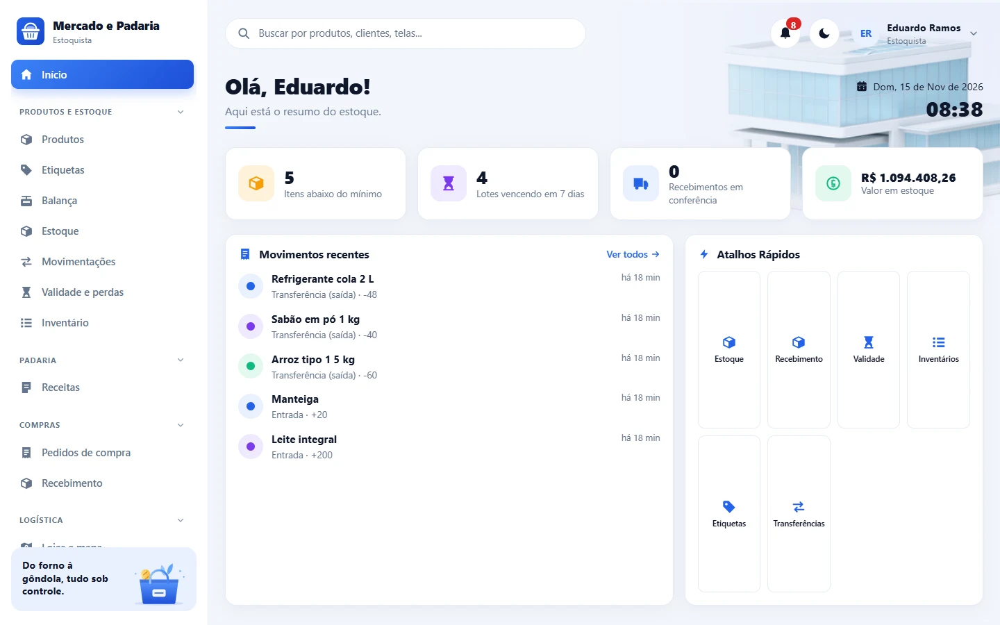

O estoquista cuida do estoque, das movimentações, da validade, dos inventários e das entregas e transferências. No dia a dia, o painel mostra os recebimentos, os lotes que vencem e o inventário do dia.

Passo a passo: abra **Inventário** para ver os inventários abertos e contar os itens. No celular, a contagem é feita lendo o código de barras.

### Painel do padeiro

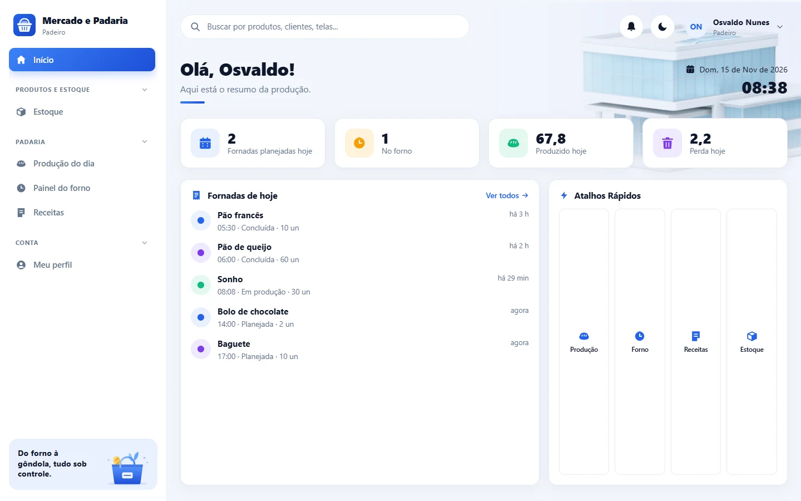

O padeiro tem a produção do dia, o painel do forno e as receitas.

Passo a passo: abra **Produção do dia** para ver as fornadas planejadas. Use o **Painel do forno** na cozinha para ver o que assar agora.

### Painel do comprador

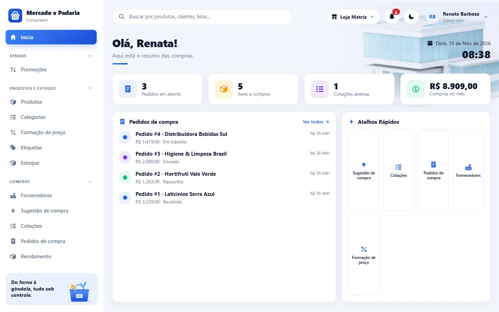

O comprador vê a sugestão de compra, as cotações e os pedidos em andamento. Ele também forma os preços de venda em **Formação de preço**, e a alteração de preço não pede a senha do gestor.

Passo a passo: abra **Sugestão de compra** para ver o que comprar. Depois, acompanhe as respostas dos fornecedores em **Cotações**.

### Painel do contador

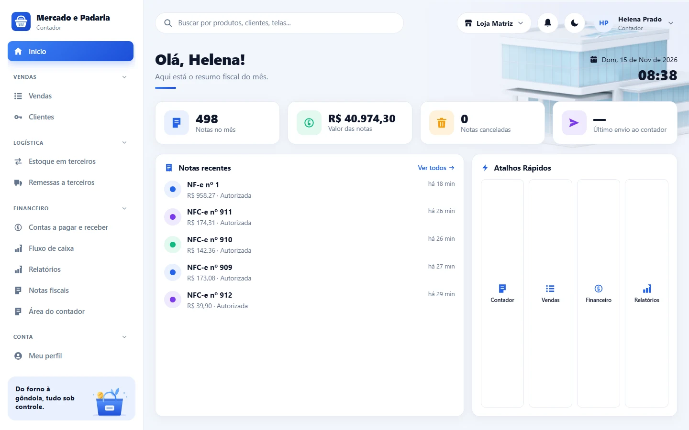

O contador vê as notas fiscais e os relatórios do mês. Ele baixa os XML do mês na área do contador, sem alterar lançamentos.

Passo a passo: abra **Área do contador**, escolha o mês e baixe o arquivo .zip com os XML.

## Dicas

- Use o perfil certo ao criar um usuário. Para o vendedor, o **Saldo de flex** define quanto ele pode dar de desconto acima do preço de tabela. Com o saldo zerado, ele não vende abaixo da tabela. Para o motorista, preencha a **CNH**.
- Antes de mudar uma permissão, confirme se a senha do gestor está gravada. Sem ela, as ações com senha ficam bloqueadas para a equipe.
- Faça uma cópia manual antes de qualquer mudança grande, em **Configurações > Backup**.
- Confira o **Log do sistema** quando alguém relatar uma falha. O filtro **Tipo** com **Falha de login** mostra as tentativas erradas.
- A atualização derruba o sistema por alguns minutos. Faça-a fora do horário de venda.

[← Voltar ao manual](README.md)
