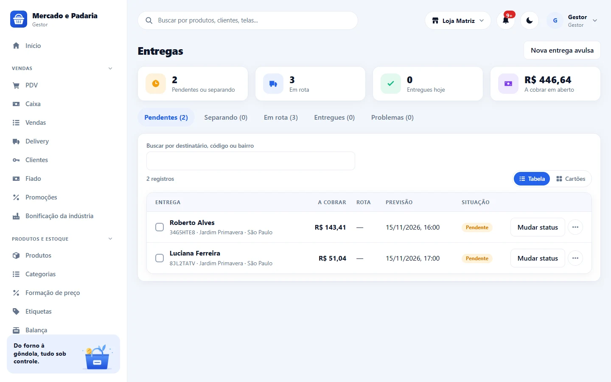
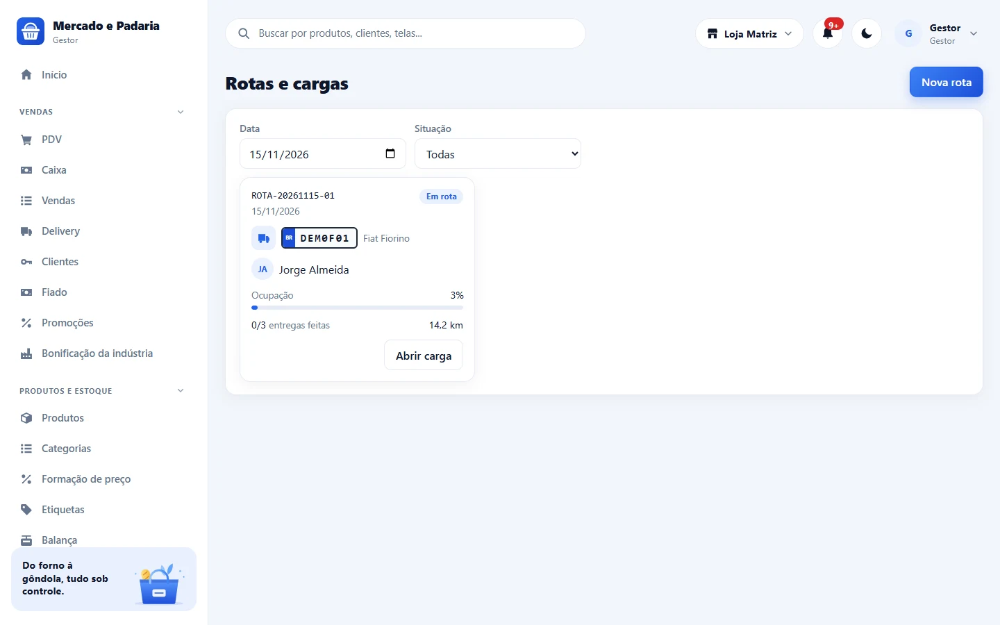
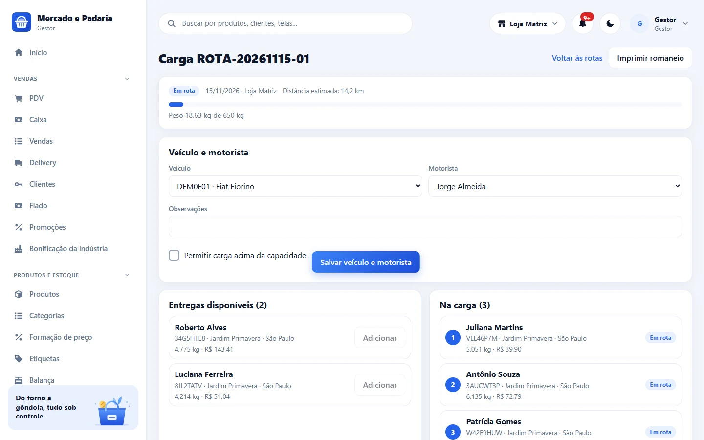
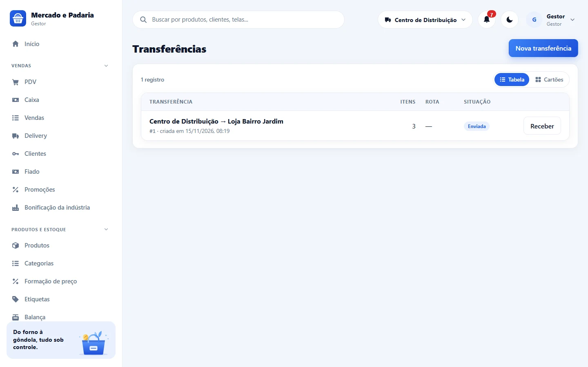
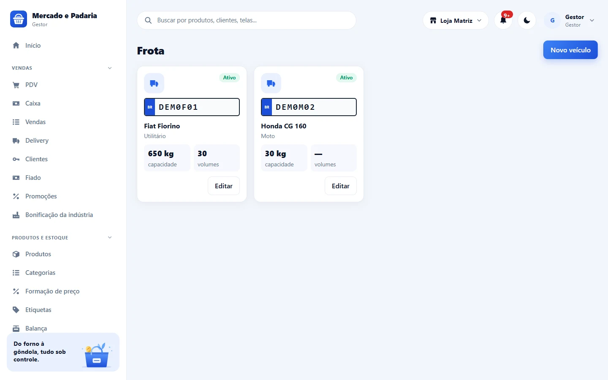
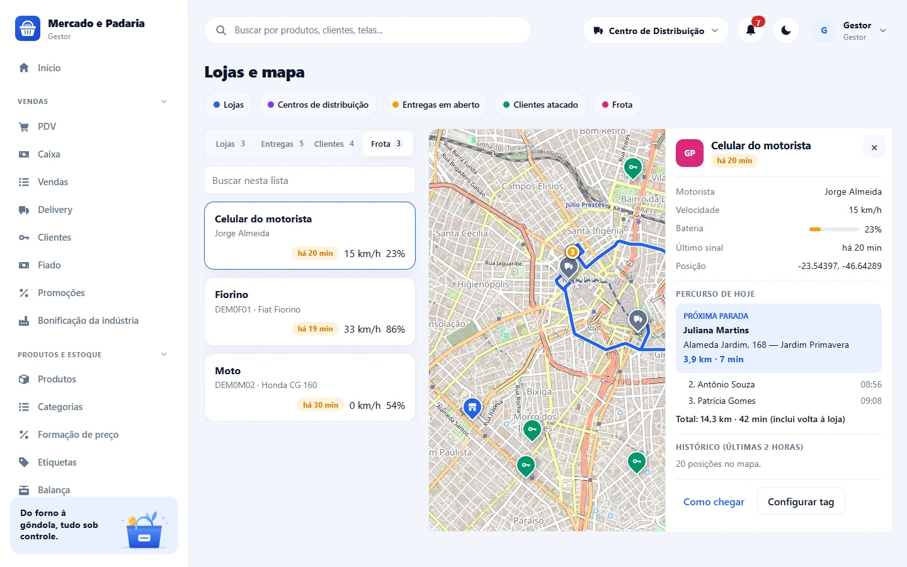
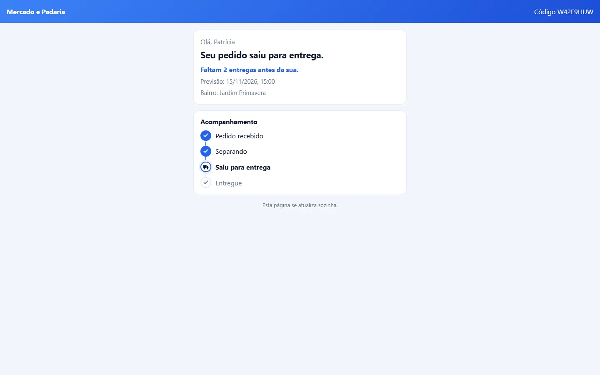
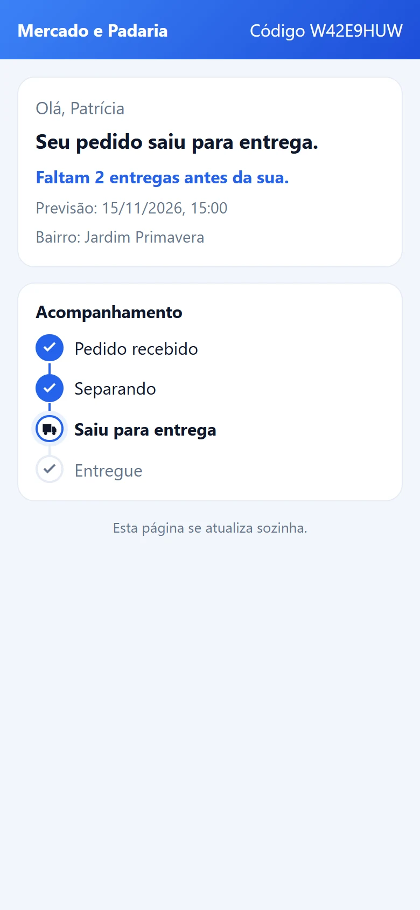
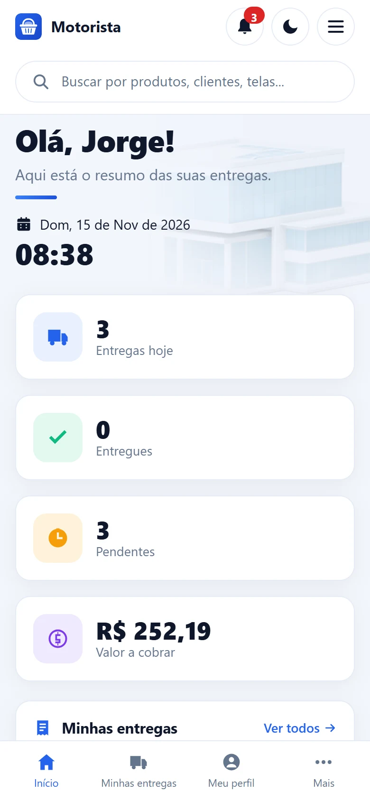
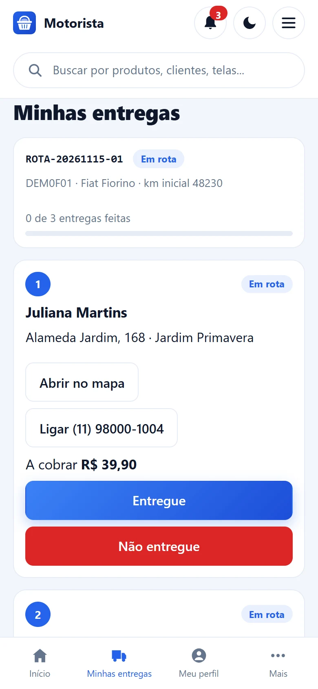

# Logística

**Para que serve.** Esta área organiza a entrega ao cliente e a movimentação de mercadoria entre lojas e o centro de distribuição. As entregas de delivery, marketplace, faturamento da força de vendas e pedidos B2B entram numa fila. O gestor ou o estoquista monta a carga de uma rota, escolhe o veículo e o motorista, roteiriza as paradas e imprime o romaneio. O motorista acompanha as paradas pelo celular, e o cliente acompanha a entrega pelo link de rastreio. As transferências levam mercadoria de uma loja para outra.

**Quem usa.**

- Gestor: todas as telas desta área, inclusive Frota e a mudança de status das entregas.
- Estoquista: Entregas (com montagem de carga), Rotas e cargas, Transferências e Lojas e mapa.
- Operador de caixa: Entregas, só para consulta.
- Comprador: Lojas e mapa, só para consulta.
- Motorista: Painel do motorista e Minhas entregas, no celular.
- Cliente: rastreio da entrega, pela página pública, sem login.

## Entregas

Lista de todas as entregas, separadas em abas pela situação: **Pendentes**, **Separando**, **Em rota**, **Entregues** e **Problemas**. A aba Problemas junta as entregas não entregues e as canceladas. Cada aba mostra a quantidade de entregas. Os cards no topo mostram as entregas pendentes ou em separação, as em rota, as entregues hoje e o valor a cobrar em aberto.

A busca filtra por destinatário, código ou bairro. Cada entrega tem um código de rastreio, usado no link que o cliente recebe.

**O que dá para fazer**

- Selecionar entregas na aba **Pendentes** e montar uma carga com elas, com o botão **Montar carga com selecionadas**. O sistema cria a rota do dia e abre a tela de carga.
- Criar uma entrega avulsa, sem venda ou pedido, com o botão **Nova entrega avulsa**.
- Mudar o status de uma entrega com o botão **Mudar status**. O gestor vê esse botão em entregas abertas.
- Copiar o link de rastreio pelo menu **Mais ações da entrega**.
- Ver os avisos de WhatsApp enviados ao cliente em cada mudança de status, pelo menu **Mais ações da entrega** e **Avisos do WhatsApp**.

Os status de uma entrega são: **Pendente**, **Separando**, **Em rota**, **Entregue**, **Não entregue** e **Cancelada**.

Na janela **Mudar status**, há três opções:

- **Saiu para entrega**: a entrega passa para Em rota.
- **Marcar como entregue**: pede o campo **Recebido por** (opcional).
- **Marcar como não entregue**: pede o **Motivo**, que é obrigatório.

Os avisos de WhatsApp aparecem com o selo **simulado** enquanto o WhatsApp não estiver configurado. Nesse caso, a mensagem é só registrada no sistema e não é enviada ao cliente.

**Criar uma entrega avulsa.** Preencha **Destinatário** e **Endereço**, que são obrigatórios. Os demais campos são opcionais: **Telefone**, **Bairro**, **Cidade**, **A cobrar (R$)**, **Taxa (R$)**, **Peso (kg)**, **Previsão** e **Observação**. O botão **Criar entrega** salva a entrega.

### Passo a passo: montar uma carga a partir das entregas

1. Abra **Entregas** e fique na aba **Pendentes**.
2. Marque as entregas que vão no mesmo veículo.
3. Clique em **Montar carga com selecionadas (N)**. O sistema cria a rota do dia e abre a tela de carga.
4. Continue na tela **Montar carga** (veja a seção a seguir).

## Rotas e cargas

Lista das rotas de uma data. Cada rota é uma carga que sai numa viagem, com um veículo e um motorista. O filtro **Data** escolhe o dia, e o filtro **Situação** separa as rotas por status: **Montando**, **Carregada**, **Em rota**, **Concluída** e **Cancelada**.

Cada card mostra o status, o veículo (ou **Sem veículo**), o motorista (ou **Sem motorista**), a **Ocupação** da carga e as entregas feitas. A ocupação é o peso da carga dividido pela capacidade do veículo, em quilos. Quando passa de 100%, o card aparece destacado.

**O que dá para fazer**

- Criar uma rota com o botão **Nova rota**. Informe a **Data da rota** (obrigatória), e, se quiser, o **Veículo**, o **Motorista** e as **Observações**.
- Abrir uma carga com o botão **Abrir carga**.
- Filtrar as rotas por data e por situação.

### Passo a passo: criar uma rota

1. Clique em **Nova rota**.
2. Informe a **Data da rota**.
3. Escolha o **Veículo** e o **Motorista**, se já souber.
4. Clique em **Criar rota**.
5. Clique em **Abrir carga** para adicionar as entregas (veja **Montar carga**).

## Montar carga

Tela de uma carga. Ela reúne o veículo e o motorista, as entregas da carga, a roteirização, a situação da rota e as transferências ligadas a ela. O título mostra o código da carga, e o botão **Imprimir romaneio** fica no topo.

A carga só pode ser editada enquanto estiver **Montando** ou **Carregada**. Depois que a rota sai, a tela fica somente para consulta.

**O que dá para fazer**

- Escolher o **Veículo** e o **Motorista** e salvar com **Salvar veículo**.
- Marcar **Permitir carga acima da capacidade** para aceitar uma carga maior que o veículo. Sem essa marca, o sistema não deixa passar.
- Adicionar entregas pendentes, que ainda não estão em outra rota, com o botão **Adicionar**.
- Remover uma entrega da carga pelo menu **Mais ações da parada**, com a opção **Remover da carga**. A entrega volta para a fila de pendentes.
- Roteirizar as paradas com o botão **Roteirizar**.
- Ver a distância estimada da rota, quando ela já foi roteirizada.
- Imprimir o romaneio.
- Mudar a situação da rota com os botões da seção **Situação da rota**.
- Cancelar a rota com **Cancelar rota**. As entregas voltam para a fila de pendentes.

**Roteirizar.** O botão **Roteirizar** ordena as paradas pelo vizinho mais próximo: a cada passo, vai para a parada mais perto de onde está, saindo da loja. Se a loja não tem coordenadas, a sequência começa na primeira entrega que tem coordenadas. Entregas sem coordenadas vão para o fim da lista, ordenadas por bairro e depois pelo nome do destinatário. A ordem definida aqui é a que aparece para o motorista e no romaneio.

**Romaneio.** O romaneio é a lista impressa da carga, na ordem das paradas. Traz o destinatário e o endereço, os itens de cada venda ou pedido, o peso, o valor a cobrar e uma coluna para a assinatura de quem recebe.

**Situação da rota.** Os botões mudam conforme a situação da rota:

| Situação atual | Botões |
|---|---|
| Montando | **Marcar carregada**, **Saiu para entrega** |
| Carregada | **Saiu para entrega**, **Concluir rota** |
| Em rota | **Concluir rota** |

Ao clicar em **Saiu para entrega**, o campo **Km na saída** é gravado com a rota. Ao clicar em **Concluir rota**, o campo **Km no retorno** é gravado. Os dois campos são opcionais.

A seção **Transferências nesta rota** aparece quando há transferências ligadas a esta carga. Cada uma mostra o status dela.

### Passo a passo: montar, roteirizar e sair com a carga

1. Abra a rota em **Rotas e cargas** e clique em **Abrir carga**.
2. Escolha o **Veículo** e o **Motorista** e clique em **Salvar veículo e motorista**.
3. Confira a ocupação. Se a carga passar de 100%, tire entregas ou marque **Permitir carga acima da capacidade**.
4. Clique em **Roteirizar** e confira a ordem das paradas no mapa do trajeto.
5. Clique em **Imprimir romaneio** e confira a lista.
6. Informe os **Km na saída** e clique em **Saiu para entrega**.
7. Ao final do dia, informe os **Km no retorno** e clique em **Concluir rota**.

## Transferências

Mercadoria que sai de uma loja e vai para outra, por exemplo do centro de distribuição para uma loja. A lista mostra cada transferência com a origem, o destino, a situação e a rota à qual ela foi ligada.

As situações são **Solicitada**, **Enviada**, **Recebida** e **Cancelada**. Enviar a transferência dá baixa no estoque da origem. Receber a transferência lança a mercadoria no estoque do destino.

**O que dá para fazer**

- Criar uma transferência com o botão **Nova transferência**. Escolha a **Loja de destino**, busque os produtos e informe a quantidade de cada um. O botão **Solicitar transferência** salva o pedido.
- Ver o saldo de cada produto na loja de origem, ao escolher os itens.
- Enviar uma transferência solicitada com o botão **Enviar**.
- Receber uma transferência enviada com o botão **Receber**. Na janela, informe quanto chegou de cada item, porque pode ser menos que o enviado.
- Cancelar uma transferência solicitada pelo menu **Mais ações da transferência**, com a opção **Cancelar transferência**. Uma transferência já enviada não pode ser cancelada.

### Passo a passo: transferir mercadoria entre lojas

1. Clique em **Nova transferência**.
2. Escolha a **Loja de destino**.
3. Busque cada produto e informe a quantidade.
4. Clique em **Solicitar transferência**.
5. Quando a mercadoria sair, clique em **Enviar** na linha da transferência.
6. Quando chegar, clique em **Receber**, informe a quantidade que chegou de cada item e confirme.

## Frota

Cadastro dos veículos usados nas entregas, com placa, modelo, tipo, capacidade e situação. Os tipos são **Moto**, **Carro**, **Van** e **Caminhão**. A capacidade é informada em quilos (**Capacidade (kg)**), e, se quiser, em volumes (**Capacidade (volumes)**). Os veículos ativos aparecem para escolha nas rotas.

Esta tela é só do gestor. Os rastreadores GPS não ficam aqui: cadastre-os em **Configurações**, na aba **Rastreadores GPS**. Lá, cada tag pode ser ligada a um veículo e a um motorista.

**O que dá para fazer**

- Cadastrar um veículo com o botão **Novo veículo**. Informe **Placa** e **Modelo** (obrigatórios), o **Tipo** e a **Capacidade (kg)**.
- Editar um veículo com o botão **Editar**.
- Marcar ou desmarcar **Veículo ativo**. Um veículo inativo não aparece para escolha nas rotas.

### Passo a passo: cadastrar um veículo

1. Clique em **Novo veículo**.
2. Preencha **Placa** e **Modelo**.
3. Escolha o **Tipo** e informe a **Capacidade (kg)**.
4. Informe a **Capacidade (volumes)**, se quiser.
5. Clique em **Salvar veículo**.

## Lojas e mapa

Mapa das lojas, dos centros de distribuição, das entregas em aberto, dos clientes de atacado e dos veículos com rastreador. A lista do lado esquerdo tem as abas **Lojas**, **Entregas**, **Clientes** e **Frota**, com a quantidade de itens de cada uma. Os botões de camadas do mapa mostram ou escondem cada tipo de ponto: **Lojas**, **Centros de distribuição**, **Entregas em aberto**, **Clientes atacado** e **Frota**.

Ao clicar em um item da lista ou do mapa, o painel de detalhes mostra as informações dele.

- **Loja**: endereço, horário, vendas de hoje e do mês, valor em estoque e pessoas da equipe. O botão **Editar loja** abre o cadastro de lojas.
- **Entrega**: destinatário, endereço, valor a cobrar, previsão e motorista. O botão **Abrir entregas** leva à lista de entregas.
- **Cliente de atacado**: telefone, endereço, limite de crédito e saldo devedor.
- **Veículo com rastreador**: velocidade, bateria, última posição e percurso de hoje. O percurso mostra a próxima parada e um traçado aproximado, feito sem um serviço de rotas. O histórico das últimas 2 horas aparece logo abaixo.

Itens sem coordenadas não aparecem no mapa, e a lista avisa isso. Se nenhum rastreador tem posição, a aba Frota mostra "Nenhum rastreador com posição". O botão **Configurar tag** leva à aba de rastreadores.

### Passo a passo: ver onde está um veículo

1. Abra **Lojas e mapa**.
2. Escolha a aba **Frota**.
3. Clique no veículo na lista ou no mapa.
4. Confira a velocidade, a última posição e o percurso de hoje no painel de detalhes.

## Rastreio da entrega

Página pública que o cliente abre pelo link de rastreio, sem login. Ela mostra só o primeiro nome do destinatário e o bairro, sem endereço completo nem telefone. A página se atualiza sozinha.

O cliente vê a etapa atual entre **Pedido recebido**, **Separando**, **Saiu para entrega** e **Entregue**. Quando a entrega está em rota, a página mostra quantas entregas faltam antes da dele, ou se ele é a próxima parada. Também mostra a previsão de entrega e a data da entrega, quando houver.

**O que dá para fazer**

- Acompanhar a entrega pelo link, sem criar conta.
- Ver a previsão e a posição na fila de entregas da rota.

Se a entrega foi entregue, a página mostra a data e a hora da entrega, com a última etapa marcada. Se a entrega não foi entregue ou foi cancelada, as etapas não aparecem, e a frase principal informa a situação.

### Passo a passo: acompanhar uma entrega

1. Abra o link de rastreio recebido.
2. Leia a frase principal, que diz em que etapa o pedido está.
3. Se a entrega saiu, veja quantas entregas faltam antes da sua.

## Painel do motorista

É a tela inicial do motorista, no celular. Traz um resumo do dia: as entregas de hoje, as já entregues, as pendentes e o valor a cobrar. Logo abaixo, mostra as entregas mais recentes, com destinatário, endereço e valor.

**O que dá para fazer**

- Ver o resumo do dia.
- Abrir **Minhas entregas** pelo menu para ver a rota e as paradas.

### Passo a passo: conferir o dia

1. Entre com o usuário de motorista.
2. Confira os cartões de entregas de hoje, entregues, pendentes e valor a cobrar.
3. Toque em **Minhas entregas** para começar as paradas.

## Minhas entregas

A rota do dia do motorista, com as paradas em ordem. O topo mostra o código da rota, a situação e o progresso, por exemplo "2 de 8 entregas feitas". Quando a rota ainda não saiu, o botão **Iniciar rota** aparece.

Cada parada tem um cartão com o número na ordem, o destinatário, a situação, o endereço e o valor a cobrar. Os botões de cada parada são:

- **Abrir no mapa**: abre o endereço no aplicativo de mapas do celular. Se a entrega tem coordenadas, usa elas.
- **Ligar**: liga para o telefone do destinatário.
- **Entregue**: abre a janela para confirmar a entrega. Há o campo **Recebido por**, para informar quem recebeu.
- **Não entregue**: abre a janela para informar o **Motivo**, que é obrigatório.

Quando a rota é concluída, a tela mostra "Rota concluída. Bom trabalho!". Se o motorista não tem rota para o dia, a tela mostra "Você não tem rota para hoje."

**O que dá para fazer**

- Iniciar a rota informando o **Km inicial do veículo**, pelo botão **Iniciar rota**.
- Abrir o endereço de cada parada no mapa.
- Ligar para o destinatário.
- Marcar cada entrega como **Entregue** ou **Não entregue**.

### Passo a passo: fazer a rota do dia

1. Toque em **Iniciar rota** e informe o **Km inicial do veículo**.
2. Toque em **Abrir no mapa** na primeira parada e siga até o endereço.
3. Ao entregar, toque em **Entregue**, informe quem recebeu e confirme.
4. Se não for possível entregar, toque em **Não entregue**, informe o motivo e confirme.
5. Repita para as próximas paradas, na ordem da lista.

## Dicas

- Confira os endereços antes de roteirizar. Entregas sem coordenadas vão para o fim da rota, em ordem de bairro, e isso pode fazer o trajeto ficar longo.
- Confira a ocupação da carga antes de sair. Passar de 100% deixa o card destacado, e a carga só passa com **Permitir carga acima da capacidade** marcado.
- Informe os km na saída e no retorno. Eles ficam gravados na rota.
- Avisos de WhatsApp com o selo **simulado** não chegam ao cliente. Configure o WhatsApp antes de depender do aviso.
- Cadastre o rastreador do veículo em Configurações, na aba **Rastreadores GPS**. Sem isso, a aba Frota de **Lojas e mapa** não mostra a posição do veículo.

[← Voltar ao manual](README.md)
