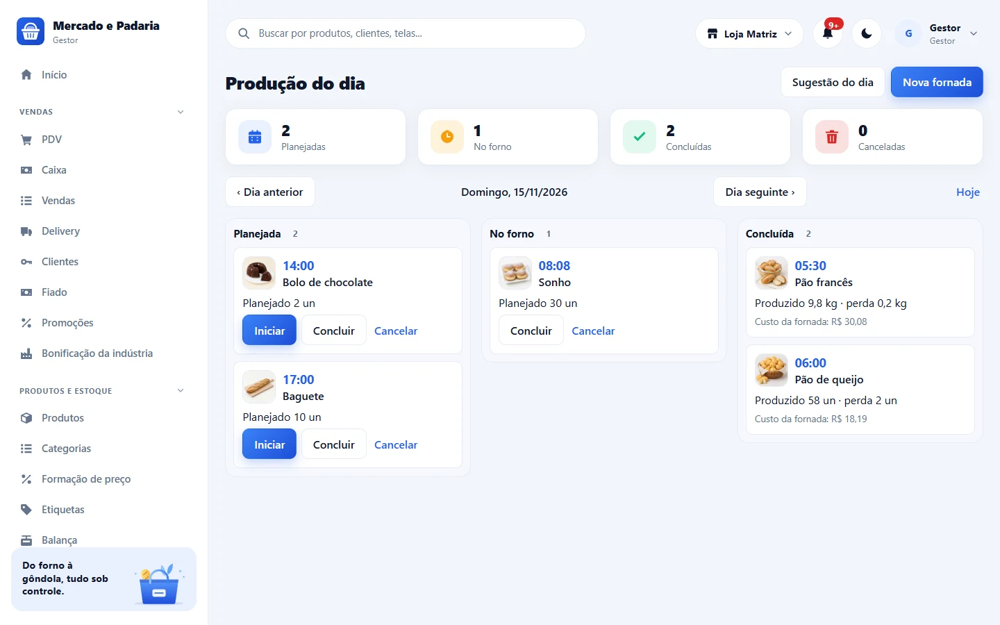
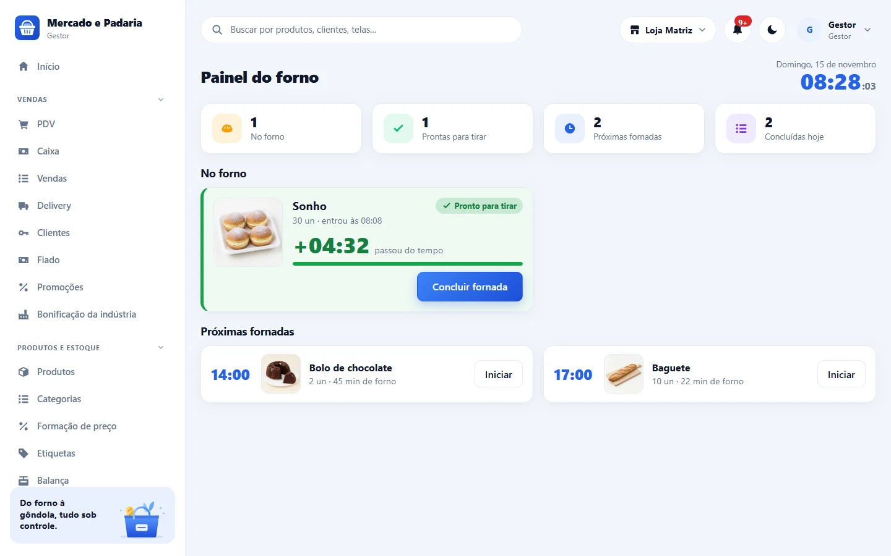
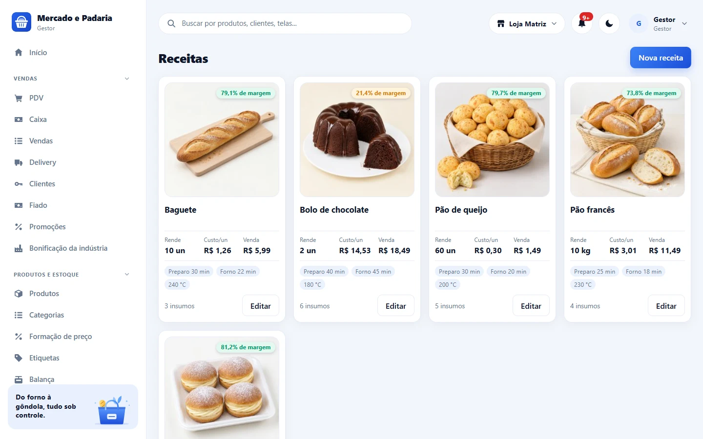

# Padaria

**Para que serve**

A padaria planeja as fornadas do dia, acompanha o que está no forno e mantém as receitas com o custo de cada unidade. Uma fornada concluída dá baixa nos insumos, dá entrada no produto acabado e atualiza o custo do produto. A sugestão de produção usa o histórico de vendas.

**Quem usa**

- Padeiro: planeja e conclui fornadas, usa o painel do forno e cadastra receitas.
- Gestor: faz tudo nesta área.
- Estoquista: consulta as receitas, sem editar.

## Produção do dia

Esta tela mostra as fornadas de um dia, com os cartões **Planejadas**, **No forno**, **Concluídas** e **Canceladas**.

O que dá para fazer:

- Trocar de dia pelos botões ao lado da data, ou voltar a hoje com **Hoje**.
- Planejar uma fornada com **Nova fornada**. Escolha a **Receita**, informe a **Quantidade planejada** e o **Horário da fornada**, e, se quiser, uma **Observação (opcional)**.
- Gerar fornadas pela **Sugestão do dia**. Veja a seção abaixo.
- Iniciar uma fornada planejada com **Iniciar**, concluí-la com **Concluir** ou cancelá-la com **Cancelar**.
- Ver o aviso **Falta insumo**, com a quantidade que a fornada precisa e a que o estoque tem.

A sugestão vale para o dia aberto na tela. Ela usa a média das vendas do mesmo dia da semana nas últimas quatro semanas. Subtrai o estoque atual e arredonda para cima no múltiplo do rendimento da receita. Na tabela, marque **Incluir** nas linhas que quer produzir e clique em **Criar ordens**. Cada linha marcada vira uma fornada às 06:00 do dia.

Para concluir uma fornada, informe o que saiu bom em **Produzido, em boas condições** e a **Perda: queimou, quebrou, caiu**, e clique em **Concluir fornada**. Os insumos saem do estoque pelo total (produzido mais perda). O produto entra no estoque só com o que saiu bom. Se o produto controla lote ou tem validade, a conclusão cria o lote, com o código F seguido do número da fornada. Sem validade cadastrada, a validade padrão é de 1 dia.

Exemplo da conta da sugestão, com números fictícios: a média vendida é 30 unidades, o estoque é 8 e o rendimento da receita é 12. A falta é 22. Como 22 dividido por 12 dá 1,83, são 2 fornadas, e o sugerido é 24 unidades.

Regras das fornadas:

- **Iniciar** vale só para fornada planejada.
- **Concluir** e **Cancelar** valem para fornada planejada ou em produção. Uma fornada concluída ou cancelada não muda mais.
- Ao cancelar, o sistema pede confirmação. Cancelar não mexe nos insumos, porque eles só saem na conclusão.

Passo a passo para planejar a produção do dia:

1. Abra **Produção do dia** e confira o dia.
2. Clique em **Sugestão do dia**, marque as linhas que vai produzir e clique em **Criar ordens**.
3. Para uma fornada fora da sugestão, clique em **Nova fornada**, escolha a receita e informe a quantidade.
4. Clique em **Planejar fornada**.
5. Na hora de assar, clique em **Iniciar** na fornada.

## Painel do forno

Painel grande para a cozinha. Mostra o que está assando agora e o que sai em seguida. Os cartões são **No forno**, **Prontas para tirar**, **Próximas fornadas** e **Concluídas hoje**.

O que dá para fazer:

- Acompanhar o tempo de cada fornada no forno. Mostra quanto falta, ou **passou do tempo** quando já deveria ter saído.
- Ver cada próxima fornada com a quantidade planejada e o tempo de forno. Sem fornadas no dia, a lista mostra **Nenhuma fornada planejada para hoje.**
- Iniciar uma fornada da lista **Próximas fornadas** com **Iniciar**.
- Concluir uma fornada com **Concluir fornada**, informando o que saiu bom e a perda.
- Ver **Sem tempo de forno na receita** nas fornadas cujas receitas não têm tempo de forno cadastrado.

A conclusão no painel usa a mesma janela da tela **Produção do dia**. As regras são as mesmas, e o painel só muda a forma de acompanhar o forno.

Passo a passo:

1. Na lista **Próximas fornadas**, clique em **Iniciar** quando for hora de assar.
2. Acompanhe o tempo restante no cartão.
3. Quando passar do tempo, clique em **Concluir fornada**.
4. Informe o que saiu bom e a perda, e clique em **Concluir fornada** para confirmar.

## Receitas

Receitas são as fichas técnicas dos produtos feitos na padaria. Cada uma traz os insumos, as quantidades, o rendimento, os tempos e o modo de preparo.

A receita é a base de duas contas: o custo por unidade e a sugestão de fornadas. Por isso, mantenha as quantidades e o rendimento sempre atualizados.

Cada cartão mostra o que a receita **Rende**, o **Custo/un**, o preço de **Venda** e o selo de margem. Também mostra o tempo de preparo, o tempo de forno e a temperatura.

A ficha da receita pede estes campos:

- **Produto acabado**: escolhido ao criar. Depois de criada, a receita não troca de produto.
- **Rendimento**: quantas unidades (ou quilos) a receita faz.
- **Tempo de preparo (min)**, **Tempo de forno (min)** e **Temperatura do forno (°C)**. O painel do forno usa esse tempo na contagem regressiva.
- **Modo de preparo**: o texto de como fazer.
- **Insumos**: cada insumo com a **Quantidade** na unidade dele. O insumo precisa estar ativo no cadastro.

O que dá para fazer:

- Criar uma receita com **Nova receita**.
- Editar uma receita abrindo o cartão. Na edição, o produto acabado não muda, mas insumos, quantidades, rendimento, tempos e modo de preparo podem mudar.
- Excluir a receita com **Excluir**, se ela não tiver fornadas. Uma receita com fornadas não pode ser excluída.

Regras:

- Cada produto tem uma receita só.
- Um insumo não pode aparecer duas vezes na mesma receita, e o produto não pode ser insumo de si mesmo.
- **Custo unitário** é a soma de quantidade vezes custo de cada insumo, dividida pelo rendimento.
- **Margem** é o preço de venda menos o custo unitário, dividido pelo preço de venda. Sem preço de venda, a tela mostra **sem preço de venda**.
- O preço de venda vem da ficha do produto, na aba **Preços**.
- Ao concluir uma fornada, o custo unitário atualiza o custo do produto acabado.

Exemplo do custo, com números fictícios: dois insumos somam R$ 12,00 de custo na receita, e o rendimento é 10 unidades. O custo unitário é R$ 1,20. Com preço de venda de R$ 3,00, a margem é 60%.

Passo a passo para criar uma receita:

1. Clique em **Nova receita**.
2. Escolha o **Produto acabado**. Se precisar, busque outro produto ativo.
3. Informe o **Rendimento**, que é a quantidade de unidades que a receita faz.
4. Em **Insumos**, busque cada insumo em **Buscar insumo para adicionar** e informe a **Quantidade**.
5. Confira o **Custo unitário** e a **Margem**. Depois, clique em **Salvar receita**.

## Dicas

- Marque os insumos como **Insumo** na ficha do produto. A busca de insumos mostra só esses produtos.
- Confira o rendimento antes de salvar. O custo unitário e a sugestão de fornadas dependem dele.
- Use a **Sugestão do dia** como ponto de partida e ajuste pelo que você sabe do movimento da loja.
- Informe sempre a perda ao concluir. Ela fica registrada e ajuda a medir o desperdício.
- O aviso de falta de insumo não baixa nada. O consumo dos insumos só acontece quando a fornada é concluída.

[← Voltar ao manual](README.md)
