# Produtos e estoque

**Para que serve**

Aqui ficam o cadastro de produtos, os preços, as etiquetas e a balança. Também ficam o saldo e os movimentos do estoque, a validade e as perdas, o inventário e a mercadoria que está com terceiros. O saldo é separado por loja.

**Quem usa**

- Gestor: faz tudo nesta área.
- Estoquista: edita produtos e etiquetas, usa a balança e lança estoque, validade, inventário e terceiros.
- Comprador: edita produtos, categorias, formação de preço e etiquetas. Consulta estoque e terceiros.
- Padeiro: consulta o estoque.
- Operador: consulta a lista de produtos, sem editar.
- Contador: consulta os terceiros.

## Produtos

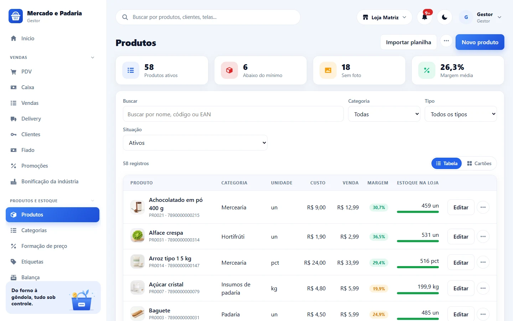

O que dá para fazer:

- Buscar por nome, código ou EAN e filtrar por categoria, tipo e situação.
- Ver os indicadores do topo: produtos ativos, abaixo do mínimo, sem foto e margem média.
- Criar um produto com **Novo produto** e editar a ficha com o botão **Editar**.
- Ver o histórico de preços e os fornecedores na aba **Histórico** da ficha.
- Ativar ou desativar um produto pelo menu **Mais ações** da linha.
- Importar e exportar a lista por planilha (veja a seção abaixo).
- Higienizar dados fiscais, ação só do gestor, no menu do topo.

A ficha do produto tem cinco abas. **Geral**: código, EAN, nome, marca, categoria, unidade, descrição, foto, **Vendido no peso (balança)**, **Ativo** e PLU. **Preços**: custo, preço de venda, margem, markup e atacado. **Estoque**: estoque mínimo e máximo, validade em dias e **Controla lote e validade**. **Padaria**: **Insumo** (não aparece no PDV) e **Produção própria**. **Fiscal**: NCM, CEST, CFOP e CSOSN.

Passo a passo para cadastrar um produto:

1. Clique em **Novo produto**.
2. Na aba **Geral**, preencha o **Nome** e, se houver, o código de barras, a categoria e a unidade.
3. Na aba **Preços**, informe o **Custo** e o **Preço de venda**. Confira a margem ou clique em **Usar sugerido**.
4. Na aba **Estoque**, informe o **Estoque mínimo** e, se o produto vence, a **Validade (dias)**.
5. Clique em **Salvar**.

### Importar e exportar por planilha

**Importar planilha** aceita arquivo .xlsx ou .csv de até 10 MB. Arquivo .xls antigo não é aceito. No menu **Mais ações** do topo, use **Exportar planilha (Excel)** ou **Baixar modelo de planilha**. A exportação segue a situação filtrada na tela. O modelo tem a aba **Produtos**, com três exemplos, e a aba **Instruções**. Estas são as colunas:

| Coluna | O que preencher |
|---|---|
| Código | Até 30 caracteres. Código existente atualiza o produto. Vazio gera o próximo código de 6 dígitos. |
| EAN | Só números, com EAN válido (8, 12, 13 ou 14 dígitos). |
| Nome* | Obrigatória para produto novo. De 1 a 120 caracteres. |
| Categoria | Nome da categoria. Se não existir, é criada. |
| Marca | Até 60 caracteres. |
| Unidade | UN, KG, G, L, ML, CX, PCT ou DZ. Vazio = UN. |
| Pesável | Sim ou Não. |
| PLU balança | Inteiro de 1 a 99999. Em pesável, vazio usa o próximo PLU livre. |
| Preço de custo | Número igual ou maior que zero. |
| Preço de venda | Número igual ou maior que zero. |
| Preço atacado | Número igual ou maior que zero. |
| Qtd. atacado | Quantidade a partir da qual vale o preço de atacado. |
| Estoque mínimo | Número igual ou maior que zero. |
| Estoque máximo | Número igual ou maior que zero. |
| Validade (dias) | Inteiro de 0 a 999. |
| NCM | 8 dígitos. |
| CEST | 7 dígitos. |
| CFOP | 4 dígitos. |
| CSOSN | 3 ou 4 dígitos. |
| Produção própria | Sim ou Não. |
| Insumo | Sim ou Não. Insumo não aparece no PDV. |
| Controla lote | Sim ou Não. |
| Ativo | Sim ou Não. Vazio = Sim na criação. |
| Descrição | Até 500 caracteres. |

Regras da importação:

- Código existente atualiza o produto. Sem código, a linha cria um produto novo. Se o código não existir, o sistema procura pelo EAN.
- Célula vazia não apaga o valor atual. Em produto novo, a célula vazia recebe o padrão do cadastro.
- Mudança de preço de venda ou de custo gera histórico de preço e pede a senha do gestor para gravar.
- A planilha não altera o estoque. A coluna **Estoque na loja** aparece só na exportação. A planilha aceita até 5.000 linhas de dados.

Passo a passo para importar:

1. Em **Produtos**, clique em **Importar planilha**.
2. Clique em **Baixar modelo**, ou em **Exportar produtos** para partir da lista atual.
3. Preencha a aba **Produtos** e escolha o arquivo, ou solte-o na janela.
4. Confira o resumo: **Novos**, **Atualizados**, **Sem mudança** e **Com erro**. Nada é gravado até aqui.
5. Clique em **Importar N produtos**. As linhas com erro são ignoradas.

## Categorias

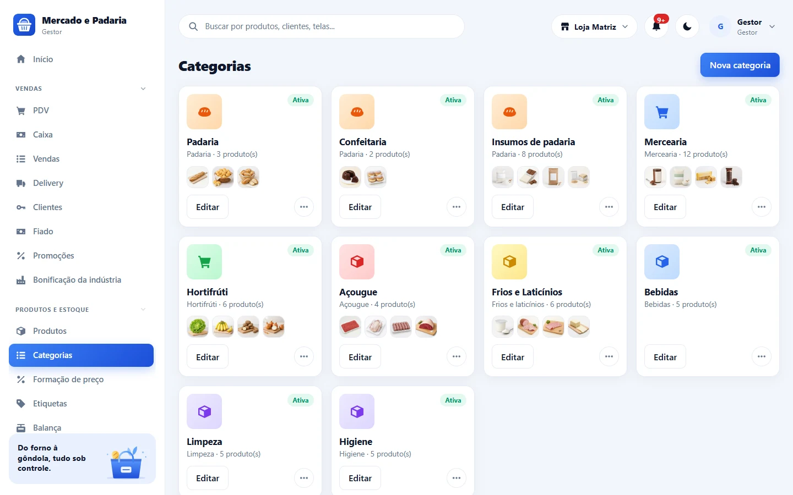

O que dá para fazer:

- Criar uma categoria com **Nova categoria**, informando o **Nome**, o **Setor** (vazio = Sem setor) e a **Ordem na lista**.
- Deixar a categoria ativa ou inativa com a opção **Categoria ativa**.
- Mudar a ordem com **Subir** e **Descer**, no menu de ações da categoria.

Passo a passo:

1. Clique em **Nova categoria**.
2. Preencha o **Nome** e, se quiser, o **Setor**.
3. Defina a **Ordem na lista**.
4. Clique em **Salvar**.

## Formação de preço

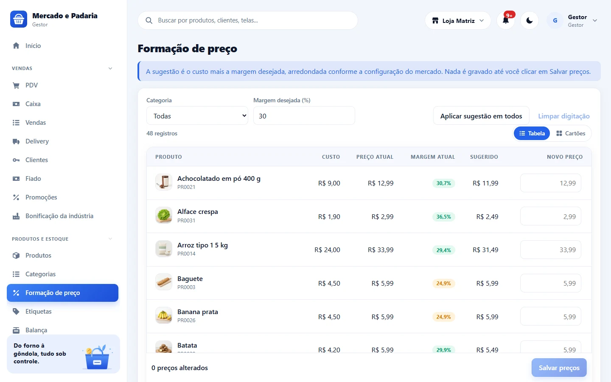

O que dá para fazer:

- Filtrar por **Categoria** (ou **Todas**) e informar a **Margem desejada (%)**.
- Ver o preço sugerido para cada produto ativo e ajustar um a um.
- Aplicar a sugestão a todos com **Aplicar sugestão em todos**.
- Gravar com **Salvar preços**. O sistema pede a senha do gestor.

Passo a passo:

1. Escolha a **Categoria**.
2. Digite a **Margem desejada (%)**.
3. Clique em **Aplicar sugestão em todos** e confira os valores.
4. Clique em **Salvar preços** e informe a senha do gestor.

## Etiquetas

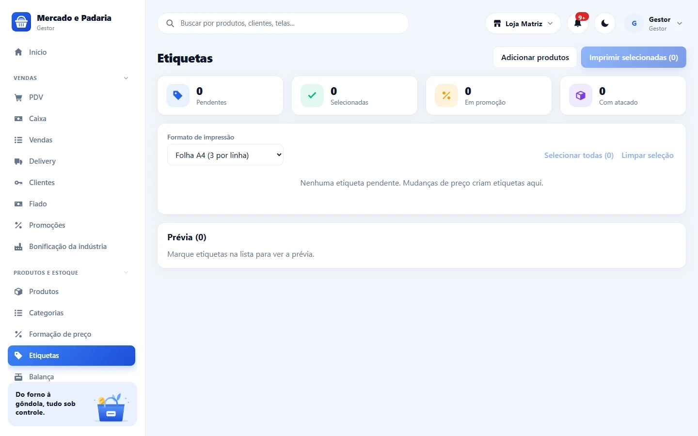

Cada mudança de preço cria uma etiqueta pendente. Esta tela junta essas etiquetas para impressão. Os cartões do topo mostram as etiquetas **Pendentes**, **Selecionadas**, **Em promoção** e **Com atacado**.

O que dá para fazer:

- Adicionar outros produtos com **Adicionar produtos**.
- Marcar ou desmarcar com **Selecionar todas** e **Limpar seleção**.
- Escolher o formato: **Folha A4 (3 por linha)**, **Impressora térmica de etiquetas (rolo)** ou **Zebra ZPL pela rede**.
- Imprimir pelo navegador com **Imprimir selecionadas**. Na Zebra, enviar direto com **Enviar N para a Zebra**, ou gerar o arquivo com **Baixar .zpl**. O envio direto precisa do IP da Zebra em **Configurações > Mercado**.

Passo a passo:

1. Veja as etiquetas pendentes na lista.
2. Marque as etiquetas que vai imprimir.
3. Escolha o formato de impressão.
4. Clique em **Imprimir selecionadas**, ou em **Enviar N para a Zebra**.

## Balança

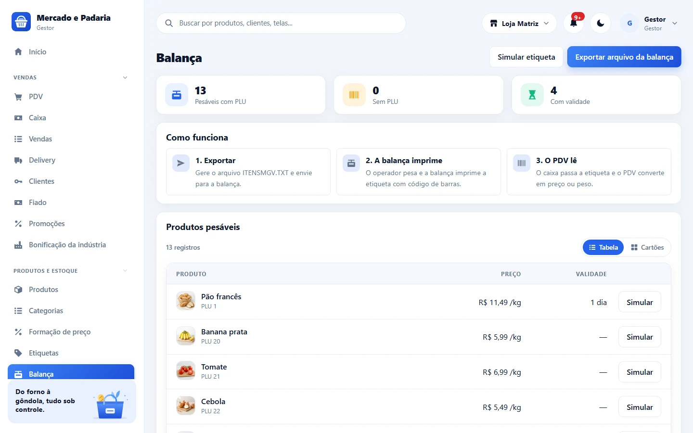

A balança usa o PLU de cada produto pesável. O arquivo **ITENSMGV.TXT** leva esses produtos para a balança. Depois, o caixa passa a etiqueta e o PDV converte o código em preço ou peso.

O que dá para fazer:

- Ver os produtos pesáveis com PLU, os que estão sem PLU e os que têm validade.
- Gerar o arquivo com **Exportar arquivo da balança**.
- Testar uma etiqueta com **Simular**: escolha o **Produto** e o **Peso (kg)** e veja o código gerado.

Passo a passo:

1. Na ficha do produto, marque **Vendido no peso (balança)** e confira o PLU.
2. Abra **Balança** e clique em **Exportar arquivo da balança**.
3. Envie o arquivo ITENSMGV.TXT para a balança.

## Estoque

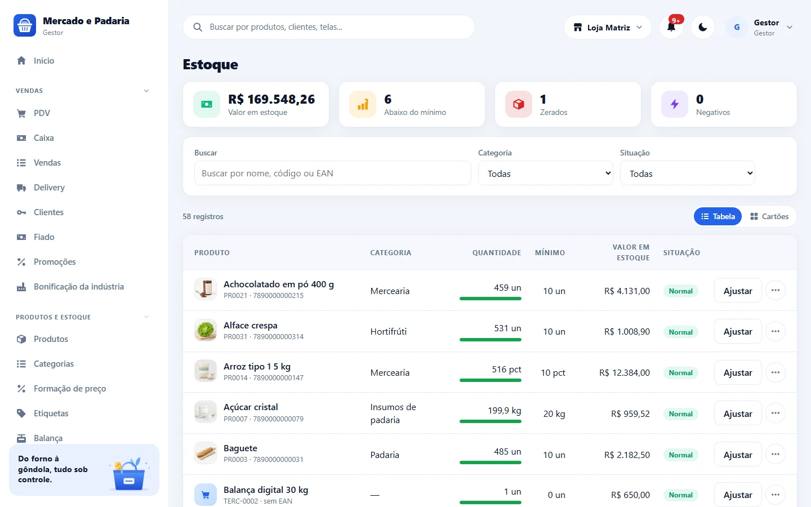

Os cartões do topo mostram o valor em estoque, os produtos abaixo do mínimo, os zerados e os negativos.

O que dá para fazer:

- Buscar por nome, código ou EAN e filtrar por **Categoria** e **Situação** (Abaixo do mínimo, Zerado, Negativo ou Normal).
- Ajustar o saldo com **Ajustar saldo**: informe o **Saldo contado** e o **Motivo**. Gravar pede a senha do gestor.
- Pelo menu **Mais ações** da linha, usar **Lançar perda**, **Ver movimentos** e **Cadastrar lote**.
- Lançar perda com a quantidade, o motivo (Vencido, Avaria, Quebra, Furto, Consumo interno ou Outro) e uma observação. A perda também pede a senha do gestor.

Passo a passo para ajustar o saldo:

1. Busque o produto.
2. Clique em **Ajustar saldo** na linha.
3. Digite o **Saldo contado** na unidade do produto.
4. Preencha o **Motivo**.
5. Clique em **Salvar ajuste** e informe a senha do gestor.

## Movimentações

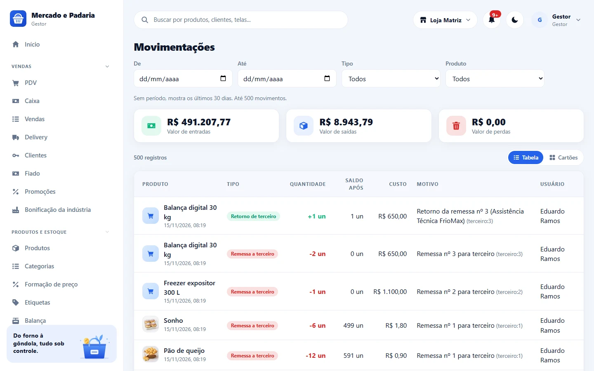

Esta tela lista cada entrada, saída, ajuste e perda, com o saldo depois de cada movimento.

O que dá para fazer:

- Filtrar por período (**De** e **Até**), **Tipo** e **Produto**. Sem período, mostra os últimos 30 dias, com até 500 movimentos.
- Ver as colunas Produto, Tipo, Quantidade, Saldo após, Custo, Motivo e Usuário.
- Ver os cartões de valor de entradas, de saídas e de perdas.

Passo a passo:

1. Escolha o período em **De** e **Até**.
2. Em **Tipo**, escolha, por exemplo, **Perda**.
3. Em **Produto**, escolha o item, se precisar.
4. Confira a quantidade e o motivo de cada linha.

## Validade e perdas

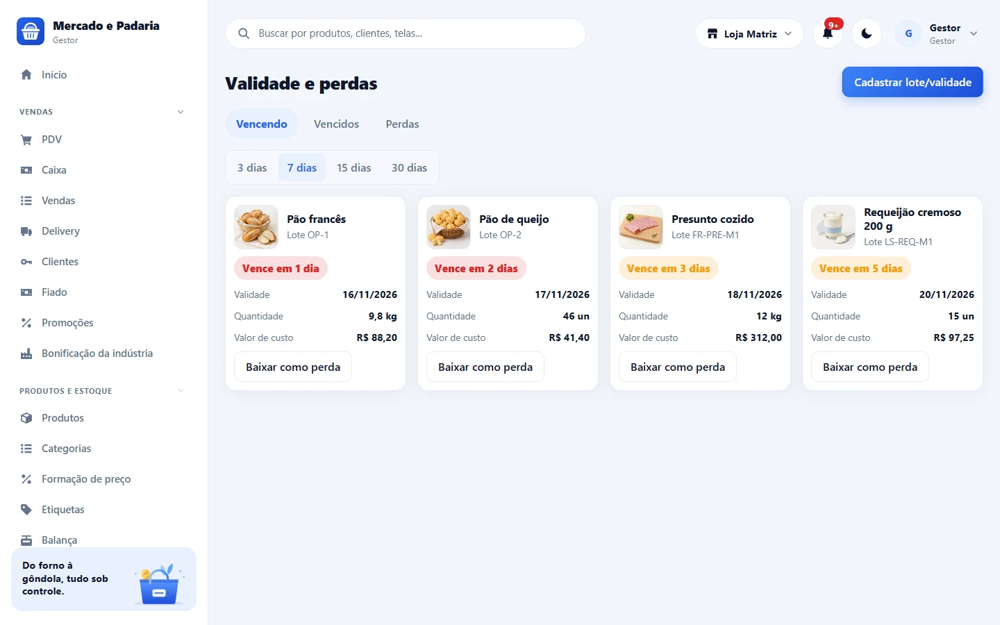

Esta tela controla os lotes por data de validade. O sistema dá saída primeiro no lote que vence antes.

O que dá para fazer:

- Ver os cartões **Vencendo**, **Vencidos** e **Perdas**, e os lotes com validade, quantidade e valor de custo.
- Cadastrar um lote com **Cadastrar lote/validade**. O cadastro não muda o saldo.
- Dar baixa em um lote com **Baixar como perda**. O motivo padrão é Vencido, e a baixa pede a senha do gestor.
- Ver as perdas do período, filtrando por **De** e **Até**.

Passo a passo para dar baixa em um lote vencido:

1. Localize o lote na lista de vencidos.
2. Clique em **Baixar como perda** na linha do lote.
3. Confirme o motivo.
4. Informe a senha do gestor e confirme.

## Inventário

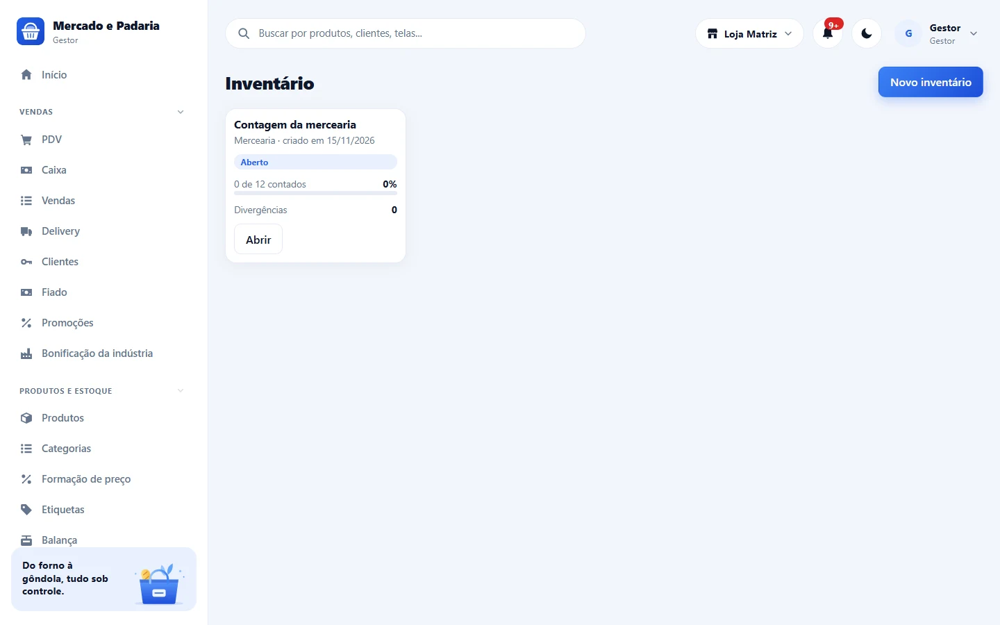

Um inventário compara a contagem física com o saldo do sistema.

O que dá para fazer:

- Criar com **Novo inventário**: informe a descrição e a categoria. Sem categoria, o inventário é da **Loja inteira**. Cada produto entra com o saldo atual como quantidade esperada.
- Abrir um inventário com **Abrir** para ver o andamento e as divergências.
- Contar pelo celular com **Contar pelo celular**. A tela de detalhe só mostra as contagens.
- Finalizar com **Finalizar**. Cada diferença vira um movimento de inventário. Produto sem contagem não muda, e um inventário finalizado não pode ser alterado.
- Cancelar com **Cancelar inventário**. Nenhum ajuste é feito.

Passo a passo:

1. Clique em **Novo inventário** e preencha a descrição e a categoria.
2. Clique em **Contar pelo celular** e conte os produtos (veja a seção abaixo).
3. Volte ao inventário e confira as divergências.
4. Clique em **Finalizar** e confirme.

## Contagem de inventário

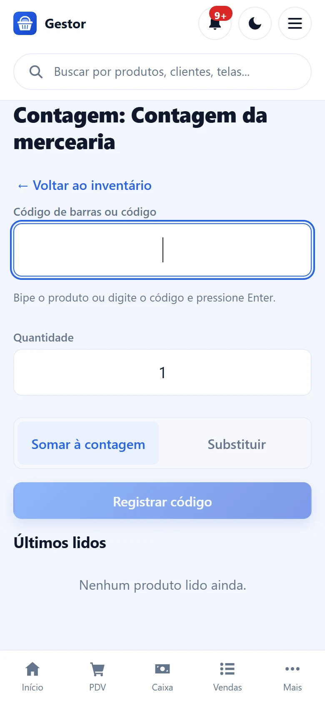

Tela para o celular. O estoquista conta os produtos lendo o código de barras.

O que dá para fazer:

- Bipar o código ou digitá-lo e pressionar Enter.
- Ler o código com a câmera, pelo botão **Ler com a câmera**, se o aparelho tiver câmera.
- Informar a **Quantidade** e escolher **Somar à contagem** ou **Substituir**.
- Ver os produtos em **Últimos lidos** e voltar ao inventário com **← Voltar ao inventário**.

Passo a passo:

1. Abra o inventário e toque em **Contar pelo celular**.
2. Bipe ou digite o código do produto.
3. Digite a quantidade e escolha o modo.
4. Toque em **Registrar código**.

## Estoque em terceiros

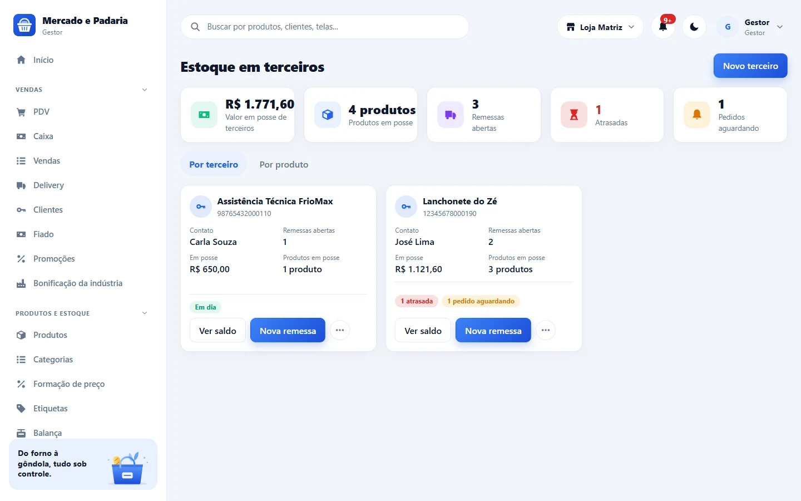

Esta tela mostra a mercadoria que está com outra empresa, por consignação, comodato, conserto, demonstração, armazém, evento ou outro tipo. Esse saldo fica separado do estoque próprio. Os cartões do topo mostram o valor em posse de terceiros, os produtos em posse, as remessas abertas, as atrasadas e os pedidos aguardando.

O que dá para fazer:

- Cadastrar um terceiro com **Novo terceiro**: nome, CPF ou CNPJ, pessoa de contato, telefone, e-mail, cidade e UF.
- Ver o saldo **Por terceiro** ou **Por produto** e filtrar por terceiro.
- Pelo menu da linha, usar **Editar cadastro**, **Link do portal** e **Ver remessas**.

O link do portal dá ao terceiro uma página, sem login, para ver o que está com ele e pedir remessas. Os pedidos chegam para aprovação em **Pedidos do portal**. Em **Criar link do portal**, você gera o link. Depois, pode copiar, abrir ou usar **Enviar por WhatsApp**, que abre o WhatsApp com o link pronto e exige telefone cadastrado. **Gerar novo link** faz o link antigo parar de funcionar. **Desligar portal** desliga o link atual, e para usar o portal de novo é preciso criar um link novo.

Passo a passo para enviar o link:

1. No terceiro, abra o menu da linha e clique em **Link do portal**.
2. Clique em **Criar link do portal**.
3. Clique em **Enviar por WhatsApp**, ou copie o link.
4. Aprove os pedidos que chegarem em **Pedidos do portal**.

## Portal de remessas (página do terceiro)

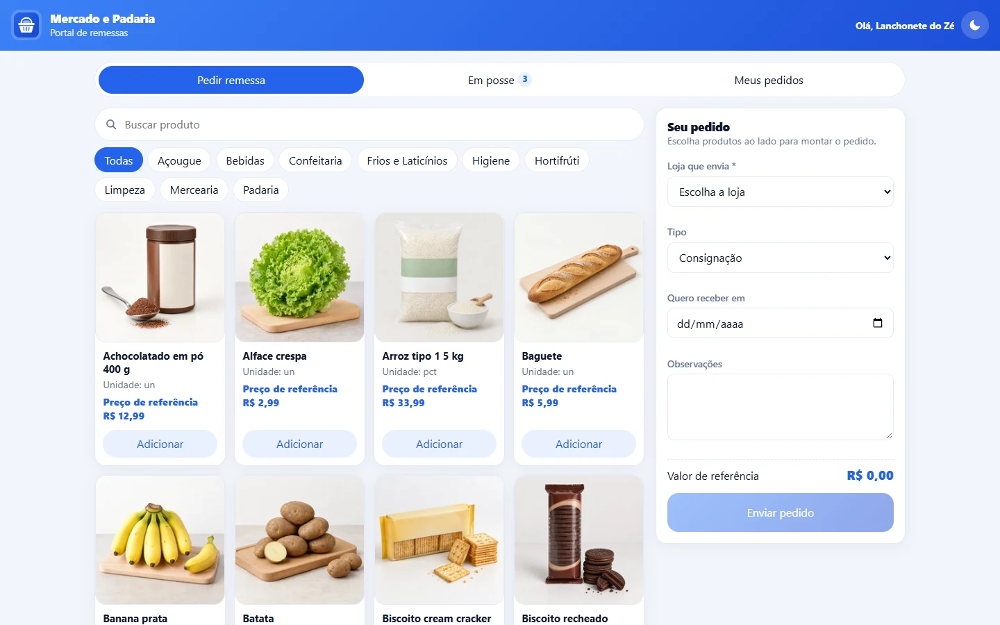

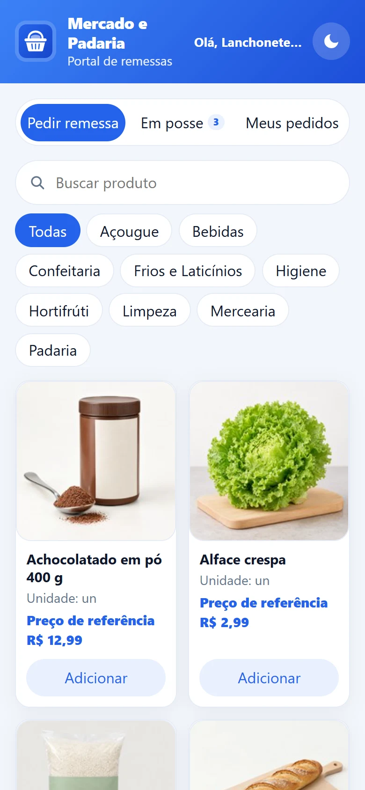

Esta é a página que o terceiro abre pelo link do portal. Ela não tem login. Mostra o que está com o terceiro e permite pedir remessas. Os pedidos chegam para aprovação em **Pedidos do portal**.

O terceiro vê três abas:

- **Pedir remessa**: o catálogo de produtos ativos. O preço de venda aparece como **Valor de referência** do pedido. Custo e estoque da loja não aparecem.
- **Em posse**: os produtos e as quantidades que estão com ele, somados de todas as lojas.
- **Meus pedidos**: o status de cada pedido (Pendente, Aprovado, Recusado ou Cancelado) e o motivo da recusa, quando houver.

Passo a passo para pedir uma remessa:

1. Busque o produto em **Buscar produto** e clique em **Adicionar**, informando a quantidade.
2. Escolha a **Loja que envia**.
3. Escolha o **Tipo**: Consignação, Comodato, Demonstração, Evento ou Outro.
4. Em **Quero receber em**, informe a data. Ela não pode ser antes de hoje.
5. Escreva as **Observações**, se quiser, e clique em **Enviar pedido**.

Regras:

- Cada terceiro pode ter até 5 pedidos aguardando resposta. Com 5 pendentes, o sistema recusa um novo pedido.
- O terceiro cancela o próprio pedido com **Cancelar pedido**, em **Meus pedidos**. Só vale enquanto o pedido estiver pendente.
- Insumo e produto inativo não podem ser pedidos.
- Link inválido ou desativado mostra a mensagem "Link inválido ou desativado." e pede um novo link à loja.

## Remessas a terceiros

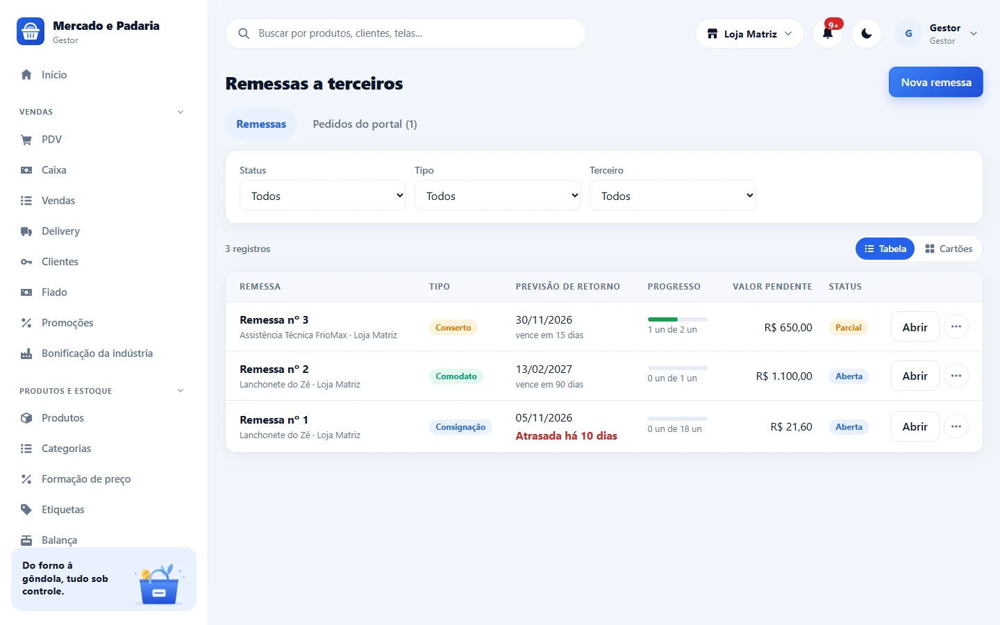

Uma remessa registra a mercadoria enviada a um terceiro. Ao enviar, o saldo sai do estoque próprio.

O que dá para fazer:

- Filtrar por **Status** (Aberta, Parcial, Atrasada, Encerrada ou Cancelada), **Tipo** e **Terceiro**.
- Criar com **Nova remessa**: escolha o **Terceiro** e o **Tipo**, informe o **Nº da nota ou contrato**, a **Previsão de retorno** e as **Observações**, e adicione os produtos com o **Preço de cobrança**.
- Pelo menu da linha, usar **Ver detalhes**, **Registrar retorno**, **Registrar baixa** e **Cancelar remessa**.

Regras: o **retorno** devolve cada item ao estoque próprio da loja. A **baixa** registra o que foi vendido, consumido, perdido ou outro, e não mexe no estoque próprio. Com **Gerar cobrança dos itens baixados** marcado, vira uma receita com vencimento em 7 dias. Essa opção vem marcada em consignação. O **cancelamento** só vale para remessa aberta, sem retorno e sem baixa.

Passo a passo para criar uma remessa:

1. Clique em **Nova remessa**.
2. Escolha o **Terceiro** e o **Tipo**.
3. Busque o produto com **Buscar produto**, clique em **Adicionar** e informe a quantidade e o preço de cobrança.
4. Clique em **Criar remessa**.

## Remessa

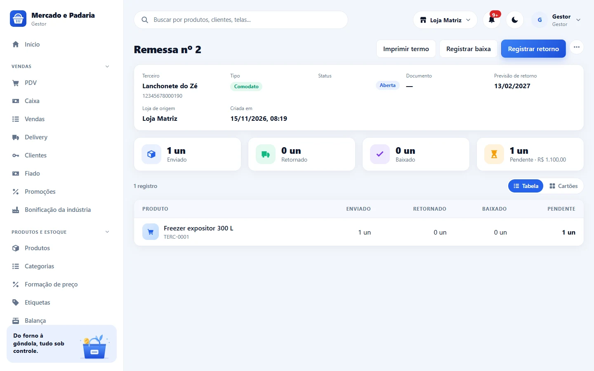

Esta tela mostra uma remessa: terceiro, tipo, status, documento, previsão de retorno, loja de origem e observações. A lista de itens indica cada um como **Enviado**, **Retornado** ou **Baixado**.

O que dá para fazer:

- Imprimir o termo com **Imprimir termo**.
- Registrar o retorno e a baixa com **Registrar retorno** e **Registrar baixa**.
- Cancelar pelo menu **Mais ações da remessa**, se não houver retorno nem baixa.

Passo a passo para registrar um retorno:

1. Abra a remessa e clique em **Registrar retorno**.
2. Informe a quantidade devolvida de cada item.
3. Clique em **Registrar retorno** para salvar.

## Pedidos do portal

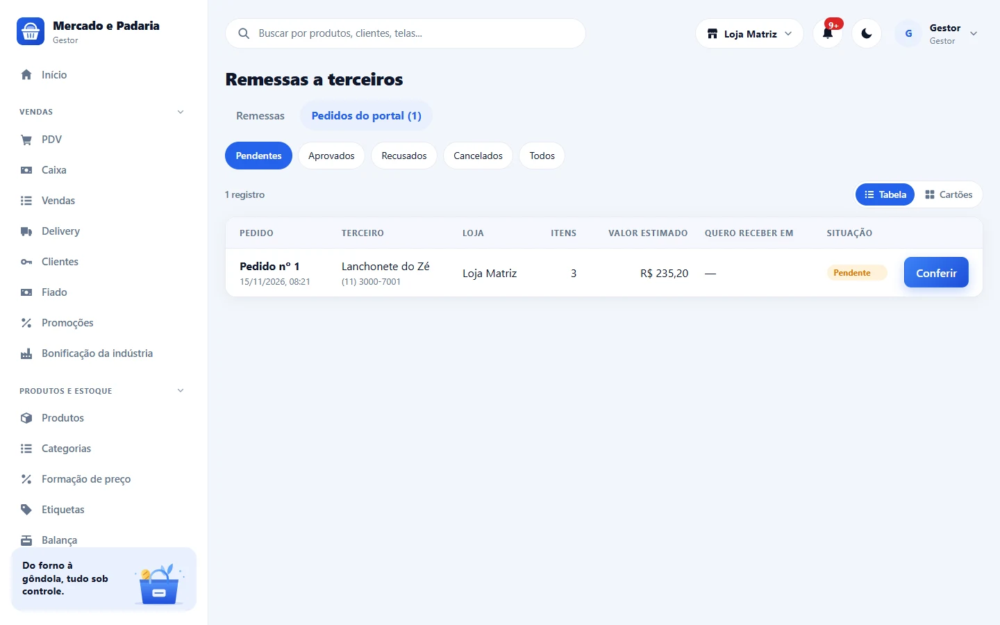

Esta aba traz os pedidos de remessa que o terceiro fez pelo portal. Cada pedido fica **Pendente** até você aprovar ou recusar. As abas são **Pendentes**, **Aprovados**, **Recusados**, **Cancelados** e **Todos**.

O que dá para fazer:

- Conferir um pedido com **Conferir**: loja, tipo, o que o terceiro quer receber e as observações.
- Aprovar com **Aprovar e enviar**. A aprovação cria a remessa e tira o saldo do estoque. Se faltar saldo na loja, o sistema não aprova.
- Recusar com **Recusar**: informe o **Motivo da recusa** e clique em **Confirmar recusa**. Nenhuma remessa é criada.

Passo a passo:

1. Abra a aba **Pedidos do portal**.
2. Clique em **Conferir** no pedido pendente.
3. Ajuste as quantidades e preencha o **Documento (nº da nota ou contrato)** e a **Previsão de retorno**.
4. Clique em **Aprovar e enviar**.

## Dicas

- Mudar preço, ajustar saldo, lançar perda e dar baixa em lote pedem a senha do gestor.
- Antes de importar uma planilha grande, exporte a lista atual e use-a como base.
- Escreva o motivo de cada ajuste com clareza. Ele aparece em **Movimentações**.
- Confira o saldo da loja antes de aprovar um pedido do portal.

[← Voltar ao manual](README.md)
