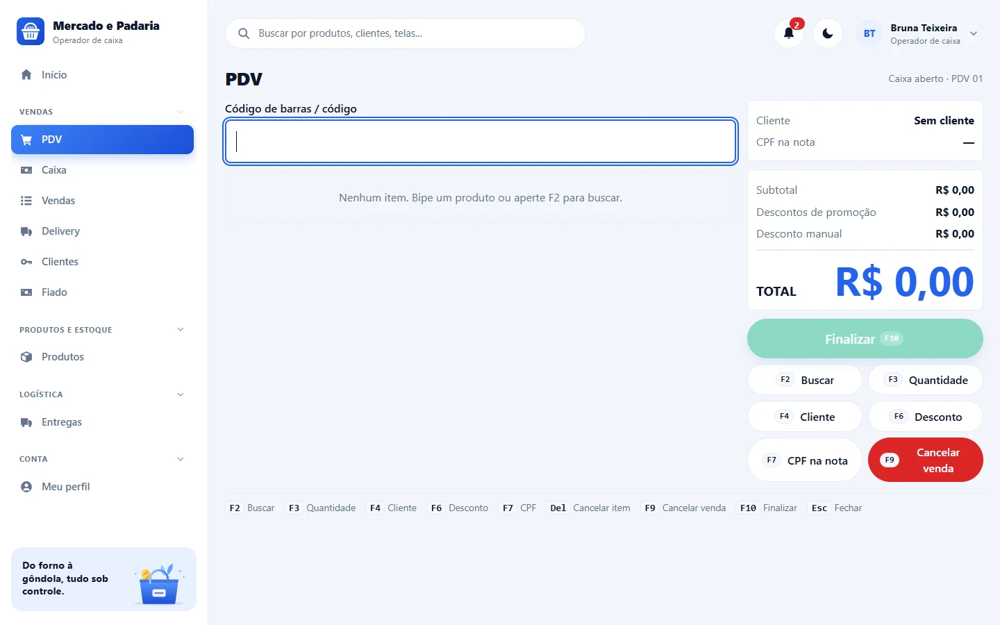
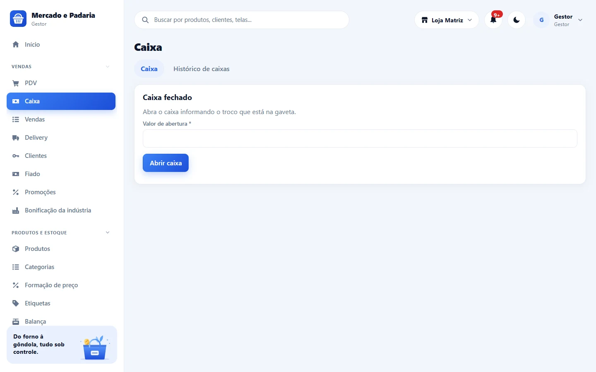
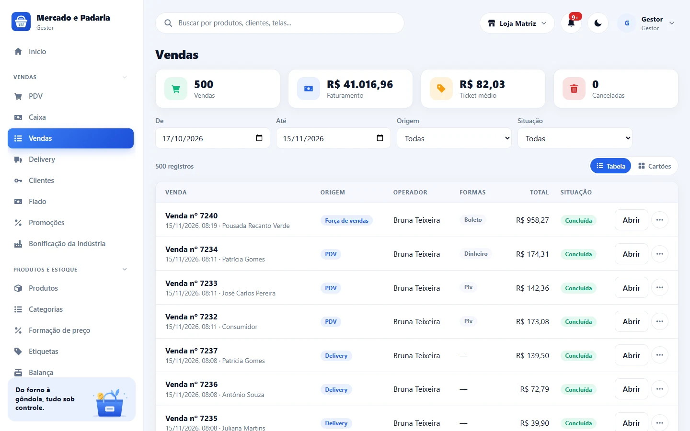
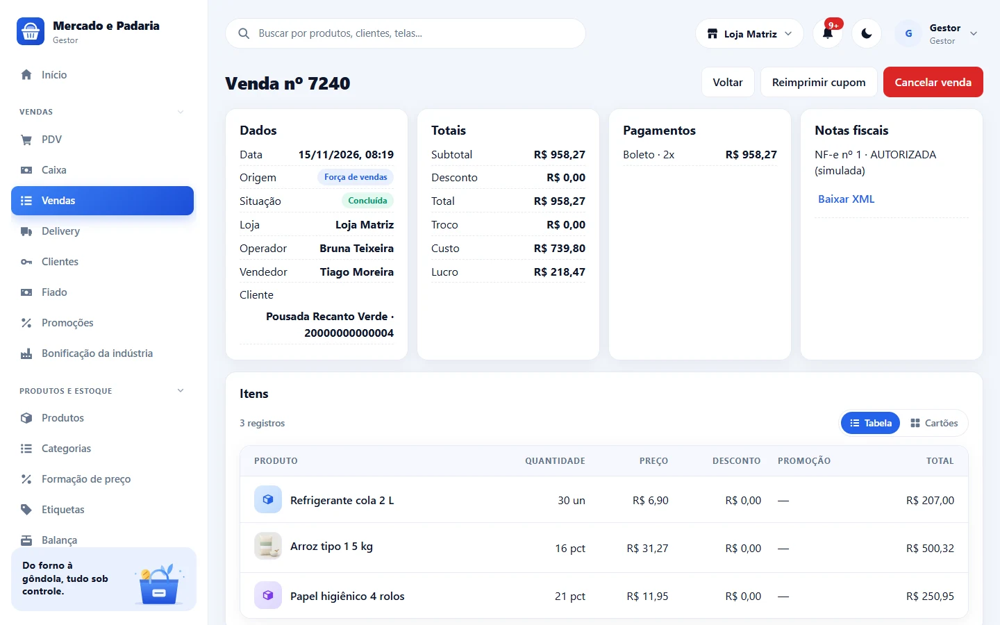
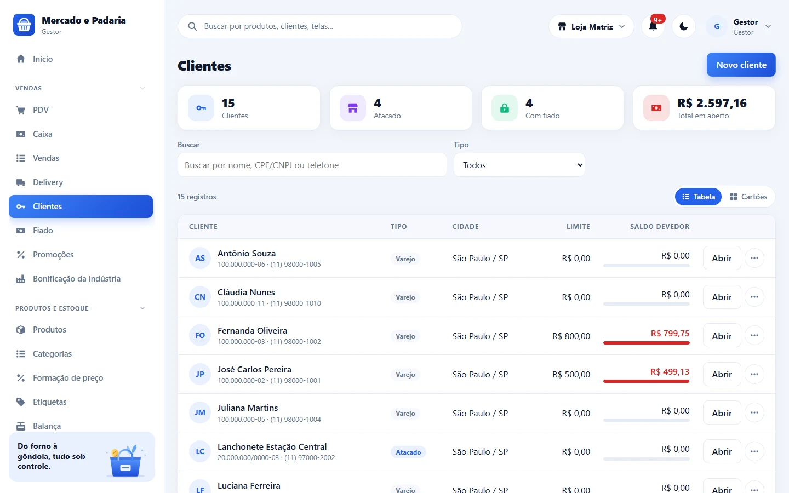
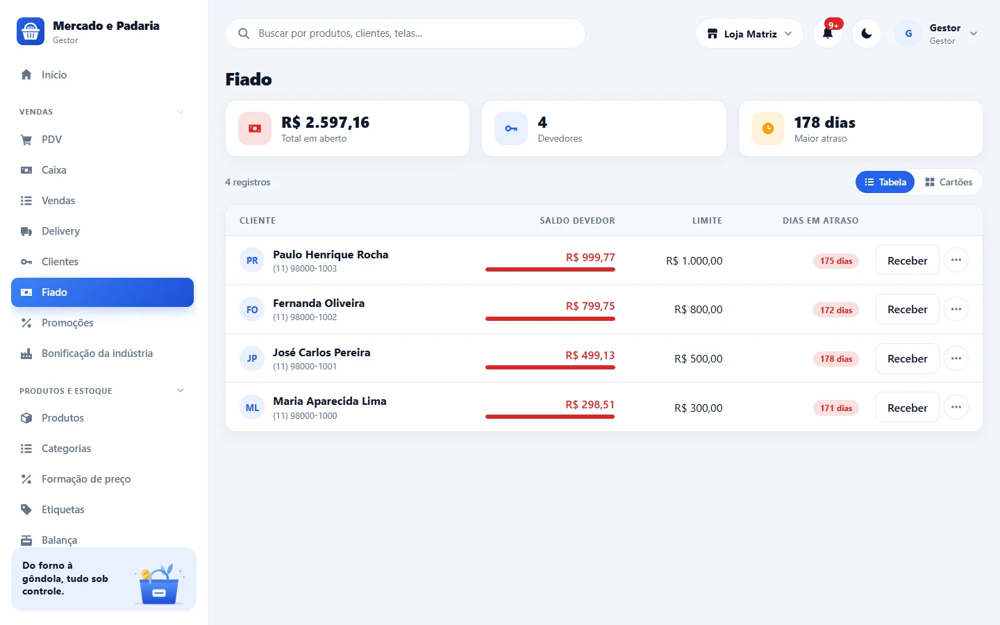
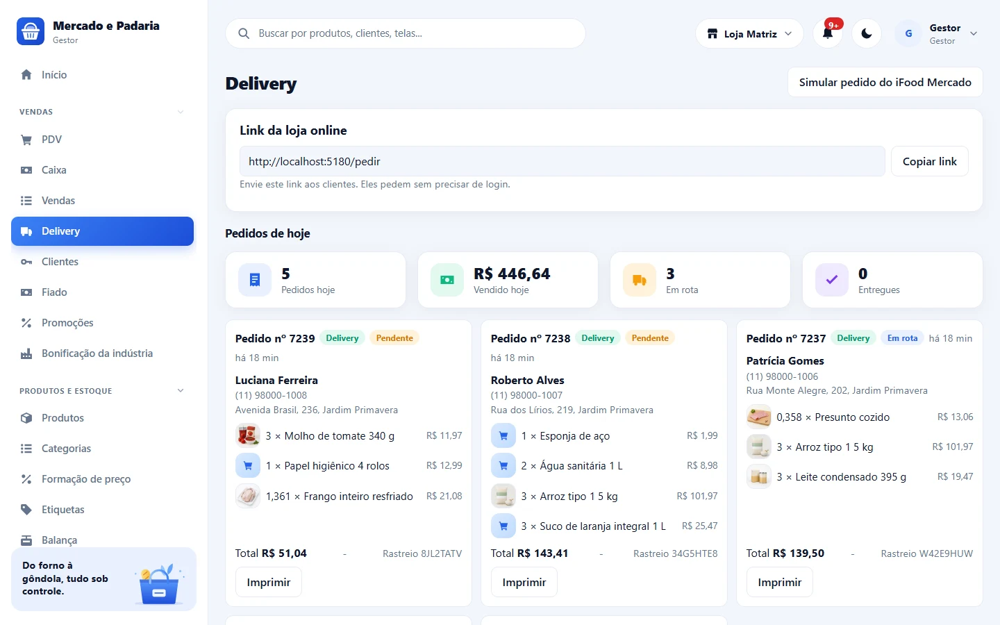
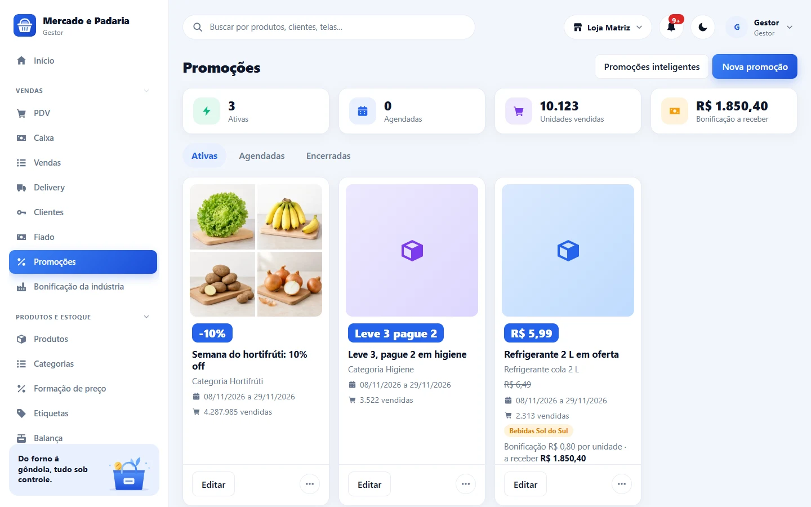
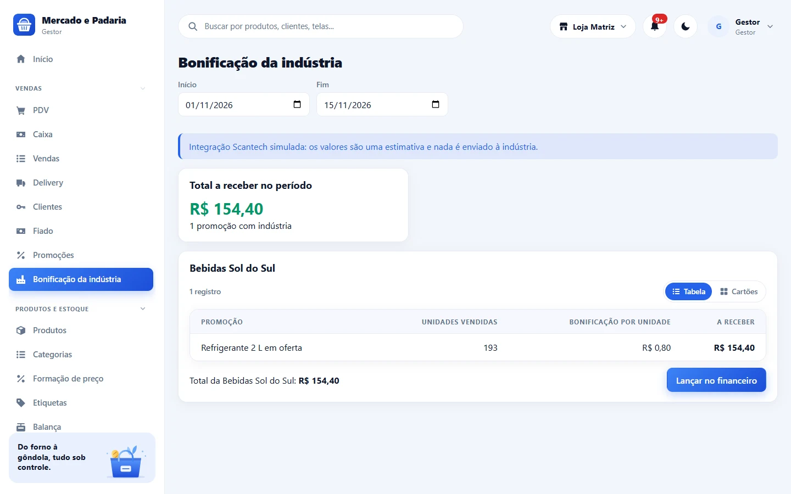
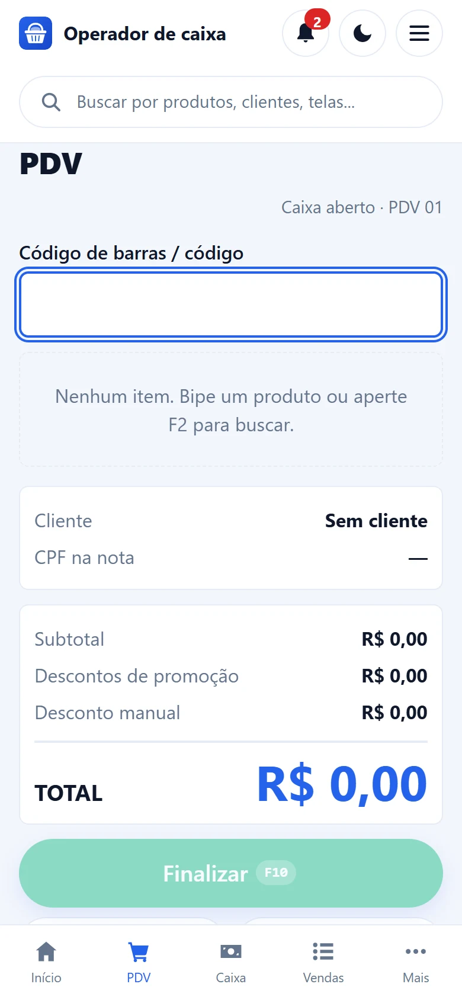

# Vendas

**Para que serve.** Esta área cobre tudo o que acontece no caixa e na venda ao cliente: o PDV (frente de caixa), a abertura e o fechamento do caixa, a lista e o cancelamento de vendas, os clientes e o fiado, os pedidos de delivery, as promoções e a bonificação da indústria. Toda venda é gravada de uma vez, com baixa de estoque e registro de pagamento.

**Quem usa.**

- Gestor: todas as telas desta área.
- Operador de caixa: PDV, Caixa, Vendas (só as próprias vendas), Clientes, Fiado e Delivery.
- Vendedor: clientes da própria carteira.
- Contador: consulta a lista e o detalhe das vendas, sem alterar nada.

## PDV (frente de caixa)

O PDV é a tela de venda. O campo de código fica sempre com o foco: basta bipar o código de barras ou digitar o código interno e apertar Enter. Cada item entra na lista com foto, quantidade, preço e promoção aplicada. O cálculo dos preços é refeito a cada mudança no carrinho. A venda só começa com o caixa aberto. O carrinho fica guardado na aba do navegador, então recarregar a página não perde a venda.

**O que dá para fazer**

- Ler produtos pelo código de barras ou pelo código interno, com o campo de código.
- Lançar várias unidades de um código de uma vez, digitando `5*código` (5 unidades do código seguinte).
- Mudar a quantidade do último item lido (F3).
- Buscar produto por nome, código ou EAN (F2).
- Identificar o cliente (F4) ou seguir sem cliente.
- Dar desconto manual em reais (F6). Por padrão, pede a senha do gestor.
- Informar CPF ou CNPJ na nota (F7).
- Remover o item selecionado (Del). Por padrão, pede a senha do gestor.
- Cancelar a venda inteira (F9). Nada foi gravado até aqui, então a tela só é limpa.
- Finalizar a venda (F10 ou F12) e escolher as formas de pagamento.
- Ver separados os descontos de promoção e o desconto manual, antes do total.

### Atalhos de teclado

| Tecla | Ação |
|---|---|
| Enter | Lê o código digitado no campo |
| F2 | Buscar produto |
| F3 | Quantidade do último item lido |
| F4 | Identificar cliente |
| F6 | Desconto manual (em reais) |
| F7 | CPF ou CNPJ na nota |
| Del | Remover o item selecionado (só com o campo de código vazio) |
| F9 | Cancelar venda |
| F10 ou F12 | Finalizar |
| Esc | Limpar o campo de código; fecha a janela aberta |

### Etiqueta de balança

Os produtos vendidos por peso ou por preço usam uma etiqueta EAN-13 gerada pela balança. Ela tem 13 dígitos, nesta ordem:

1. Prefixo de 1 dígito, configurado em Configurações > Mercado > Balança.
2. PLU de 6 dígitos, que é o campo "PLU da balança" do cadastro do produto.
3. Valor de 5 dígitos.
4. Dígito verificador.

O modo da balança define o que o valor significa. No modo **Preço**, o valor é o total em centavos, e o PDV calcula a quantidade (valor dividido pelo preço do produto). No modo **Peso**, o valor é o peso em gramas. Se nenhum produto tiver aquele PLU, o PDV tenta o código como EAN ou código interno e pode mostrar "Produto não encontrado". Para o cadastro do PLU, veja [Produtos e estoque](produtos-e-estoque.md).

### Formas de pagamento

- **Dinheiro**: informe o valor recebido. Se for maior que o restante, o PDV mostra o troco.
- **Pix**: o PDV gera um código Pix copia e cola com a chave de Configurações > Mercado > Pix. Copie o código para o app do banco e clique em "Pix recebido" quando confirmar o pagamento. A confirmação é feita pelo operador.
- **Débito** e **Crédito**: informe o NSU ou a autorização, se quiser. No crédito, escolha de 1x a 12x.
- **Vale-alimentação**: pagamento com o valor informado.
- **Fiado**: só aparece com o fiado ativo em Configurações > Mercado > Fiado e com um cliente sem bloqueio. Veja a seção Fiado.

Uma venda pode ter mais de uma forma: adicione cada pagamento e o restante vai diminuindo. A venda só é confirmada quando o restante chega a zero.

### Passo a passo: vender com cartão

1. Abra o caixa, informando o valor de abertura (o troco da gaveta), e clique em **Abrir caixa**.
2. Bipe ou digite o código de cada produto e aperte Enter.
3. Se o cliente for identificado, aperte F4, busque o cliente e escolha-o.
4. Confira Subtotal, Descontos de promoção, Desconto manual e TOTAL.
5. Aperte F10 para finalizar.
6. Escolha **Débito** ou **Crédito**, confira o valor e clique em **Adicionar pagamento**.
7. Quando o restante chegar a zero, clique em **Confirmar venda**.
8. Clique em **Imprimir cupom** e depois em **Nova venda**.

## Caixa

O caixa controla o dinheiro da gaveta de cada operador. Cada operador tem um caixa aberto por vez. Ao abrir, informe o valor de abertura. Durante o turno, o caixa registra sangrias (retiradas) e suprimentos (entradas de troco), sempre com um motivo.

O **dinheiro esperado** é a abertura, mais as vendas em dinheiro, mais os suprimentos, menos as sangrias. No fechamento, o operador conta a gaveta e informa o valor. O sistema mostra a diferença entre o contado e o esperado.

**O que dá para fazer**

- Abrir o caixa com o valor de abertura.
- Fazer uma sangria (**Sangria**), com valor e motivo. Por padrão, é livre; a regra pode ser mudada em Configurações > Permissões.
- Fazer um suprimento (**Suprimento**), com valor e motivo.
- Ver os totais do turno: abertura, vendas, dinheiro esperado e número de vendas, além das vendas por forma de pagamento.
- Fechar o caixa (**Fechar caixa**), informando o dinheiro contado.
- Imprimir o resumo do caixa depois do fechamento (**Imprimir resumo** e **Concluir**).
- O gestor vê também a aba **Histórico de caixas**, com abertura, operador, terminal, situação, vendas, valor contado e diferença de cada caixa.

### Passo a passo: fechar o caixa

1. Abra a tela Caixa e clique em **Fechar caixa**.
2. Conte o dinheiro da gaveta.
3. Informe o valor em **Dinheiro contado**. A diferença aparece logo abaixo.
4. Clique em **Fechar caixa**.
5. Clique em **Imprimir resumo** e depois em **Concluir**.

## Vendas

A lista mostra as vendas do período, das mais recentes para as mais antigas. Os indicadores do topo somam as vendas concluídas (quantidade, faturamento e ticket médio) e as canceladas.

**O que dá para fazer**

- Filtrar por período (**De** e **Até**), por **Origem** (PDV, Delivery, Marketplace, Força de vendas ou Loja B2B) e por **Situação** (Concluída ou Cancelada).
- Abrir o detalhe de uma venda pelo botão de abrir da linha.
- Reimprimir o cupom pelo menu **Mais ações da venda**.
- Cancelar uma venda pelo mesmo menu, com um motivo de pelo menos 3 caracteres. Por padrão, o cancelamento pede a senha do gestor.
- O operador vê só as próprias vendas.

Ao cancelar, o estoque volta, o fiado da venda é estornado, os lançamentos em aberto da venda são removidos e as notas e entregas ligadas a ela são canceladas.

### Passo a passo: cancelar uma venda

1. Abra Vendas e filtre o período da venda.
2. Na linha da venda, abra o menu **Mais ações da venda nº ...** e escolha **Cancelar venda**.
3. Escreva o motivo do cancelamento.
4. Clique em **Cancelar venda**. Se a regra pedir, informe a senha do gestor.

## Detalhe da venda

O detalhe mostra tudo o que foi gravado na venda: dados, totais, pagamentos, notas fiscais, entrega e os itens.

**O que dá para fazer**

- Ver os dados da venda: loja, operador, cliente, CPF na nota e origem.
- Ver os totais: subtotal, desconto, acréscimo e total.
- Ver os pagamentos, com forma, valor e parcelas.
- Ver as notas fiscais emitidas. Quando a nota é simulada, o sistema marca "(simulada)".
- Ver a entrega ligada à venda, se houver.
- Ver os itens, com quantidade, preço unitário, desconto, promoção e total.
- Reimprimir o cupom (**Reimprimir cupom**).
- Cancelar a venda (**Cancelar venda**), com motivo, se ela ainda não estiver cancelada.

### Passo a passo: conferir uma venda

1. Abra Vendas e clique na venda.
2. Confira os itens e os pagamentos.
3. Se precisar do papel, clique em **Reimprimir cupom**.
4. Clique em **Voltar** para retornar à lista.

## Clientes

Os clientes são de varejo ou de atacado (B2B). O cadastro guarda o limite de crédito, usado no fiado. O saldo devedor só muda no recebimento de fiado e no registro ou cancelamento de venda.

**O que dá para fazer**

- Buscar por nome, CPF/CNPJ ou telefone, e filtrar por **Tipo** (Varejo ou Atacado).
- Criar um cliente com **Novo cliente**.
- Abrir a ficha do cliente, com as abas **Dados**, **Crédito**, **B2B** e **Compras**.
- Informar o limite de crédito na aba **Crédito**.
- Abrir a conversa no WhatsApp pelo menu de ações, quando o cliente tem telefone com DDD.
- Bloquear ou liberar o fiado do cliente (**Bloquear** ou **Liberar fiado**). Só o gestor pode fazer isso.
- Para cliente de atacado, copiar o link da loja B2B e gerar um novo código de acesso.

Um limite de crédito zero significa que o fiado não tem teto.

### Passo a passo: cadastrar um cliente para o fiado

1. Clique em **Novo cliente**.
2. Preencha o nome e escolha o tipo (**Varejo** ou **Atacado (B2B)**). O CPF ou CNPJ é opcional, mas precisa ter 11 ou 14 dígitos.
3. Clique em **Salvar**.
4. Abra a ficha do cliente, vá na aba **Crédito** e informe o **Limite de crédito (R$)**.
5. Clique em **Salvar**.

## Fiado

O fiado é a venda a prazo para clientes cadastrados. A compra entra no saldo devedor do cliente. Ela é cobrada depois, em um ou mais recebimentos. Para usar, ligue o fiado em Configurações > Mercado > Fiado.

**O que dá para fazer**

- Ver o total em aberto, o número de devedores e o maior atraso do grupo.
- Ver, por cliente, o saldo devedor com uma barra em relação ao limite, o limite e os dias em atraso. A cor do selo muda: verde até 30 dias, amarelo de 31 a 60 dias e vermelho acima de 60.
- Receber o valor total ou parcial com **Receber**, pela forma Dinheiro, Pix, Débito ou Crédito, com uma observação opcional.
- Ver o extrato de compras e pagamentos com **Ver extrato**.
- Cobrar pelo WhatsApp com **Cobrar pelo WhatsApp**, que abre uma mensagem pronta.

O recebimento abate o saldo e quita primeiro as compras mais antigas. Não é possível receber mais do que o saldo devedor.

Vender a prazo acima do limite de crédito pede a senha do gestor, por padrão.

### Passo a passo: receber um fiado

1. Localize o cliente na lista de devedores.
2. Clique em **Receber**.
3. Confira o valor (vem o saldo inteiro) e ajuste se for um pagamento parcial.
4. Escolha a forma de pagamento e, se quiser, escreva uma observação.
5. Clique em **Receber**.

## Delivery

A tela Delivery reúne os pedidos de hoje feitos pela loja online e pelo iFood Mercado. A lista se atualiza sozinha quando chega um pedido. A entrega em si é acompanhada na tela Entregas, da Logística (veja [Logística](logistica.md)).

**O que dá para fazer**

- Copiar o link da loja online (**Copiar link**) e enviá-lo aos clientes. Eles pedem sem login.
- Ver os indicadores do dia: pedidos, valor vendido, pedidos em rota e entregues.
- Ver cada pedido com origem (Delivery ou iFood), itens, total, forma de pagamento e a situação da entrega (Pendente, Separando, Em rota, Entregue, Falhou ou Cancelada).
- Imprimir o pedido (**Imprimir**).
- O gestor pode criar um pedido de teste do iFood Mercado com **Simular pedido do iFood Mercado**. O pedido é simulado, e a ativação do iFood fica em Configurações > Mercado.

### Passo a passo: divulgar a loja online

1. Abra Delivery e clique em **Copiar link**.
2. Envie o link ao cliente pelo WhatsApp ou pelo canal que preferir.
3. Acompanhe os pedidos que chegam na lista de hoje.
4. Clique em **Imprimir** no pedido para levá-lo à separação.

## Promoções

Uma promoção vale para um produto ou para uma categoria, com período de início e fim. O preço de cada item é o menor total entre o preço de tabela, o preço de atacado e as promoções vigentes. Vale nas vendas do PDV, do delivery e da força de vendas, quando o preço não foi negociado no pedido.

**Tipos de promoção**

- **Preço fixo**: o item sai por um preço promocional em reais.
- **Percentual**: desconto em porcentagem sobre o preço de tabela.
- **Leve X pague Y**: por exemplo, leve 3 e pague 2.
- **Atacado**: preço por unidade a partir de uma quantidade mínima.

**O que dá para fazer**

- Ver as promoções em três abas: **Ativas**, **Agendadas** e **Encerradas**.
- Ver os indicadores: ativas, agendadas, unidades vendidas e bonificação a receber.
- Criar uma promoção com **Nova promoção** e editar com **Editar**.
- Pedir sugestões com **Promoções inteligentes**. As sugestões se baseiam na validade e nas vendas. Nada é criado até clicar em **Criar**.
- Encerrar uma promoção ativa pelo menu de ações (**Encerrar**). A data de fim passa a ser o momento atual.
- Excluir uma promoção (**Excluir**), só se ela ainda não tiver vendas. Se já vendeu, é preciso encerrá-la.
- Informar a indústria e a bonificação por unidade, para a bonificação da indústria (veja a seção seguinte).

### Passo a passo: criar uma promoção Leve 3 pague 2

1. Clique em **Nova promoção**.
2. Em **Tipo**, escolha **Leve X pague Y**.
3. Digite o **Nome** da promoção e, em **Vale para**, escolha **Um produto** ou **Uma categoria**. Depois, escolha o produto ou a categoria.
4. Preencha **Leve (quantidade)** com 3 e **Pague (quantidade)** com 2.
5. Informe **Início** e **Fim** e clique em **Salvar**.

## Bonificação da indústria

Algumas indústrias pagam uma bonificação por unidade vendida das promoções delas. A tela soma, por indústria, o valor a receber no período escolhido. Só o gestor vê esta tela.

A integração com a indústria é **simulada** (Scantech simulado): os valores são uma estimativa e nada é enviado à indústria.

**O que dá para fazer**

- Escolher o período com **Início** e **Fim**.
- Ver o total a receber no período e, para cada indústria, as promoções, as unidades vendidas, a bonificação por unidade e o valor a receber.
- Lançar o total de uma indústria no financeiro com **Lançar no financeiro**. O sistema pede confirmação e informa que o valor vence em 30 dias.

A indústria e a bonificação por unidade são definidas na promoção (veja Promoções).

### Passo a passo: lançar a bonificação de uma indústria

1. Escolha o **Início** e o **Fim** do período.
2. Confira o total da indústria no cartão correspondente.
3. Clique em **Lançar no financeiro** e confirme.
4. Confira o lançamento na área Financeiro (veja [Financeiro](financeiro.md)).

## PDV no celular

O PDV também funciona no celular, com a mesma tela e as mesmas regras do computador. Os botões da tela substituem as teclas de atalho.

### Passo a passo: vender pelo celular

1. Abra o PDV e confirme que o caixa está aberto. Se não estiver, informe o valor de abertura e toque em **Abrir caixa**.
2. Digite o código ou o EAN no campo e confirme com Enter.
3. Repita para cada produto. Para remover um item, selecione-o e use **Remover item selecionado**.
4. Toque em **Finalizar**.
5. Escolha a forma de pagamento, informe o valor e toque em **Adicionar pagamento**. Quando o restante chegar a zero, toque em **Confirmar venda**.

## Dicas

- Confira o caixa antes de fechar. A diferença fica registrada no histórico de caixas, e o gestor vê cada uma delas.
- Desconto e cancelamento pedem a senha do gestor por padrão. Ajuste as regras em Configurações > Permissões, se o seu mercado precisar de outra regra.
- Antes de vender a prazo, confira o limite de crédito do cliente na ficha dele.
- Promoção que já teve vendas não pode ser excluída. Encerre-a e crie uma nova, se precisar.
- Confira o PLU de cada produto pesável no cadastro. Sem o PLU, a etiqueta da balança não encontra o produto.

[← Voltar ao manual](README.md)
